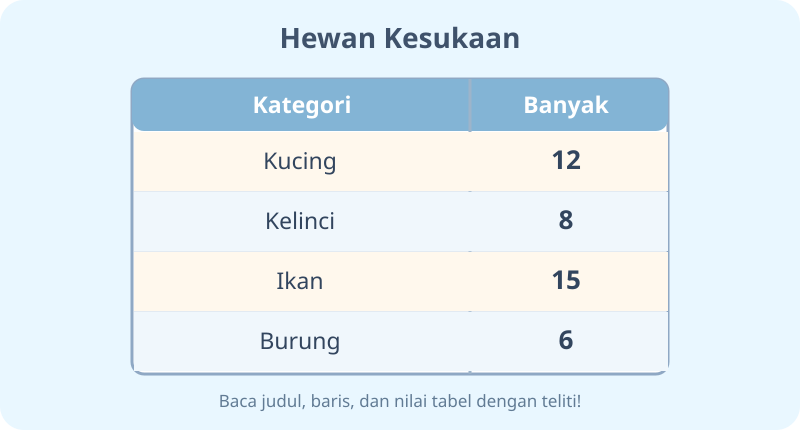
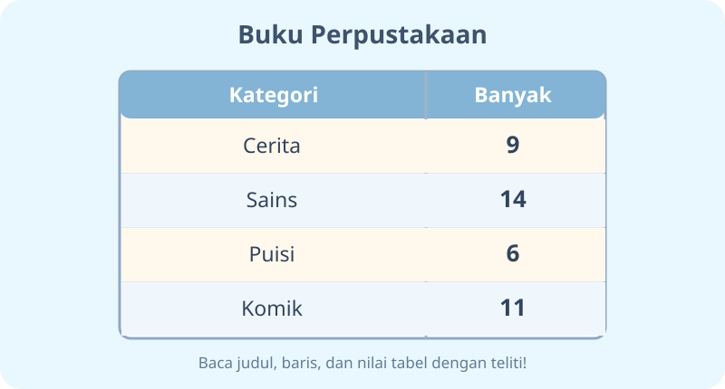

# Penyajian Data dalam Tabel — Dua Modul

**Kelas:** 3 SD | **ID Bab:** K03-MTK-B05

**Acuan:** Matematika untuk SD/MI Kelas III, Susanto dkk., 2022, Bab 5 (mengurutkan dan membandingkan data serta menyajikan data dalam tabel).

**Standar matematika:** MathJax `$...$`, `$$...$$`; data tabel tetap teks, angka dan operasi dalam uraian menggunakan notasi matematika. Simpan Markdown asli, konversi ke JSON hanya oleh Codex.

---

## K03-MTK-B05-MOD-01

# Detektif Tabel: Membaca Cerita Angka

Hai, Penyelidik Data! Pernah menghitung teman yang suka buah tertentu? Setelah dihitung, hasilnya bisa kita susun menjadi **data**. Tabel membantu kita membaca data dengan cepat dan rapi.

## Cara membaca tabel

Perhatikan tabel hewan kesukaan. Bacalah **judul**, lalu **nama kategori pada baris**, dan **banyaknya** pada kolom. Misalnya, kucing disukai $12$ anak, kelinci $8$, ikan $15$, dan burung $6$.

**Tebakan:** Mana yang paling banyak? Ikan, karena $15$ lebih besar dari $12$, $8$, dan $6$. Mana paling sedikit? Burung, yaitu $6$.

## Bandingkan dan urutkan

Urutkan data dari yang paling sedikit: burung $6$, kelinci $8$, kucing $12$, ikan $15$. Selisih paling banyak dengan paling sedikit adalah $15-6=9$. Jumlah seluruh pilihan adalah $12+8+15+6=41$.

## Ayo membuat tabel

Tanyakan kepada beberapa anggota keluarga tentang buah kesukaan mereka. Catat satu pilihan dari setiap orang, lalu hitung banyaknya untuk setiap buah. Tulis dua kolom: **nama buah** dan **banyak orang**. Ingat, isi tabel harus sesuai jawaban sebenarnya, bukan dikarang.

**Tantangan penutup:** Baca tabel buku pada gambar. Temukan kategori tertinggi, kategori terendah, dan jelaskan bagaimana kamu menemukannya.

---

## K03-MTK-B05-MOD-02

# Penjaga Perpustakaan dan Tabel Rahasia

Selamat datang di perpustakaan mini! Penjaganya ingin tahu jenis buku apa yang paling diminati. Ia tidak bisa hanya menebak. Ia perlu **mengumpulkan data, mengelompokkan, lalu membuat tabel**.

## Rak satu: kumpulkan data

Misalnya, hasil pengamatan menunjukkan buku cerita $9$, sains $14$, puisi $6$, dan komik $11$. Tulis setiap nama pada satu baris tabel dan masukkan angka yang benar di sampingnya.

**Bisa kamu jawab?** Buku paling banyak adalah buku sains, $14$. Paling sedikit puisi, $6$. Perbedaan jumlahnya $14-6=8$.

## Rak dua: tabel bercerita

Tabel yang baik punya **judul** dan kolom yang jelas. Jangan menambahkan angka yang tidak dikumpulkan. Dari tabel kita dapat melihat mana terbesar, mana terkecil, jumlah seluruh data, dan perbandingan dua kategori.

Pada tabel hewan, total semua pilihan $12+8+15+6=41$. Urutan dari kecil ke besar $6<8<12<15$. Kamu tidak perlu menebak; cukup baca baris lalu hitung!

## Misi penjaga tabel

Ambil empat jenis benda yang aman di rumah, misalnya pensil, penghapus, buku, dan penggaris. Hitung masing-masing, buat tabel dua kolom, lalu ajukan dua pertanyaan kepada teman: *“Yang paling banyak apa?”* dan *“Berapa selisih dua jenis benda?”*

**Pesan penting:** Data adalah hasil pengamatan atau pencatatan; tabel membantu orang lain memahami hasilnya.
