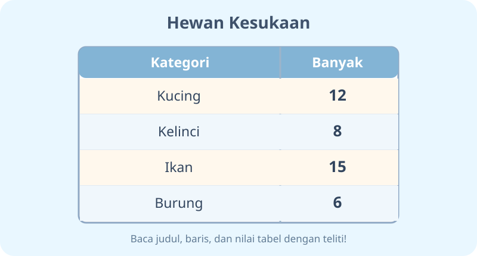
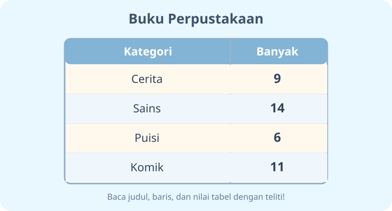
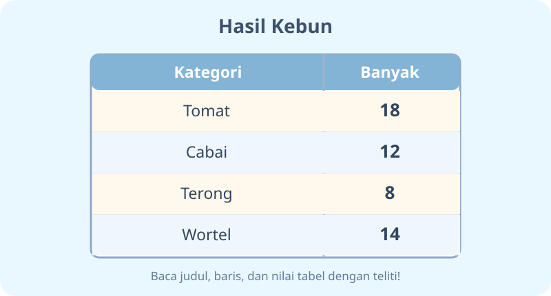
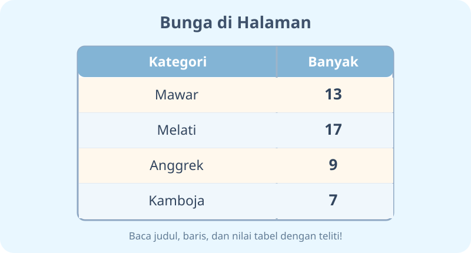
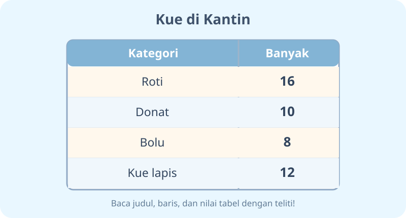
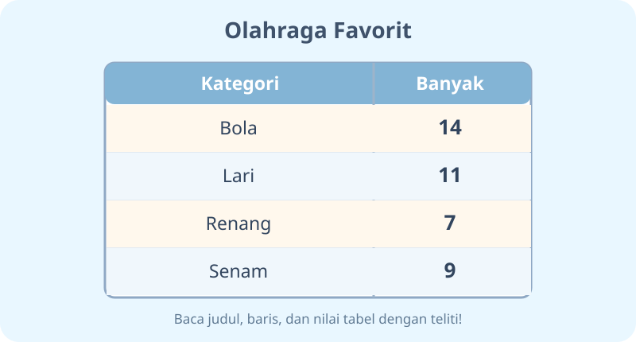
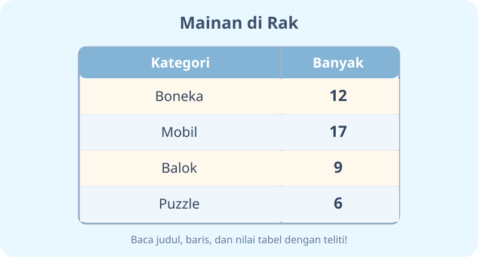
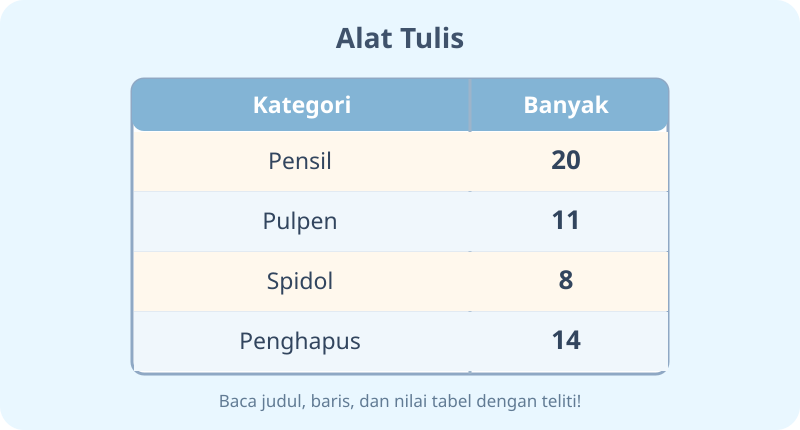
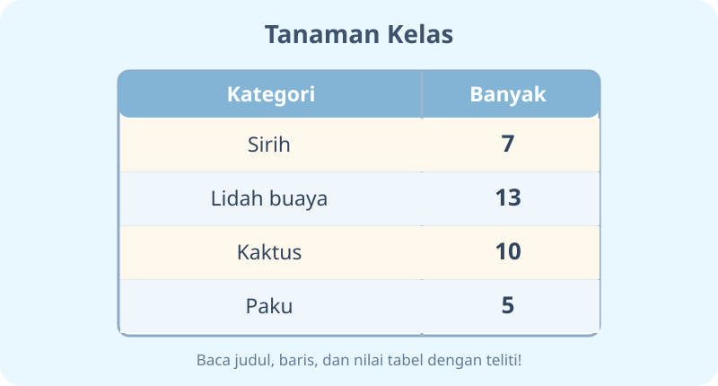
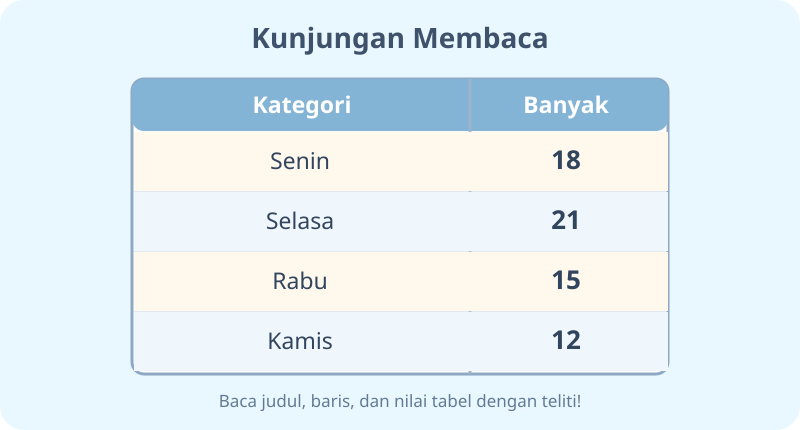

# Penyajian Data dalam Tabel — 20 Soal Bergambar

Kelas 3 SD · ID: K03-MTK-B05 · MathJax · Soal tabel visual

## Soal 51 — K03-MTK-B05-M01-051

**Pertanyaan:** Menurut tabel pada gambar, kategori terbanyak adalah ...

**Pilihan jawaban:**
- Ikan
- Kucing
- Kelinci
- Burung

**Kunci Jawaban:** Ikan

**Pembahasan:** Ikan memiliki $15$, jumlah paling tinggi.

---

## Soal 52 — K03-MTK-B05-M01-052

**Pertanyaan:** Menurut tabel pada gambar, berapa selisih kategori Ikan dan Burung?

**Pilihan jawaban:**
- $11$
- $9$
- $10$
- $8$

**Kunci Jawaban:** $9$

**Pembahasan:** Kurangkan nilai terbesar dan terkecil: $15-6=9$.

---

## Soal 53 — K03-MTK-B05-M01-053

**Pertanyaan:** Menurut tabel pada gambar, kategori terbanyak adalah ...

**Pilihan jawaban:**
- Puisi
- Komik
- Sains
- Cerita

**Kunci Jawaban:** Sains

**Pembahasan:** Sains memiliki $14$, jumlah paling tinggi.

---

## Soal 54 — K03-MTK-B05-M01-054

**Pertanyaan:** Menurut tabel pada gambar, berapa selisih kategori Sains dan Puisi?

**Pilihan jawaban:**
- $9$
- $7$
- $10$
- $8$

**Kunci Jawaban:** $8$

**Pembahasan:** Kurangkan nilai terbesar dan terkecil: $14-6=8$.

---

## Soal 55 — K03-MTK-B05-M01-055

**Pertanyaan:** Menurut tabel pada gambar, kategori terbanyak adalah ...

**Pilihan jawaban:**
- Cabai
- Terong
- Wortel
- Tomat

**Kunci Jawaban:** Tomat

**Pembahasan:** Tomat memiliki $18$, jumlah paling tinggi.

---

## Soal 56 — K03-MTK-B05-M01-056

**Pertanyaan:** Menurut tabel pada gambar, berapa selisih kategori Tomat dan Terong?

**Pilihan jawaban:**
- $10$
- $11$
- $9$
- $12$

**Kunci Jawaban:** $10$

**Pembahasan:** Kurangkan nilai terbesar dan terkecil: $18-8=10$.

---

## Soal 57 — K03-MTK-B05-M01-057

**Pertanyaan:** Menurut tabel pada gambar, kategori terbanyak adalah ...

**Pilihan jawaban:**
- Kamboja
- Melati
- Mawar
- Anggrek

**Kunci Jawaban:** Melati

**Pembahasan:** Melati memiliki $17$, jumlah paling tinggi.

---

## Soal 58 — K03-MTK-B05-M01-058

**Pertanyaan:** Menurut tabel pada gambar, berapa selisih kategori Melati dan Kamboja?

**Pilihan jawaban:**
- $9$
- $12$
- $10$
- $11$

**Kunci Jawaban:** $10$

**Pembahasan:** Kurangkan nilai terbesar dan terkecil: $17-7=10$.

---

## Soal 59 — K03-MTK-B05-M01-059

**Pertanyaan:** Menurut tabel pada gambar, kategori terbanyak adalah ...

**Pilihan jawaban:**
- Bolu
- Kue lapis
- Roti
- Donat

**Kunci Jawaban:** Roti

**Pembahasan:** Roti memiliki $16$, jumlah paling tinggi.

---

## Soal 60 — K03-MTK-B05-M01-060

**Pertanyaan:** Menurut tabel pada gambar, berapa selisih kategori Roti dan Bolu?

**Pilihan jawaban:**
- $9$
- $7$
- $10$
- $8$

**Kunci Jawaban:** $8$

**Pembahasan:** Kurangkan nilai terbesar dan terkecil: $16-8=8$.

---

## Soal 61 — K03-MTK-B05-M01-061

**Pertanyaan:** Menurut tabel pada gambar, kategori terbanyak adalah ...

**Pilihan jawaban:**
- Bola
- Lari
- Renang
- Senam

**Kunci Jawaban:** Bola

**Pembahasan:** Bola memiliki $14$, jumlah paling tinggi.

---

## Soal 62 — K03-MTK-B05-M01-062

**Pertanyaan:** Menurut tabel pada gambar, berapa selisih kategori Bola dan Renang?

**Pilihan jawaban:**
- $9$
- $7$
- $8$
- $6$

**Kunci Jawaban:** $7$

**Pembahasan:** Kurangkan nilai terbesar dan terkecil: $14-7=7$.

---

## Soal 63 — K03-MTK-B05-M01-063

**Pertanyaan:** Menurut tabel pada gambar, kategori terbanyak adalah ...

**Pilihan jawaban:**
- Puzzle
- Mobil
- Boneka
- Balok

**Kunci Jawaban:** Mobil

**Pembahasan:** Mobil memiliki $17$, jumlah paling tinggi.

---

## Soal 64 — K03-MTK-B05-M01-064

**Pertanyaan:** Menurut tabel pada gambar, berapa selisih kategori Mobil dan Puzzle?

**Pilihan jawaban:**
- $10$
- $13$
- $11$
- $12$

**Kunci Jawaban:** $11$

**Pembahasan:** Kurangkan nilai terbesar dan terkecil: $17-6=11$.

---

## Soal 65 — K03-MTK-B05-M01-065

**Pertanyaan:** Menurut tabel pada gambar, kategori terbanyak adalah ...

**Pilihan jawaban:**
- Pulpen
- Spidol
- Penghapus
- Pensil

**Kunci Jawaban:** Pensil

**Pembahasan:** Pensil memiliki $20$, jumlah paling tinggi.

---

## Soal 66 — K03-MTK-B05-M01-066

**Pertanyaan:** Menurut tabel pada gambar, berapa selisih kategori Pensil dan Spidol?

**Pilihan jawaban:**
- $12$
- $13$
- $11$
- $14$

**Kunci Jawaban:** $12$

**Pembahasan:** Kurangkan nilai terbesar dan terkecil: $20-8=12$.

---

## Soal 67 — K03-MTK-B05-M01-067

**Pertanyaan:** Menurut tabel pada gambar, kategori terbanyak adalah ...

**Pilihan jawaban:**
- Lidah buaya
- Sirih
- Kaktus
- Paku

**Kunci Jawaban:** Lidah buaya

**Pembahasan:** Lidah buaya memiliki $13$, jumlah paling tinggi.

---

## Soal 68 — K03-MTK-B05-M01-068

**Pertanyaan:** Menurut tabel pada gambar, berapa selisih kategori Lidah buaya dan Paku?

**Pilihan jawaban:**
- $10$
- $8$
- $9$
- $7$

**Kunci Jawaban:** $8$

**Pembahasan:** Kurangkan nilai terbesar dan terkecil: $13-5=8$.

---

## Soal 69 — K03-MTK-B05-M01-069

**Pertanyaan:** Menurut tabel pada gambar, kategori terbanyak adalah ...

**Pilihan jawaban:**
- Rabu
- Kamis
- Selasa
- Senin

**Kunci Jawaban:** Selasa

**Pembahasan:** Selasa memiliki $21$, jumlah paling tinggi.

---

## Soal 70 — K03-MTK-B05-M01-070

**Pertanyaan:** Menurut tabel pada gambar, berapa selisih kategori Selasa dan Kamis?

**Pilihan jawaban:**
- $10$
- $8$
- $11$
- $9$

**Kunci Jawaban:** $9$

**Pembahasan:** Kurangkan nilai terbesar dan terkecil: $21-12=9$.
