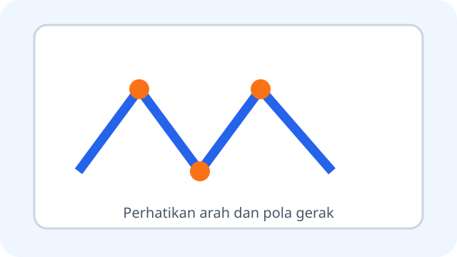
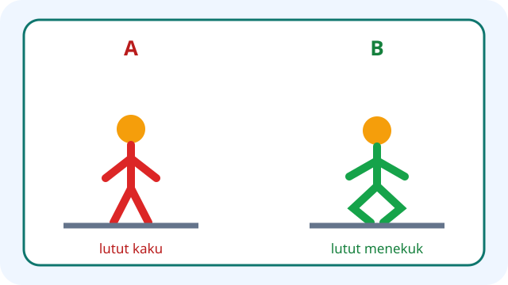

# PJOK Kelas 3 — Unit 1: Aktivitas Pola Gerak Dasar Lokomotor

## MOD-01 — K03-PJK-B01-MOD-01

### Mengenal dan mempraktikkan gerak lokomotor

Gerak **lokomotor** membuat tubuh berpindah dari satu tempat ke tempat lain. Pada Unit 1, latihan utama meliputi variasi **berjalan, berlari, melompat, dan meloncat**.

- **Berjalan:** kaki melangkah bergantian; selalu ada kaki yang menyentuh tanah.
- **Berlari:** langkah lebih cepat dan ada saat singkat kedua kaki tidak menyentuh tanah.
- **Melompat:** tolakan menggunakan satu kaki.
- **Meloncat:** tolakan menggunakan dua kaki.

Gerak dapat divariasikan ke depan, ke samping, ke belakang, mengitari lingkaran, atau mengikuti jalur zig-zag. Saat arah berubah, kurangi kecepatan bila perlu agar tubuh tetap terkendali. Ayunan lengan membantu keseimbangan, tetapi tidak boleh mengenai teman.

**Sebelum latihan:**

1. Pastikan tubuh sehat dan siap. Sampaikan kepada guru bila sedang sakit atau cedera.
2. Periksa lapangan: tidak licin, tidak ada benda tajam, tas, atau rintangan tak terencana.
3. Gunakan pakaian dan alas kaki yang sesuai.
4. Ikuti pemanasan yang dipimpin guru.
5. Jaga jarak dan tunggu giliran.

Latihan bukan perlombaan untuk memaksa semua siswa menjadi tercepat. Setiap siswa bergerak sesuai kemampuan, saling membantu, dan mengikuti instruksi guru.

---

## MOD-02 — K03-PJK-B01-MOD-02

### Berlatih melalui lintasan aman

Latihan dapat dibuat menjadi empat pos sederhana di bawah pengawasan guru:

1. **Pos berjalan:** maju mengikuti garis, lalu langkah menyamping. Untuk berjalan mundur, periksa ruang di belakang dan gunakan langkah pendek.
2. **Pos berlari:** berlari lurus lalu zig-zag di antara penanda lunak. Ubah arah dengan terkendali dan jangan memotong jalur teman.
3. **Pos melompat:** tolak dengan satu kaki untuk melewati garis rendah, lalu mendarat seimbang.
4. **Pos meloncat:** tolak dengan dua kaki dari tempat yang datar, lalu mendarat dengan lutut sedikit menekuk.

Rintangan harus rendah, stabil, dan sesuai kemampuan. Jangan memakai benda tajam, kursi keras yang mudah jatuh, atau permukaan basah. Tinggi dan jarak latihan boleh diperkecil. Siswa yang belum siap dapat berjalan mengikuti pola atau berlatih tanpa rintangan.

**Saat berlatih:**

- Lihat arah gerak dan ruang pendaratan.
- Jaga jarak, antre, dan mulai setelah jalur kosong.
- Berhenti jika merasa nyeri, sangat lelah, pusing, atau tidak enak badan; segera beri tahu guru.
- Minum saat waktu istirahat dan lakukan pendinginan setelah latihan.

**Refleksi:** Gerak mana yang sudah dapat kamu kendalikan? Bagian mana yang masih memerlukan bantuan guru? Menilai diri dengan jujur membantu latihan berikutnya menjadi aman dan sesuai kebutuhan.
