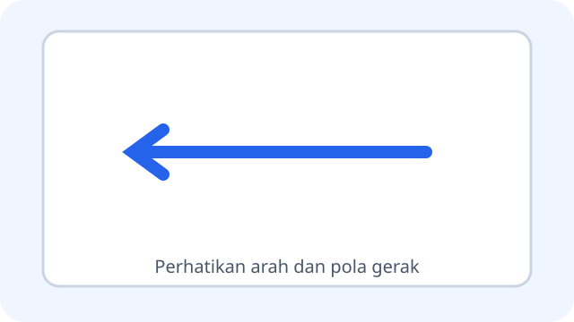
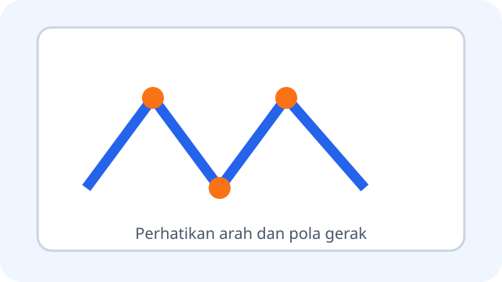
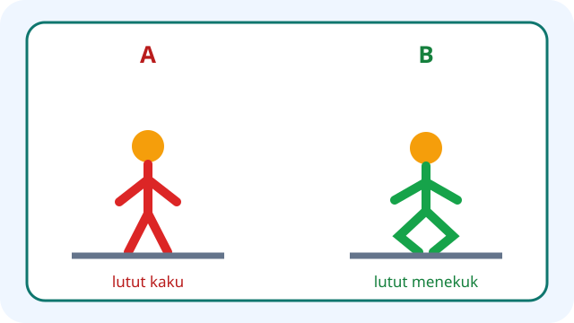
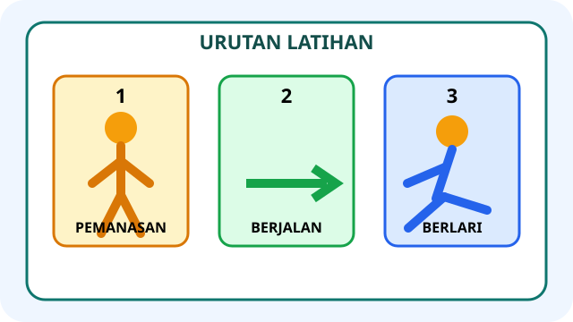
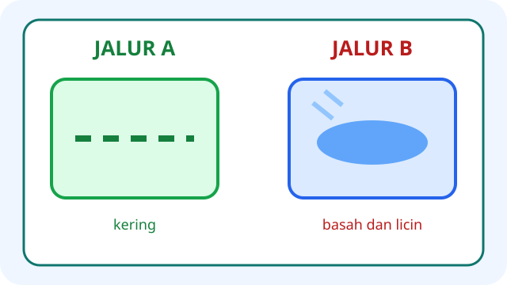
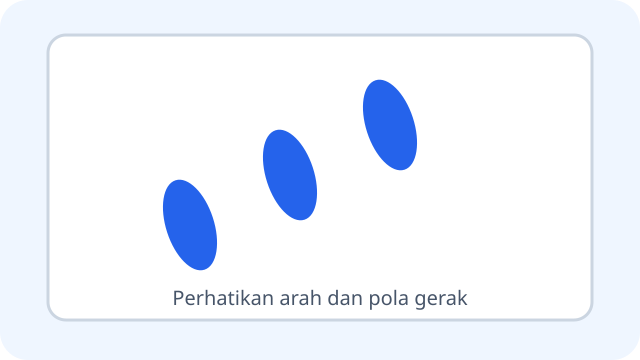
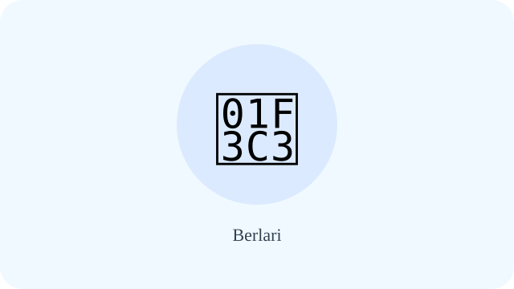
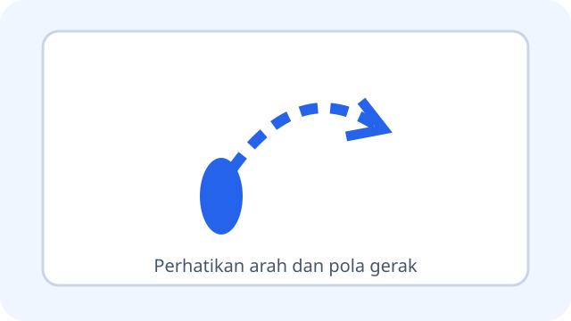
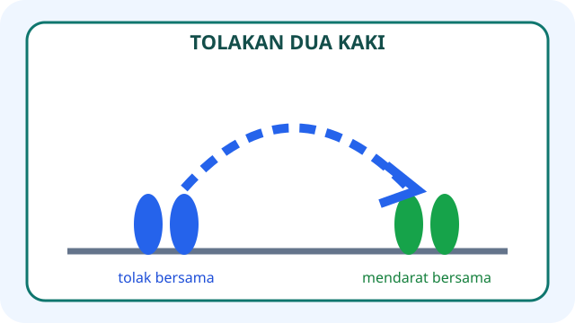
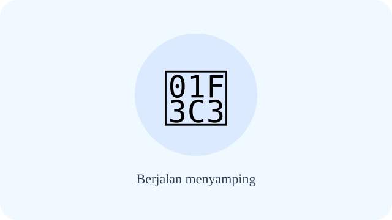

# Unit 1 — Aktivitas Pola Gerak Dasar Lokomotor

10 soal bergambar. Stimulus menunjukkan jalur, urutan, posisi tubuh, dan kondisi lapangan yang harus dibaca untuk menjawab.

## Soal 36 — K03-PJK-B01-M01-036

**Pertanyaan:** Gambar menunjukkan sebuah kerucut tepat di belakang siswa yang akan berjalan mundur. Apa tindakan pertama yang aman?

**Pilihan jawaban:**
- langsung mundur dengan cepat
- berhenti, memeriksa jalur, lalu meminta kerucut dipindahkan
- menutup mata agar tidak takut
- mendorong teman ke belakang

**Kunci Jawaban:** berhenti, memeriksa jalur, lalu meminta kerucut dipindahkan

**Pembahasan:** Kerucut menghalangi jalur belakang. Rintangan perlu diketahui dan dipindahkan sebelum latihan dilanjutkan.

---

## Soal 37 — K03-PJK-B01-M01-037

**Pertanyaan:** Perhatikan jalur yang melewati sisi bergantian dari empat kerucut. Pola gerak apakah yang sesuai?

**Pilihan jawaban:**
- lari lurus melewati semua kerucut
- lari zig-zag dengan perubahan arah terkontrol
- meloncat di tempat tanpa berpindah
- berjalan mundur menjauhi lintasan

**Kunci Jawaban:** lari zig-zag dengan perubahan arah terkontrol

**Pembahasan:** Jalur berbelok ke kiri dan kanan di antara kerucut menunjukkan pola zig-zag.

---

## Soal 38 — K03-PJK-B01-M01-038

**Pertanyaan:** Gambar A menunjukkan lutut kaku saat mendarat. Gambar B menunjukkan lutut sedikit menekuk. Posisi mana yang lebih aman?

**Pilihan jawaban:**
- A, karena lutut harus dikunci
- B, karena tekukan lutut membantu meredam pendaratan
- A dan B sama karena posisi lutut tidak penting
- tidak keduanya; siswa harus mendarat sambil duduk

**Kunci Jawaban:** B, karena tekukan lutut membantu meredam pendaratan

**Pembahasan:** Pendaratan terkontrol dilakukan dengan lutut sedikit menekuk, bukan terkunci kaku.

---

## Soal 39 — K03-PJK-B01-M01-039

**Pertanyaan:** Urutan gambar menunjukkan pemanasan, berjalan, lalu berlari. Mengapa pemanasan ditempatkan pertama?

**Pilihan jawaban:**
- agar tubuh bersiap bergerak secara bertahap
- agar siswa langsung kelelahan
- agar tidak perlu memperhatikan kondisi tubuh
- agar latihan dapat dilakukan di lantai licin

**Kunci Jawaban:** agar tubuh bersiap bergerak secara bertahap

**Pembahasan:** Pemanasan dilakukan sebelum aktivitas utama untuk menyiapkan tubuh sesuai arahan guru.

---

## Soal 40 — K03-PJK-B01-M01-040

**Pertanyaan:** Gambar membandingkan Jalur A yang kering dengan Jalur B yang basah dan licin. Jalur mana yang dipilih untuk latihan?

**Pilihan jawaban:**
- Jalur A yang kering
- Jalur B yang basah
- keduanya dipakai sambil berlari secepat mungkin
- jalur mana saja tanpa diperiksa

**Kunci Jawaban:** Jalur A yang kering

**Pembahasan:** Permukaan kering dan bebas hambatan lebih aman daripada jalur basah dan licin.

---

## Soal 41 — K03-PJK-B01-M01-041

**Pertanyaan:** Jejak kaki pada gambar tersusun bergantian tanpa fase kedua kaki melayang. Gerak apakah yang ditunjukkan?

**Pilihan jawaban:**
- berjalan
- berlari
- meloncat dua kaki
- memutar badan di tempat

**Kunci Jawaban:** berjalan

**Pembahasan:** Langkah bergantian dengan salah satu kaki tetap menyentuh tanah merupakan ciri berjalan.

---

## Soal 42 — K03-PJK-B01-M01-042

**Pertanyaan:** Pada gambar tengah, kedua kaki pelari sesaat tidak menyentuh tanah. Ciri tersebut menunjukkan gerak ....

**Pilihan jawaban:**
- berjalan santai
- berlari
- berdiri seimbang
- mengayun lengan di tempat

**Kunci Jawaban:** berlari

**Pembahasan:** Fase kedua kaki melayang sesaat membedakan lari dari berjalan.

---

## Soal 43 — K03-PJK-B01-M01-043

**Pertanyaan:** Gambar menunjukkan tolakan dari satu kaki untuk melewati garis, lalu mendarat terkendali. Gerak ini disebut ....

**Pilihan jawaban:**
- melompat
- meloncat
- berjalan menyamping
- memutar lengan

**Kunci Jawaban:** melompat

**Pembahasan:** Dalam materi Unit 1, melompat menggunakan tolakan satu kaki.

---

## Soal 44 — K03-PJK-B01-M01-044

**Pertanyaan:** Gambar menunjukkan kedua kaki menolak bersama dan mendarat bersama. Gerak ini disebut ....

**Pilihan jawaban:**
- berlari
- melompat satu kaki
- meloncat
- berjalan mundur

**Kunci Jawaban:** meloncat

**Pembahasan:** Dalam materi Unit 1, meloncat menggunakan tolakan kedua kaki.

---

## Soal 45 — K03-PJK-B01-M01-045

**Pertanyaan:** Tiga siswa pada gambar bergerak menyamping dengan jarak antarsiswa. Aturan keselamatan yang tampak adalah ....

**Pilihan jawaban:**
- bergerak serapat mungkin
- menjaga jarak dan memastikan ruang samping kosong
- menarik baju teman agar tetap bersama
- menutup mata saat melangkah

**Kunci Jawaban:** menjaga jarak dan memastikan ruang samping kosong

**Pembahasan:** Jarak dan ruang kosong mengurangi risiko bertabrakan saat langkah menyamping.

---

