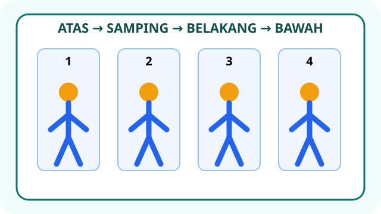
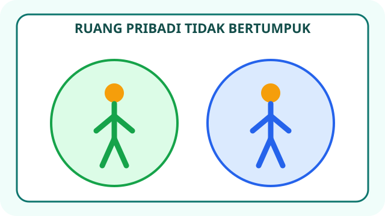

# PJOK Kelas 3 — Unit 2: Aktivitas Pola Gerak Dasar Nonlokomotor

## MOD-01 — K03-PJK-B02-MOD-01

### Bergerak di tempat dengan terkendali

Gerak **nonlokomotor** menggerakkan anggota tubuh tanpa perpindahan tempat utama. Unit 2 mempelajari variasi:

- **Memutar:** mengubah arah hadap badan dengan tumpuan tetap.
- **Mengayun:** menggerakkan lengan secara terkontrol ke atas, samping, belakang, atau bawah.
- **Membungkuk:** mencondongkan batang tubuh ke depan lalu kembali tegak.
- **Menekuk:** membengkokkan kaki atau lutut pada arah gerak yang wajar.
- **Meliuk:** menggerakkan batang tubuh ke kanan, kiri, depan, atau belakang dengan kendali.

Sikap awal umumnya berdiri tegak dengan kaki dibuka secukupnya agar stabil. Pandangan mengikuti arahan guru. Gerakan dilakukan perlahan lebih dahulu, mengikuti hitungan, dan bernapas normal. Jangkauan gerak setiap siswa dapat berbeda.

**Keselamatan:**

1. Pastikan tubuh sehat dan lakukan pemanasan.
2. Gunakan ruang yang cukup; ayunan lengan atau simpai tidak boleh mengenai teman.
3. Peralatan harus ringan, utuh, dan tanpa ujung tajam.
4. Jangan menekan, menarik, atau memaksa tubuh teman.
5. Hentikan gerak bila nyeri, pusing, atau tidak nyaman dan beri tahu guru.

---

## MOD-02 — K03-PJK-B02-MOD-02

### Rangkaian dan permainan sederhana

Gerak nonlokomotor dapat disusun menjadi rangkaian:

1. Berdiri stabil pada tanda.
2. Ayunkan lengan ke atas dan ke samping.
3. Putar badan perlahan ke kanan lalu kembali ke depan.
4. Tekuk lutut secara wajar.
5. Liukkan badan ke kiri lalu kembali tegak.

Guru dapat memberi kartu perintah **PUTAR – AYUN – TEKUK – LIUK**. Siswa mengikuti urutan tanpa meninggalkan tanda. Kegiatan dapat dilakukan berpasangan atau dalam kelompok kecil dengan jarak aman.

**Penyesuaian kemampuan:**

- Perkecil jangkauan bila ruang sempit atau gerak belum dikuasai.
- Perlambat hitungan agar posisi tubuh lebih terkendali.
- Gunakan tangan tanpa alat bila simpai terasa sulit.
- Pilih posisi stabil; bantuan diberikan melalui contoh dan arahan, bukan menarik tubuh.

Setelah latihan, lakukan pendinginan ringan. Catat gerak yang sudah terkendali dan gerak yang masih memerlukan bantuan. Refleksi bukan perlombaan kelenturan; tujuan utamanya adalah kontrol gerak, mandiri, gotong royong, dan keselamatan.
