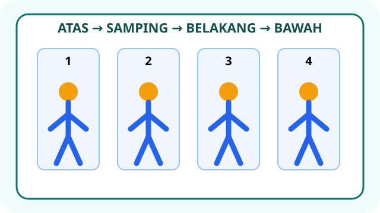
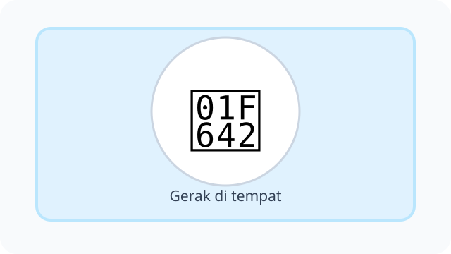
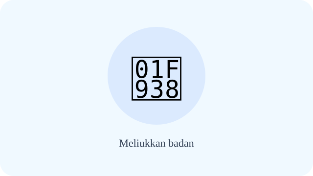
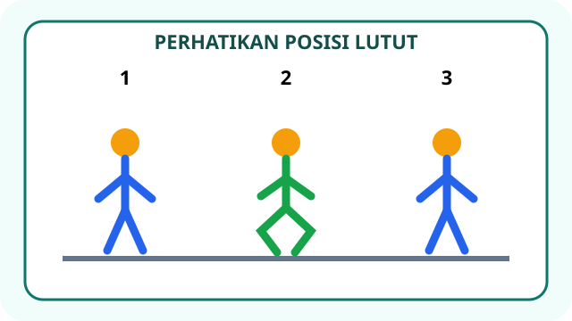
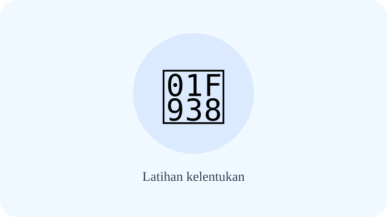
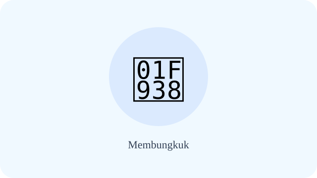
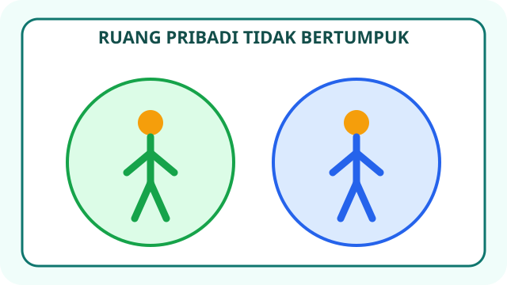
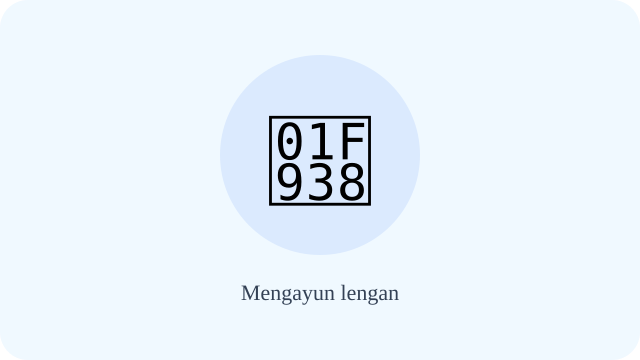
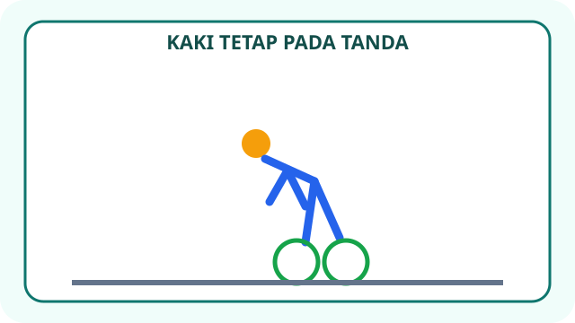
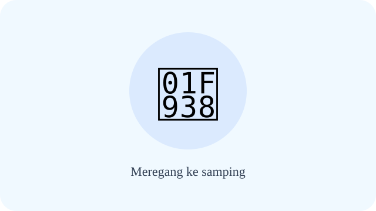

# Unit 2 — Aktivitas Pola Gerak Dasar Nonlokomotor

10 soal bergambar. Setiap stimulus menunjukkan urutan, posisi tubuh, ruang, atau tanda keselamatan yang diperlukan untuk menjawab.

## Soal 36 — K03-PJK-B02-M01-036

**Pertanyaan:** Gambar menunjukkan urutan ayunan lengan: atas, samping, belakang, bawah. Setelah posisi samping, gerak berikutnya adalah ....

**Pilihan jawaban:**
- ke belakang
- ke atas lagi
- berlari ke depan
- duduk

**Kunci Jawaban:** ke belakang

**Pembahasan:** Urutan visual menempatkan posisi belakang setelah posisi samping.

---

## Soal 37 — K03-PJK-B02-M01-037

**Pertanyaan:** Pada panel A kaki tetap di tanda sambil badan berputar. Panel B berjalan meninggalkan tanda. Panel mana yang menunjukkan nonlokomotor?

**Pilihan jawaban:**
- panel A
- panel B
- keduanya berpindah tempat
- tidak ada gerak

**Kunci Jawaban:** panel A

**Pembahasan:** Panel A mengubah arah tubuh tanpa meninggalkan titik tumpu.

---

## Soal 38 — K03-PJK-B02-M01-038

**Pertanyaan:** Panah pada gambar bergerak dari posisi tegak ke kanan lalu ke kiri. Gerak apa yang ditunjukkan?

**Pilihan jawaban:**
- meliukkan badan ke samping
- berlari zig-zag
- berjalan menyamping
- melempar bola

**Kunci Jawaban:** meliukkan badan ke samping

**Pembahasan:** Batang tubuh bergerak ke kanan dan kiri sementara kaki tetap.

---

## Soal 39 — K03-PJK-B02-M01-039

**Pertanyaan:** Gambar bernomor 1–3 menunjukkan lutut lurus, menekuk, lalu kembali lurus. Posisi menekuk ditunjukkan oleh nomor ....

**Pilihan jawaban:**
- 1
- 2
- 3
- 1 dan 3

**Kunci Jawaban:** 2

**Pembahasan:** Pada posisi 2, sudut lutut mengecil sehingga lutut tampak menekuk.

---

## Soal 40 — K03-PJK-B02-M01-040

**Pertanyaan:** Dua siswa memegang simpai. Panel A memiliki jarak cukup; Panel B terlalu berdekatan. Susunan yang aman adalah ....

**Pilihan jawaban:**
- panel A
- panel B
- keduanya harus berhimpitan
- keduanya harus mengayun ke arah teman

**Kunci Jawaban:** panel A

**Pembahasan:** Jarak cukup mencegah simpai dan lengan mengenai teman.

---

## Soal 41 — K03-PJK-B02-M01-041

**Pertanyaan:** Skala gambar menunjukkan gerak nyaman pada zona hijau dan nyeri pada zona merah. Jika gerak mencapai zona merah, siswa harus ....

**Pilihan jawaban:**
- berhenti dan memberi tahu guru
- memaksa melewati batas
- meminta teman menarik lebih keras
- mengulang lebih cepat

**Kunci Jawaban:** berhenti dan memberi tahu guru

**Pembahasan:** Nyeri adalah tanda untuk menghentikan atau menyesuaikan gerak.

---

## Soal 42 — K03-PJK-B02-M01-042

**Pertanyaan:** Dua lingkaran ruang pribadi pada gambar tidak saling bertumpuk. Apa aturan yang ditunjukkan?

**Pilihan jawaban:**
- menjaga jarak saat mengayun
- berdiri berhimpitan
- saling menarik tangan
- berlari keluar lingkaran

**Kunci Jawaban:** menjaga jarak saat mengayun

**Pembahasan:** Ruang pribadi yang tidak bertumpuk memberi tempat aman untuk ayunan.

---

## Soal 43 — K03-PJK-B02-M01-043

**Pertanyaan:** Kartu urutan menunjukkan PUTAR → AYUN → TEKUK. Gerak ketiga adalah ....

**Pilihan jawaban:**
- putar
- ayun
- tekuk
- lari

**Kunci Jawaban:** tekuk

**Pembahasan:** Kartu ketiga pada urutan adalah TEKUK.

---

## Soal 44 — K03-PJK-B02-M01-044

**Pertanyaan:** Gambar menunjukkan tubuh condong ke depan tetapi kedua kaki tetap pada tanda. Gerak ini adalah ....

**Pilihan jawaban:**
- membungkuk di tempat
- berjalan maju
- berlari cepat
- melompat jauh

**Kunci Jawaban:** membungkuk di tempat

**Pembahasan:** Tubuh condong tanpa meninggalkan tanda kaki.

---

## Soal 45 — K03-PJK-B02-M01-045

**Pertanyaan:** Tabel pemeriksaan tubuh menunjukkan: nyaman—lanjut; nyeri—berhenti; pusing—berhenti. Siswa merasa pusing. Apa tindakannya?

**Pilihan jawaban:**
- berhenti dan memberi tahu guru
- melanjutkan lebih cepat
- menyembunyikan keluhan
- memutar kepala kuat-kuat

**Kunci Jawaban:** berhenti dan memberi tahu guru

**Pembahasan:** Tabel secara jelas mengarahkan berhenti saat pusing.

---

