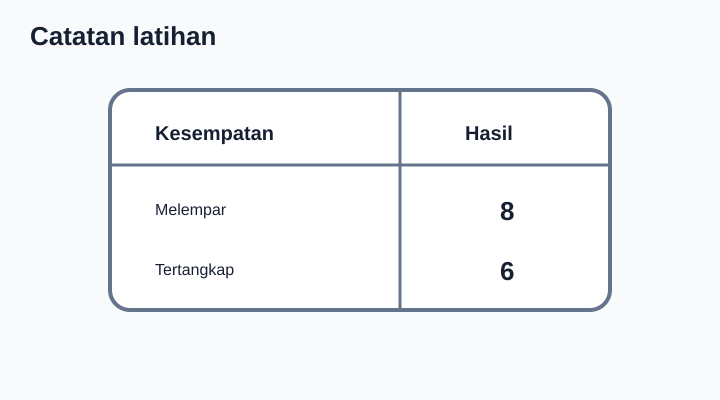
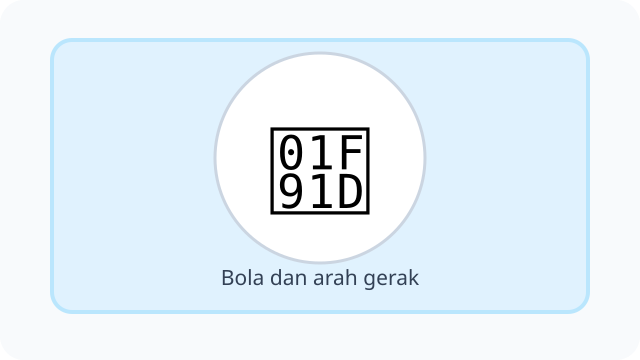
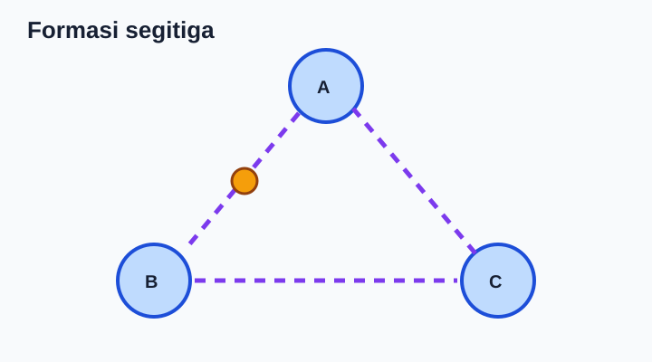
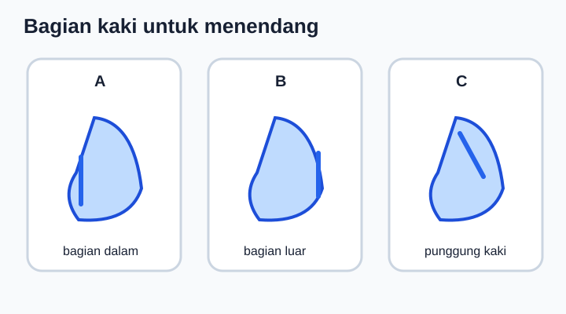
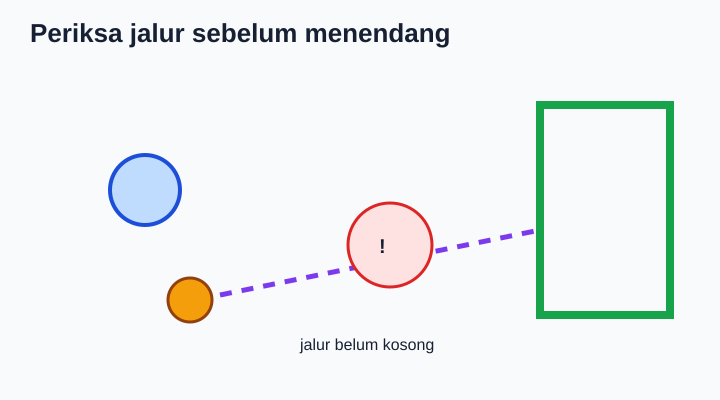

# Unit 3 — Aktivitas Pola Gerak Dasar Manipulatif

10 soal bergambar, **DRAF**. Ilustrasi SVG bersifat simbolik, belum ilustrasi gerak yang spesifik.

## Soal 36 — K03-PJK-B03-M01-036

**Pertanyaan:** Perhatikan kegiatan atau konsep "Mengoper bola". Jawaban yang paling sesuai adalah ....

**Pilihan jawaban:**
- menyembunyikan bola
- melempar ke penonton
- mengabaikan teman
- memberikan bola kepada teman satu tim

**Kunci Jawaban:** memberikan bola kepada teman satu tim

**Pembahasan:** Mengoper bola: memberikan bola kepada teman satu tim.

---

## Soal 37 — K03-PJK-B03-M01-037

**Pertanyaan:** Perhatikan kegiatan atau konsep "Arah lemparan". Jawaban yang paling sesuai adalah ....

**Pilihan jawaban:**
- ke kaca jendela
- ke jalan raya
- diarahkan ke sasaran yang aman
- ke wajah teman

**Kunci Jawaban:** diarahkan ke sasaran yang aman

**Pembahasan:** Arah lemparan: diarahkan ke sasaran yang aman.

---

## Soal 38 — K03-PJK-B03-M01-038

**Pertanyaan:** Perhatikan kegiatan atau konsep "Menangkap bola mendatar". Jawaban yang paling sesuai adalah ....

**Pilihan jawaban:**
- berlari tanpa melihat
- memperhatikan arah datang bola dan menyiapkan tangan
- memejamkan mata
- membelakangi bola

**Kunci Jawaban:** memperhatikan arah datang bola dan menyiapkan tangan

**Pembahasan:** Menangkap bola mendatar: memperhatikan arah datang bola dan menyiapkan tangan.

---

## Soal 39 — K03-PJK-B03-M01-039

**Pertanyaan:** Perhatikan kegiatan atau konsep "Bermain bola bersama". Jawaban yang paling sesuai adalah ....

**Pilihan jawaban:**
- mematuhi aturan dan bergiliran
- merebut secara kasar
- mengejek teman
- mendorong lawan

**Kunci Jawaban:** mematuhi aturan dan bergiliran

**Pembahasan:** Bermain bola bersama: mematuhi aturan dan bergiliran.

---

## Soal 40 — K03-PJK-B03-M01-040

**Pertanyaan:** Perhatikan kegiatan atau konsep "Bola untuk latihan anak". Jawaban yang paling sesuai adalah ....

**Pilihan jawaban:**
- harus paling berat
- harus keras seperti batu
- selalu lebih besar dari tubuh
- dipilih sesuai ukuran dan kemampuan

**Kunci Jawaban:** dipilih sesuai ukuran dan kemampuan

**Pembahasan:** Bola untuk latihan anak: dipilih sesuai ukuran dan kemampuan.

---

## Soal 41 — K03-PJK-B03-M01-041

**Pertanyaan:** Perhatikan ilustrasi berikut. Apa penjelasan yang tepat tentang melempar bola?

**Pilihan jawaban:**
- berdiri satu kaki
- membungkuk
- menggerakkan bola menjauh menggunakan tangan
- menahan bola dengan kaki

**Kunci Jawaban:** menggerakkan bola menjauh menggunakan tangan

**Pembahasan:** Melempar bola: menggerakkan bola menjauh menggunakan tangan.

---

## Soal 42 — K03-PJK-B03-M01-042

**Pertanyaan:** Perhatikan ilustrasi berikut. Apa penjelasan yang tepat tentang menangkap bola?

**Pilihan jawaban:**
- berjalan mundur
- menerima bola dengan tangan secara terkendali
- menendang bola
- memutar badan

**Kunci Jawaban:** menerima bola dengan tangan secara terkendali

**Pembahasan:** Menangkap bola: menerima bola dengan tangan secara terkendali.

---

## Soal 43 — K03-PJK-B03-M01-043

**Pertanyaan:** Perhatikan ilustrasi berikut. Apa penjelasan yang tepat tentang menendang bola?

**Pilihan jawaban:**
- menggerakkan bola menggunakan kaki
- memukul bola dengan tangan
- menangkap bola
- mengayun lengan

**Kunci Jawaban:** menggerakkan bola menggunakan kaki

**Pembahasan:** Menendang bola: menggerakkan bola menggunakan kaki.

---

## Soal 44 — K03-PJK-B03-M01-044

**Pertanyaan:** Perhatikan ilustrasi berikut. Apa penjelasan yang tepat tentang menggiring bola dengan kaki?

**Pilihan jawaban:**
- melempar bola ke udara
- duduk diam
- berputar
- mengontrol bola lewat sentuhan kaki berulang

**Kunci Jawaban:** mengontrol bola lewat sentuhan kaki berulang

**Pembahasan:** Menggiring bola dengan kaki: mengontrol bola lewat sentuhan kaki berulang.

---

## Soal 45 — K03-PJK-B03-M01-045

**Pertanyaan:** Perhatikan ilustrasi berikut. Apa penjelasan yang tepat tentang memantulkan bola?

**Pilihan jawaban:**
- menendang jauh
- membungkuk
- mendorong bola ke lantai agar memantul kembali
- menahan bola di tas

**Kunci Jawaban:** mendorong bola ke lantai agar memantul kembali

**Pembahasan:** Memantulkan bola: mendorong bola ke lantai agar memantul kembali.

---
