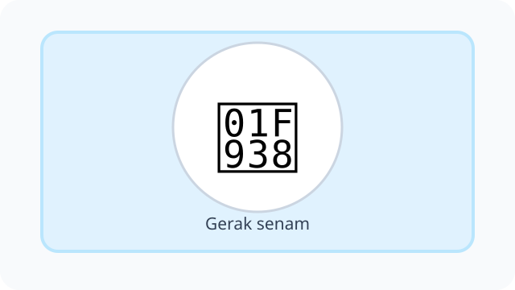
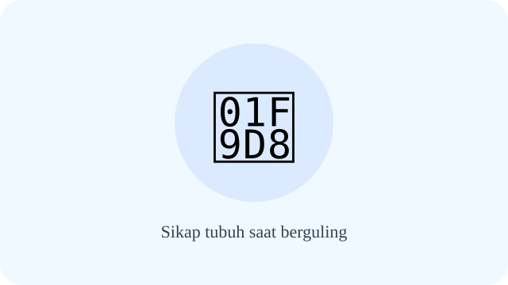
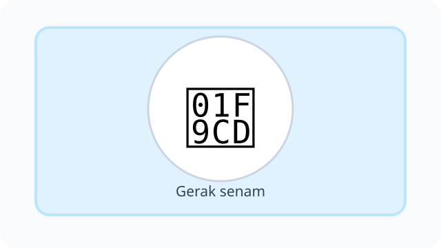
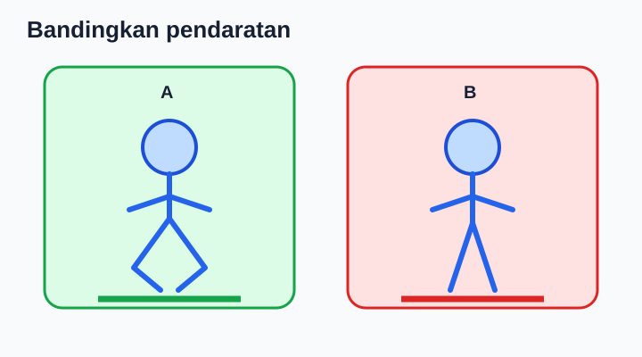
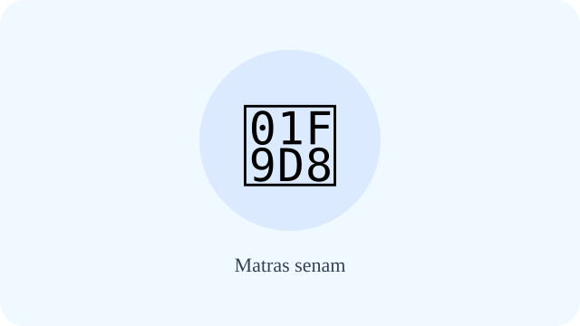
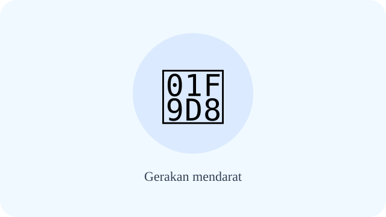

# Unit 4 — Aktivitas Gerak Dominan Senam

10 soal bergambar telah direvisi dengan konteks; diagram SVG diproses terpisah dan pemeriksaan visual akhir masih diperlukan.

## Soal 36 — K03-PJK-B04-M01-036

**Pertanyaan:** Siswa mencoba posisi dasar dengan instruksi guru. Apa prinsip keamanan utama latihan?

**Pilihan jawaban:**
- selalu dilakukan sendirian
- harus di tempat sempit
- dilakukan sesuai kemampuan dan arahan guru
- dipaksa sampai sakit

**Kunci Jawaban:** dilakukan sesuai kemampuan dan arahan guru

**Pembahasan:** Latihan senam dasar: dilakukan sesuai kemampuan dan arahan guru.

---

## Soal 37 — K03-PJK-B04-M01-037

**Pertanyaan:** Siswa bergerak ringan sebelum berlatih senam. Apa tujuan tahap persiapan ini?

**Pilihan jawaban:**
- menghilangkan risiko sepenuhnya
- mempersiapkan otot dan sendi
- menggantikan seluruh latihan
- membuat tidak perlu minum

**Kunci Jawaban:** mempersiapkan otot dan sendi

**Pembahasan:** Pemanasan senam: mempersiapkan otot dan sendi.

---

## Soal 38 — K03-PJK-B04-M01-038

**Pertanyaan:** Anak hendak berguling di atas matras. Bagian tubuh apa yang harus diperhatikan?

**Pilihan jawaban:**
- kepala dan leher dijaga sesuai arahan guru
- leher ditumpu paksa
- mata selalu ditutup
- teman ditarik

**Kunci Jawaban:** kepala dan leher dijaga sesuai arahan guru

**Pembahasan:** Sikap tubuh saat berguling: kepala dan leher dijaga sesuai arahan guru.

---

## Soal 39 — K03-PJK-B04-M01-039

**Pertanyaan:** Dua siswa berbagi matras. Bagaimana mereka mengatur waktu dan jarak?

**Pilihan jawaban:**
- saling mendorong
- mengganggu gerakan
- melempar alat
- bergiliran dan menjaga jarak aman

**Kunci Jawaban:** bergiliran dan menjaga jarak aman

**Pembahasan:** Teman saat senam: bergiliran dan menjaga jarak aman.

---

## Soal 40 — K03-PJK-B04-M01-040

**Pertanyaan:** Gambar memperlihatkan rangkaian tumpuan dan gerak. Kelompok kemampuan senam apa yang dilatih?

**Pilihan jawaban:**
- hanya berenang
- hanya berlari
- meliputi bertumpu, bergantung, keseimbangan, dan berguling sesuai pembelajaran
- hanya menendang bola

**Kunci Jawaban:** meliputi bertumpu, bergantung, keseimbangan, dan berguling sesuai pembelajaran

**Pembahasan:** Gerak dominan senam: meliputi bertumpu, bergantung, keseimbangan, dan berguling sesuai pembelajaran.

---

## Soal 41 — K03-PJK-B04-M01-041

**Pertanyaan:** Siswa menahan sebagian berat tubuh di atas tangan dan kaki. Gerak yang sesuai ialah ....

**Pilihan jawaban:**
- berlari sprint
- menopang berat badan dengan bagian tubuh tertentu
- melempar bola
- berenang jauh

**Kunci Jawaban:** menopang berat badan dengan bagian tubuh tertentu

**Pembahasan:** Bertumpu: menopang berat badan dengan bagian tubuh tertentu.

---

## Soal 42 — K03-PJK-B04-M01-042

**Pertanyaan:** Siswa bergerak berguling ke depan menggunakan matras dan pengawasan. Manakah uraian yang tepat?

**Pilihan jawaban:**
- menggulingkan tubuh ke depan di matras dengan bimbingan
- melompat dari atap
- menendang bola
- berlari mundur

**Kunci Jawaban:** menggulingkan tubuh ke depan di matras dengan bimbingan

**Pembahasan:** Berguling depan: menggulingkan tubuh ke depan di matras dengan bimbingan.

---

## Soal 43 — K03-PJK-B04-M01-043

**Pertanyaan:** Anak berusaha tetap stabil pada satu posisi. Keterampilan apa yang dilatih?

**Pilihan jawaban:**
- mendorong teman
- berlari tanpa arah
- melempar bola
- menjaga tubuh tetap stabil

**Kunci Jawaban:** menjaga tubuh tetap stabil

**Pembahasan:** Sikap keseimbangan: menjaga tubuh tetap stabil.

---

## Soal 44 — K03-PJK-B04-M01-044

**Pertanyaan:** Seorang guru memasang alas latihan lunak. Mengapa alas tersebut digunakan?

**Pilihan jawaban:**
- dipakai sebagai bola
- dipakai untuk berenang
- membantu menyediakan permukaan latihan yang lebih aman
- digunakan untuk melempar

**Kunci Jawaban:** membantu menyediakan permukaan latihan yang lebih aman

**Pembahasan:** Matras senam: membantu menyediakan permukaan latihan yang lebih aman.

---

## Soal 45 — K03-PJK-B04-M01-045

**Pertanyaan:** Anak turun dari gerak meloncat rendah. Cara mendarat yang tepat adalah ....

**Pilihan jawaban:**
- dilakukan sambil mendorong teman
- dilakukan terkendali dengan lutut tidak kaku
- dilakukan sambil menutup mata
- dilakukan di lantai licin

**Kunci Jawaban:** dilakukan terkendali dengan lutut tidak kaku

**Pembahasan:** Gerakan mendarat: dilakukan terkendali dengan lutut tidak kaku.

---
