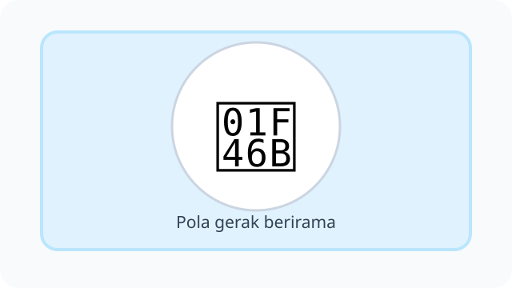
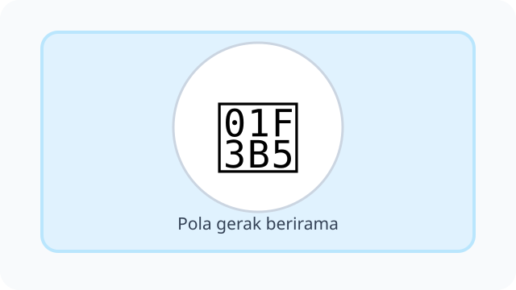
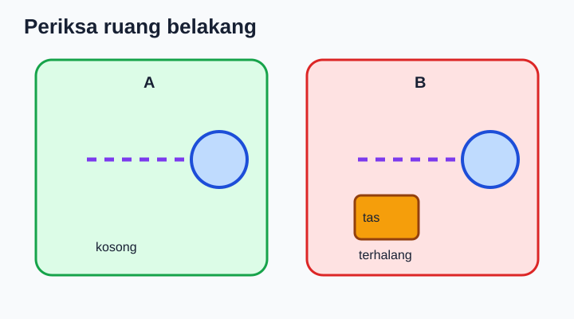
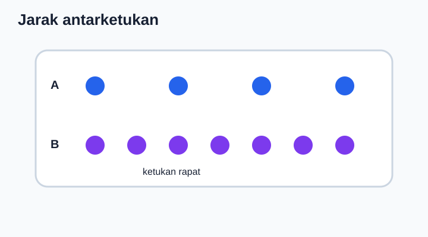
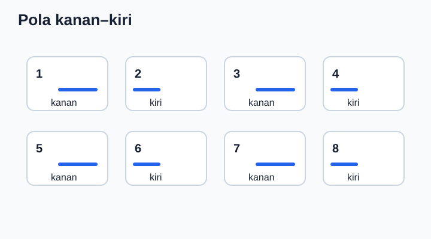
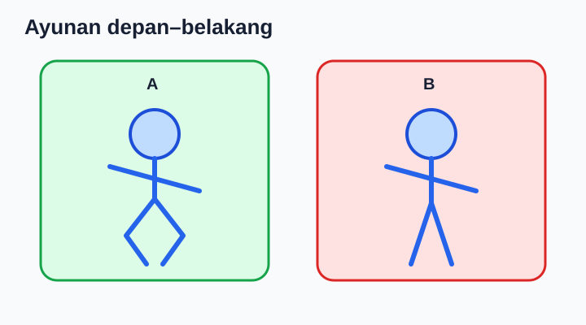
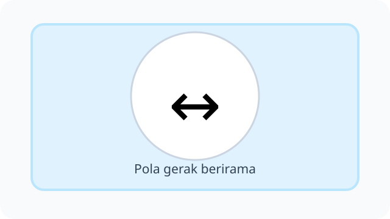
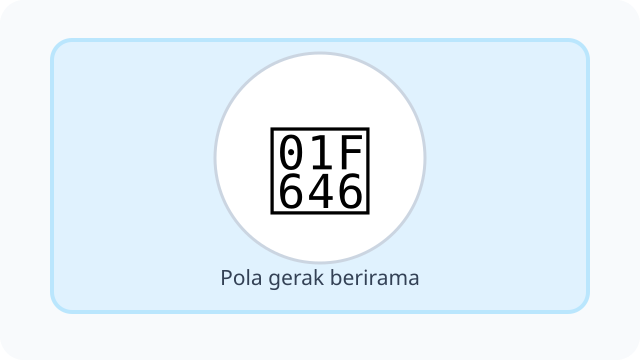
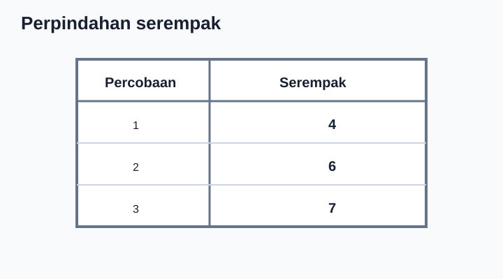

# Unit 5 — Aktivitas Gerak Berirama

10 soal bergambar, **DRAF**. Ilustrasi SVG bersifat simbolik, belum ilustrasi gerak yang spesifik.

## Soal 36 — K03-PJK-B05-M01-036

**Pertanyaan:** Perhatikan kegiatan atau konsep "Gerak kelompok berirama". Jawaban yang paling sesuai adalah ....

**Pilihan jawaban:**
- hanya dilakukan sendiri
- memerlukan kerja sama dan kekompakan
- memerlukan saling mengejek
- harus tanpa aturan

**Kunci Jawaban:** memerlukan kerja sama dan kekompakan

**Pembahasan:** Gerak kelompok berirama: memerlukan kerja sama dan kekompakan.

---

## Soal 37 — K03-PJK-B05-M01-037

**Pertanyaan:** Perhatikan kegiatan atau konsep "Tempo lambat". Jawaban yang paling sesuai adalah ....

**Pilihan jawaban:**
- gerakan mengikuti ketukan yang lebih pelan
- gerakan selalu secepat mungkin
- gerakan berhenti total
- gerakan tanpa hitungan

**Kunci Jawaban:** gerakan mengikuti ketukan yang lebih pelan

**Pembahasan:** Tempo lambat: gerakan mengikuti ketukan yang lebih pelan.

---

## Soal 38 — K03-PJK-B05-M01-038

**Pertanyaan:** Perhatikan kegiatan atau konsep "Tempo cepat". Jawaban yang paling sesuai adalah ....

**Pilihan jawaban:**
- gerakan harus sembarangan
- gerakan harus di lantai licin
- gerakan tidak perlu kendali
- gerakan mengikuti ketukan lebih rapat dengan tetap aman

**Kunci Jawaban:** gerakan mengikuti ketukan lebih rapat dengan tetap aman

**Pembahasan:** Tempo cepat: gerakan mengikuti ketukan lebih rapat dengan tetap aman.

---

## Soal 39 — K03-PJK-B05-M01-039

**Pertanyaan:** Perhatikan kegiatan atau konsep "Jarak antarpeserta". Jawaban yang paling sesuai adalah ....

**Pilihan jawaban:**
- tidak perlu diperhatikan
- harus di lorong sempit
- perlu cukup agar tidak bertabrakan
- harus saling menempel

**Kunci Jawaban:** perlu cukup agar tidak bertabrakan

**Pembahasan:** Jarak antarpeserta: perlu cukup agar tidak bertabrakan.

---

## Soal 40 — K03-PJK-B05-M01-040

**Pertanyaan:** Perhatikan kegiatan atau konsep "Pendinginan setelah bergerak". Jawaban yang paling sesuai adalah ....

**Pilihan jawaban:**
- berarti berhenti bernapas
- membantu tubuh beralih ke keadaan lebih tenang
- menggantikan tidur malam
- membuat tubuh tidak perlu air

**Kunci Jawaban:** membantu tubuh beralih ke keadaan lebih tenang

**Pembahasan:** Pendinginan setelah bergerak: membantu tubuh beralih ke keadaan lebih tenang.

---

## Soal 41 — K03-PJK-B05-M01-041

**Pertanyaan:** Perhatikan ilustrasi berikut. Apa penjelasan yang tepat tentang gerak berirama?

**Pilihan jawaban:**
- gerakan tubuh mengikuti irama atau ketukan
- gerak tanpa memperhatikan irama
- hanya duduk diam
- hanya melempar bola

**Kunci Jawaban:** gerakan tubuh mengikuti irama atau ketukan

**Pembahasan:** Gerak berirama: gerakan tubuh mengikuti irama atau ketukan.

---

## Soal 42 — K03-PJK-B05-M01-042

**Pertanyaan:** Perhatikan ilustrasi berikut. Apa penjelasan yang tepat tentang tepuk tangan sesuai ketukan?

**Pilihan jawaban:**
- menggantikan minum
- menyebabkan harus berlari
- menjadi gerak renang
- membantu mengikuti pola irama

**Kunci Jawaban:** membantu mengikuti pola irama

**Pembahasan:** Tepuk tangan sesuai ketukan: membantu mengikuti pola irama.

---

## Soal 43 — K03-PJK-B05-M01-043

**Pertanyaan:** Perhatikan ilustrasi berikut. Apa penjelasan yang tepat tentang langkah ke kanan dan kiri?

**Pilihan jawaban:**
- dilakukan tanpa melihat sekitar
- harus sangat cepat
- dilakukan mengikuti hitungan dengan ruang aman
- dilakukan sambil mendorong teman

**Kunci Jawaban:** dilakukan mengikuti hitungan dengan ruang aman

**Pembahasan:** Langkah ke kanan dan kiri: dilakukan mengikuti hitungan dengan ruang aman.

---

## Soal 44 — K03-PJK-B05-M01-044

**Pertanyaan:** Perhatikan ilustrasi berikut. Apa penjelasan yang tepat tentang ayunan lengan berirama?

**Pilihan jawaban:**
- tidak perlu terkendali
- disesuaikan dengan ketukan musik
- selalu melawan ketukan
- dilakukan sambil memukul teman

**Kunci Jawaban:** disesuaikan dengan ketukan musik

**Pembahasan:** Ayunan lengan berirama: disesuaikan dengan ketukan musik.

---

## Soal 45 — K03-PJK-B05-M01-045

**Pertanyaan:** Perhatikan ilustrasi berikut. Apa penjelasan yang tepat tentang hitungan satu sampai empat?

**Pilihan jawaban:**
- membantu mengatur urutan gerak
- menentukan ukuran sepatu
- mengganti pemanasan
- mengubah tinggi badan

**Kunci Jawaban:** membantu mengatur urutan gerak

**Pembahasan:** Hitungan satu sampai empat: membantu mengatur urutan gerak.

---
