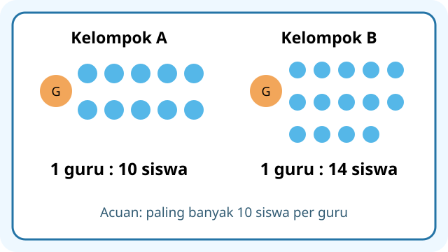
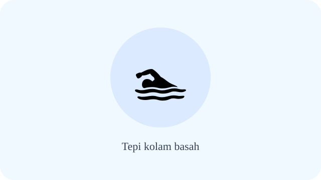
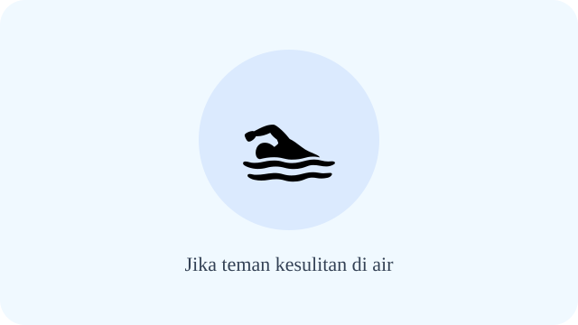
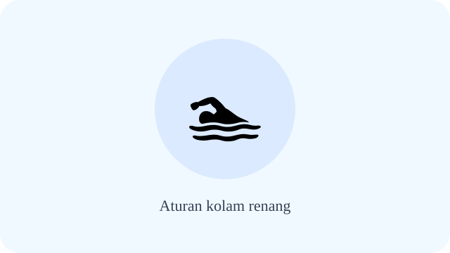
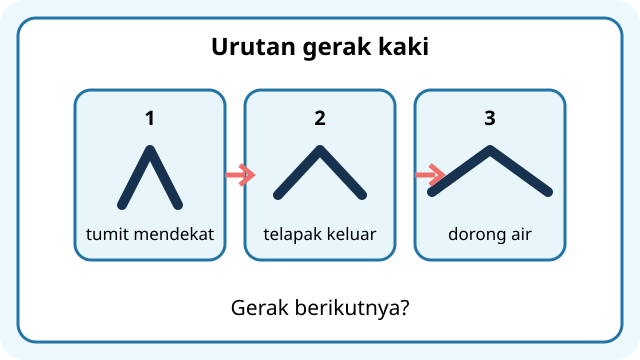
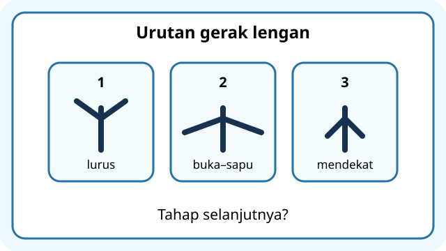
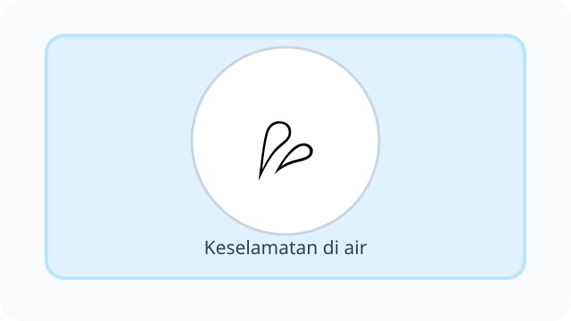
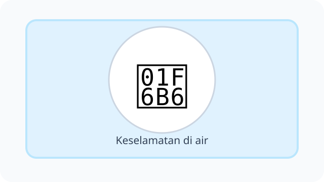
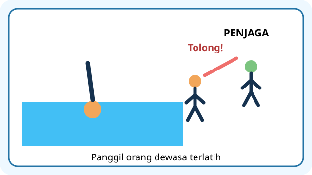
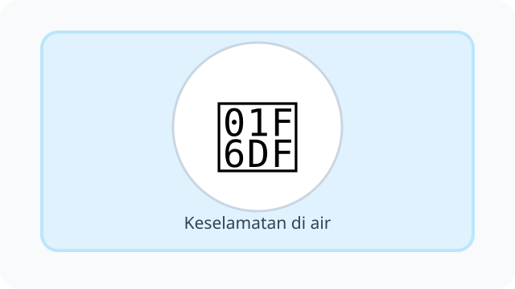

# Unit 6 — Aktivitas Permainan dan Olahraga di Air

10 soal bergambar, **DRAF**. Ilustrasi SVG bersifat simbolik, belum ilustrasi gerak yang spesifik.

## Soal 36 — K03-PJK-B06-M01-036

**Pertanyaan:** Perhatikan kegiatan atau konsep "Pelampung latihan". Jawaban yang paling sesuai adalah ....

**Pilihan jawaban:**
- alat bantu yang digunakan sesuai petunjuk, bukan pengganti pengawasan
- jaminan boleh berenang sendirian
- alat untuk memukul
- pengganti guru

**Kunci Jawaban:** alat bantu yang digunakan sesuai petunjuk, bukan pengganti pengawasan

**Pembahasan:** Pelampung latihan: alat bantu yang digunakan sesuai petunjuk, bukan pengganti pengawasan.

---

## Soal 37 — K03-PJK-B06-M01-037

**Pertanyaan:** Perhatikan kegiatan atau konsep "Tepi kolam basah". Jawaban yang paling sesuai adalah ....

**Pilihan jawaban:**
- dilewati dengan berlari
- digunakan melompat tanpa izin
- digunakan mendorong teman
- dilewati dengan berjalan hati-hati

**Kunci Jawaban:** dilewati dengan berjalan hati-hati

**Pembahasan:** Tepi kolam basah: dilewati dengan berjalan hati-hati.

---

## Soal 38 — K03-PJK-B06-M01-038

**Pertanyaan:** Perhatikan kegiatan atau konsep "Jika teman kesulitan di air". Jawaban yang paling sesuai adalah ....

**Pilihan jawaban:**
- menertawakan
- meninggalkan tanpa memberi tahu
- segera memanggil guru atau penjaga kolam
- langsung melompat tanpa kemampuan

**Kunci Jawaban:** segera memanggil guru atau penjaga kolam

**Pembahasan:** Jika teman kesulitan di air: segera memanggil guru atau penjaga kolam.

---

## Soal 39 — K03-PJK-B06-M01-039

**Pertanyaan:** Perhatikan kegiatan atau konsep "Aturan kolam renang". Jawaban yang paling sesuai adalah ....

**Pilihan jawaban:**
- berlaku saat lomba saja
- dipatuhi untuk keselamatan semua orang
- boleh diabaikan
- hanya untuk guru

**Kunci Jawaban:** dipatuhi untuk keselamatan semua orang

**Pembahasan:** Aturan kolam renang: dipatuhi untuk keselamatan semua orang.

---

## Soal 40 — K03-PJK-B06-M01-040

**Pertanyaan:** Perhatikan kegiatan atau konsep "Latihan gerak kaki di air". Jawaban yang paling sesuai adalah ....

**Pilihan jawaban:**
- dilakukan dengan pegangan atau bantuan sesuai arahan
- dilakukan tanpa pengawasan di kolam dalam
- dilakukan di air deras
- dilakukan sambil mengganggu teman

**Kunci Jawaban:** dilakukan dengan pegangan atau bantuan sesuai arahan

**Pembahasan:** Latihan gerak kaki di air: dilakukan dengan pegangan atau bantuan sesuai arahan.

---

## Soal 41 — K03-PJK-B06-M01-041

**Pertanyaan:** Perhatikan ilustrasi berikut. Apa penjelasan yang tepat tentang keselamatan di kolam?

**Pilihan jawaban:**
- berenang sendirian
- berlari di tepi licin
- mendorong teman ke air
- selalu mengikuti pengawasan guru atau orang dewasa yang kompeten

**Kunci Jawaban:** selalu mengikuti pengawasan guru atau orang dewasa yang kompeten

**Pembahasan:** Keselamatan di kolam: selalu mengikuti pengawasan guru atau orang dewasa yang kompeten.

---

## Soal 42 — K03-PJK-B06-M01-042

**Pertanyaan:** Perhatikan ilustrasi berikut. Apa penjelasan yang tepat tentang pengenalan air?

**Pilihan jawaban:**
- tanpa pengawasan
- dengan menahan teman
- dilakukan bertahap di tempat aman dan diawasi
- langsung ke kolam dalam

**Kunci Jawaban:** dilakukan bertahap di tempat aman dan diawasi

**Pembahasan:** Pengenalan air: dilakukan bertahap di tempat aman dan diawasi.

---

## Soal 43 — K03-PJK-B06-M01-043

**Pertanyaan:** Perhatikan ilustrasi berikut. Apa penjelasan yang tepat tentang berjalan di air dangkal?

**Pilihan jawaban:**
- dilakukan sendirian di sungai
- dilakukan sesuai arahan dan kedalaman aman
- dilakukan di air deras
- dilakukan tanpa melihat dasar

**Kunci Jawaban:** dilakukan sesuai arahan dan kedalaman aman

**Pembahasan:** Berjalan di air dangkal: dilakukan sesuai arahan dan kedalaman aman.

---

## Soal 44 — K03-PJK-B06-M01-044

**Pertanyaan:** Perhatikan ilustrasi berikut. Apa penjelasan yang tepat tentang mengembuskan napas ke air?

**Pilihan jawaban:**
- dilatih perlahan sesuai instruksi
- dilakukan dengan panik
- dilakukan tanpa bernapas lama
- dilakukan di air dalam sendirian

**Kunci Jawaban:** dilatih perlahan sesuai instruksi

**Pembahasan:** Mengembuskan napas ke air: dilatih perlahan sesuai instruksi.

---

## Soal 45 — K03-PJK-B06-M01-045

**Pertanyaan:** Perhatikan ilustrasi berikut. Apa penjelasan yang tepat tentang mengapung?

**Pilihan jawaban:**
- menyelam tanpa batas
- berlari di tepi kolam
- melempar batu
- menjaga posisi tubuh di permukaan air dengan bantuan bila perlu

**Kunci Jawaban:** menjaga posisi tubuh di permukaan air dengan bantuan bila perlu

**Pembahasan:** Mengapung: menjaga posisi tubuh di permukaan air dengan bantuan bila perlu.

---
