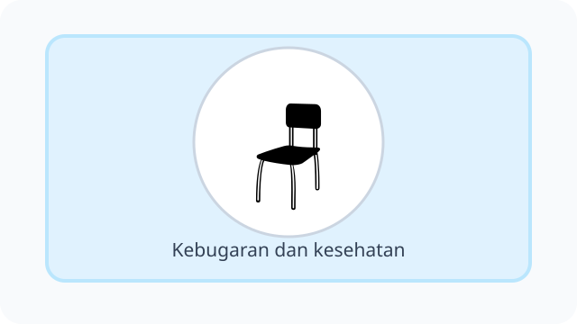
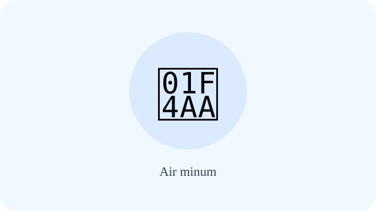
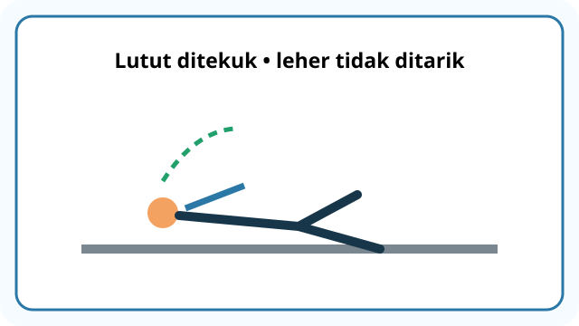
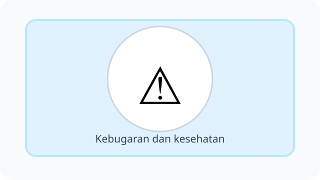
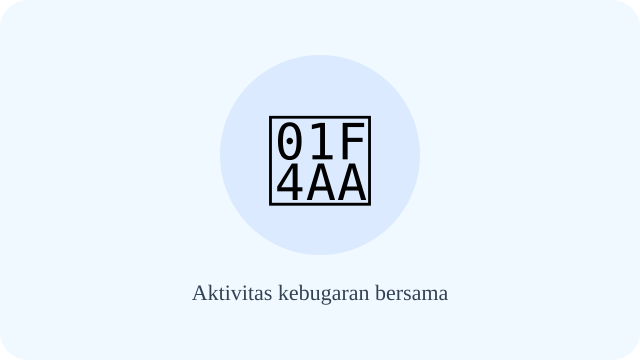
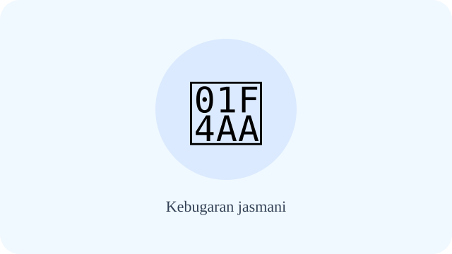
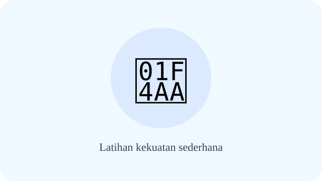
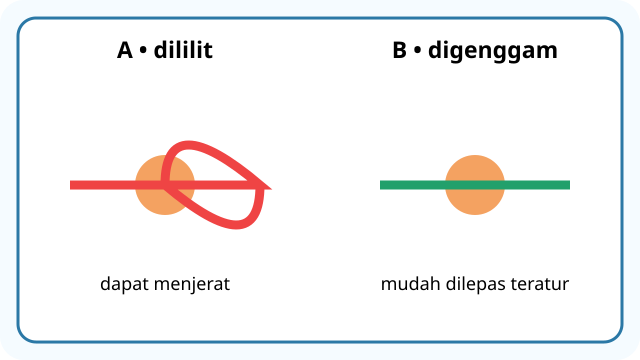
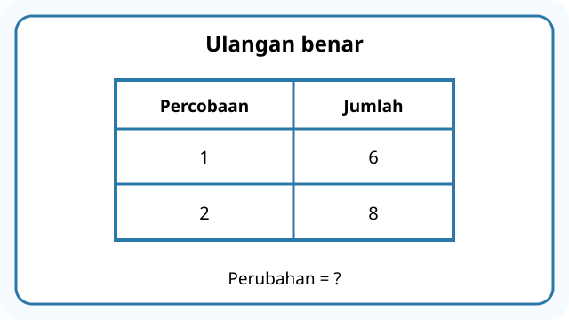
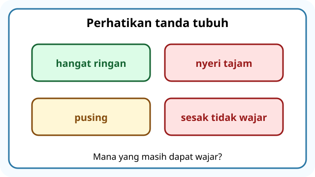

# Unit 7 — Aktivitas Kebugaran untuk Kesehatan

10 soal bergambar telah direvisi dengan konteks; diagram SVG diproses terpisah dan pemeriksaan visual akhir masih diperlukan.

## Soal 36 — K03-PJK-B07-M01-036

**Pertanyaan:** Setelah bermain, anak beristirahat. Apa manfaat jeda aktivitas tersebut?

**Pilihan jawaban:**
- berarti tidak boleh minum
- berarti harus terus berlari
- tidak diperlukan
- membantu pemulihan tubuh

**Kunci Jawaban:** membantu pemulihan tubuh

**Pembahasan:** Istirahat setelah olahraga: membantu pemulihan tubuh.

---

## Soal 37 — K03-PJK-B07-M01-037

**Pertanyaan:** Gambar menunjukkan botol air di dekat area latihan. Untuk apa air minum diperlukan?

**Pilihan jawaban:**
- tidak diperlukan saat panas
- harus dihindari
- membantu memenuhi kebutuhan cairan tubuh
- dapat diganti minuman sembarang

**Kunci Jawaban:** membantu memenuhi kebutuhan cairan tubuh

**Pembahasan:** Air minum: membantu memenuhi kebutuhan cairan tubuh.

---

## Soal 38 — K03-PJK-B07-M01-038

**Pertanyaan:** Jadwal latihan memiliki waktu teratur dan jeda. Pola yang baik ialah ....

**Pilihan jawaban:**
- tidak perlu aman
- lebih baik dilakukan teratur sesuai kemampuan
- harus selalu berlebihan
- harus dilakukan saat sakit berat

**Kunci Jawaban:** lebih baik dilakukan teratur sesuai kemampuan

**Pembahasan:** Latihan rutin: lebih baik dilakukan teratur sesuai kemampuan.

---

## Soal 39 — K03-PJK-B07-M01-039

**Pertanyaan:** Anak tampak pusing saat latihan. Gejala apa yang menandakan perlunya berhenti?

**Pilihan jawaban:**
- nyeri hebat, pusing, atau sesak yang tidak wajar
- rasa senang
- napas sedikit lebih cepat yang wajar
- keringat ringan

**Kunci Jawaban:** nyeri hebat, pusing, atau sesak yang tidak wajar

**Pembahasan:** Tanda perlu berhenti latihan: nyeri hebat, pusing, atau sesak yang tidak wajar.

---

## Soal 40 — K03-PJK-B07-M01-040

**Pertanyaan:** Anak-anak dengan kemampuan berbeda berlatih bersama. Sikap yang tepat adalah ....

**Pilihan jawaban:**
- dilakukan sambil mengejek
- dilakukan tanpa pemanasan
- dilakukan di jalan ramai
- dilakukan dengan aturan dan saling mendukung

**Kunci Jawaban:** dilakukan dengan aturan dan saling mendukung

**Pembahasan:** Aktivitas kebugaran bersama: dilakukan dengan aturan dan saling mendukung.

---

## Soal 41 — K03-PJK-B07-M01-041

**Pertanyaan:** Siswa menjalani kegiatan fisik tanpa kelelahan berlebihan. Kemampuan apa yang ditunjukkan?

**Pilihan jawaban:**
- kemampuan makan paling banyak
- kemampuan menghindari gerak
- kemampuan tubuh melakukan kegiatan tanpa cepat kelelahan berlebihan
- kemampuan tidur sepanjang hari

**Kunci Jawaban:** kemampuan tubuh melakukan kegiatan tanpa cepat kelelahan berlebihan

**Pembahasan:** Kebugaran jasmani: kemampuan tubuh melakukan kegiatan tanpa cepat kelelahan berlebihan.

---

## Soal 42 — K03-PJK-B07-M01-042

**Pertanyaan:** Seorang siswa memilih latihan tubuh yang sesuai usianya. Prinsipnya adalah ....

**Pilihan jawaban:**
- dilakukan tanpa pengawasan
- dilakukan sesuai usia dan kemampuan
- mengangkat beban berbahaya
- dipaksakan sampai sakit

**Kunci Jawaban:** dilakukan sesuai usia dan kemampuan

**Pembahasan:** Latihan kekuatan sederhana: dilakukan sesuai usia dan kemampuan.

---

## Soal 43 — K03-PJK-B07-M01-043

**Pertanyaan:** Gambar memperlihatkan jalan cepat dan gerak ringan. Latihan tersebut melatih apa?

**Pilihan jawaban:**
- dapat berupa jalan cepat atau lari ringan sesuai kemampuan
- hanya duduk diam
- selalu mengangkat beban berat
- tidak perlu istirahat

**Kunci Jawaban:** dapat berupa jalan cepat atau lari ringan sesuai kemampuan

**Pembahasan:** Latihan daya tahan: dapat berupa jalan cepat atau lari ringan sesuai kemampuan.

---

## Soal 44 — K03-PJK-B07-M01-044

**Pertanyaan:** Anak meregangkan sendi dalam rentang yang nyaman. Kemampuan itu adalah ....

**Pilihan jawaban:**
- kemampuan melempar jauh saja
- kemampuan tidur
- kemampuan makan
- kemampuan sendi bergerak dalam rentang yang wajar

**Kunci Jawaban:** kemampuan sendi bergerak dalam rentang yang wajar

**Pembahasan:** Kelentukan: kemampuan sendi bergerak dalam rentang yang wajar.

---

## Soal 45 — K03-PJK-B07-M01-045

**Pertanyaan:** Anak berdiri di atas satu kaki sambil menjaga tubuh. Kemampuan apa yang digunakan?

**Pilihan jawaban:**
- kemampuan berlari tanpa arah
- kemampuan makan cepat
- kemampuan menjaga posisi tubuh agar stabil
- kemampuan berteriak

**Kunci Jawaban:** kemampuan menjaga posisi tubuh agar stabil

**Pembahasan:** Keseimbangan: kemampuan menjaga posisi tubuh agar stabil.

---
