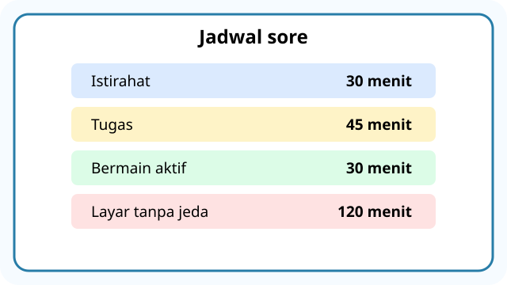
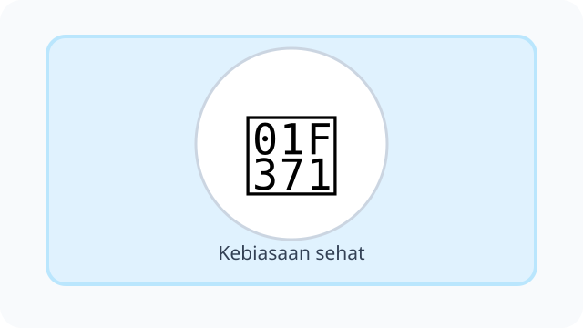
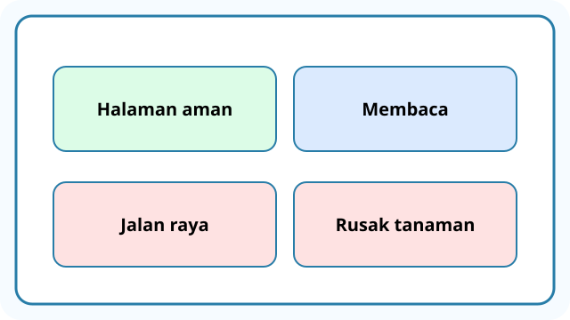
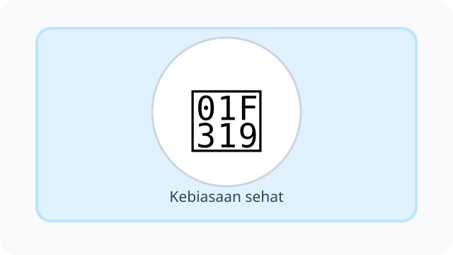
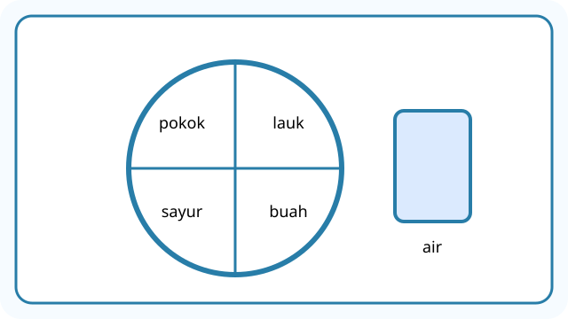
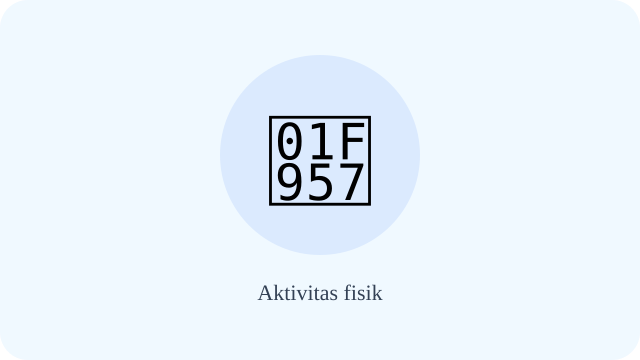
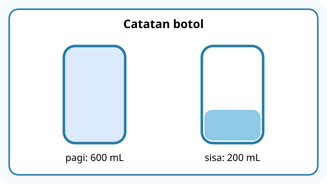
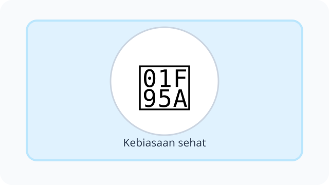
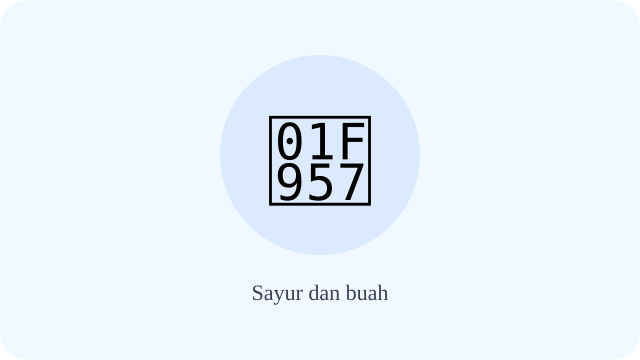
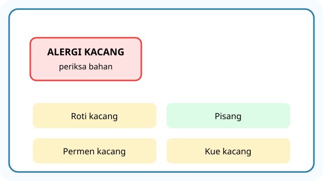

# Unit 8 — Aktivitas Fisik dan Memilih Makanan Bergizi

10 soal bergambar memakai jadwal, perbandingan, diagram, data, label, urutan, dan informasi alergi yang diperlukan untuk menjawab.

## Soal 36 — K03-PJK-B08-M01-036

**Pertanyaan:** Jadwal sore menunjukkan: istirahat 30 menit, tugas 45 menit, bermain aktif 30 menit, layar 120 menit tanpa jeda. Bagian yang paling perlu diperbaiki adalah ....

**Pilihan jawaban:**
- waktu layar panjang tanpa jeda
- waktu bermain aktif
- waktu mengerjakan tugas
- waktu istirahat singkat setelah sekolah

**Kunci Jawaban:** waktu layar panjang tanpa jeda

**Pembahasan:** Jadwal perlu memberi jeda dari posisi dan pandangan yang sama.

---
## Soal 37 — K03-PJK-B08-M01-037

**Pertanyaan:** Gambar A menunjukkan berjalan ke taman bersama pendamping; gambar B menunjukkan duduk menonton. Aktivitas yang memakai lebih banyak gerak tubuh adalah ....

**Pilihan jawaban:**
- gambar A
- gambar B
- keduanya tidak memakai energi
- keduanya adalah tidur

**Kunci Jawaban:** gambar A

**Pembahasan:** Berjalan melibatkan gerak tubuh lebih banyak daripada duduk menonton.

---
## Soal 38 — K03-PJK-B08-M01-038

**Pertanyaan:** Empat kartu waktu luang menampilkan bermain di halaman aman, membaca, berlari di jalan raya, dan merusak tanaman. Kegiatan yang aman dan aktif adalah ....

**Pilihan jawaban:**
- bermain di halaman aman
- membaca sambil duduk
- berlari di jalan raya
- merusak tanaman

**Kunci Jawaban:** bermain di halaman aman

**Pembahasan:** Bermain di area aman mengisi waktu luang secara aktif tanpa membahayakan pengguna jalan.

---
## Soal 39 — K03-PJK-B08-M01-039

**Pertanyaan:** Diagram empat pilar menampilkan makanan beragam, hidup bersih, pemantauan pertumbuhan, dan satu kotak kosong. Isi kotak kosong adalah ....

**Pilihan jawaban:**
- aktivitas fisik
- minuman manis
- diet ketat
- lomba berat badan

**Kunci Jawaban:** aktivitas fisik

**Pembahasan:** Aktivitas fisik merupakan salah satu dari empat pilar gizi seimbang.

---
## Soal 40 — K03-PJK-B08-M01-040

**Pertanyaan:** Piring contoh berisi makanan pokok, lauk, sayur, buah, dan air. Alasan piring itu lebih beragam adalah ....

**Pilihan jawaban:**
- memuat beberapa kelompok pangan
- semua bagiannya harus sama besar
- hanya mengandung karbohidrat
- buah menggantikan lauk

**Kunci Jawaban:** memuat beberapa kelompok pangan

**Pembahasan:** Keragaman kelompok pangan membantu memenuhi fungsi zat gizi berbeda.

---
## Soal 41 — K03-PJK-B08-M01-041

**Pertanyaan:** Diagram memasangkan nasi dengan energi, tempe dengan pertumbuhan, dan sayur dengan vitamin/mineral/serat. Pasangan yang tepat untuk tempe adalah ....

**Pilihan jawaban:**
- pertumbuhan dan perbaikan jaringan
- satu-satunya sumber cairan
- pengganti semua sayur
- bahan tanpa protein

**Kunci Jawaban:** pertumbuhan dan perbaikan jaringan

**Pembahasan:** Tempe merupakan salah satu sumber protein.

---
## Soal 42 — K03-PJK-B08-M01-042

**Pertanyaan:** Catatan minum menunjukkan botol 600 mL terisi penuh pagi hari dan tersisa 200 mL setelah bermain. Tidak ada air yang tumpah atau ditambahkan. Air yang diminum adalah ....

**Pilihan jawaban:**
- 400 mL
- 200 mL
- 600 mL
- 800 mL

**Kunci Jawaban:** 400 mL

**Pembahasan:** Enam ratus dikurangi dua ratus sama dengan empat ratus mililiter.

---
## Soal 43 — K03-PJK-B08-M01-043

**Pertanyaan:** Kemasan A utuh dan belum melewati tanggal; kemasan B menggembung dan tanggalnya telah lewat. Pilihan yang lebih aman adalah ....

**Pilihan jawaban:**
- kemasan A
- kemasan B
- keduanya harus dicicipi dulu
- pilih berdasarkan warna saja

**Kunci Jawaban:** kemasan A

**Pembahasan:** Kemasan utuh dan tanggal yang masih berlaku merupakan tanda pilihan yang lebih aman pada contoh ini, tetapi bukan jaminan makanan bebas bahaya.

---
## Soal 44 — K03-PJK-B08-M01-044

**Pertanyaan:** Urutan gambar: basahi tangan, pakai sabun, gosok semua bagian, bilas, lalu keringkan. Setelah memakai sabun, langkah berikutnya adalah ....

**Pilihan jawaban:**
- menggosok seluruh bagian tangan
- langsung memegang makanan
- mengeringkan tanpa membilas
- menyentuh tempat sampah

**Kunci Jawaban:** menggosok seluruh bagian tangan

**Pembahasan:** Sabun perlu digosokkan ke telapak, punggung, sela jari, dan bagian lain sebelum dibilas.

---
## Soal 45 — K03-PJK-B08-M01-045

**Pertanyaan:** Kartu siswa bertuliskan “alergi kacang”. Dari pilihan roti kacang, pisang, permen kacang, dan kue dengan kacang, pilihan yang tidak memuat kacang pada contoh adalah ....

**Pilihan jawaban:**
- pisang
- roti kacang
- permen kacang
- kue dengan kacang

**Kunci Jawaban:** pisang

**Pembahasan:** Pada stimulus, pisang adalah satu-satunya pilihan tanpa kacang; informasi bahan nyata tetap perlu diperiksa.

---
