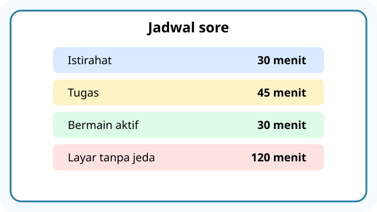
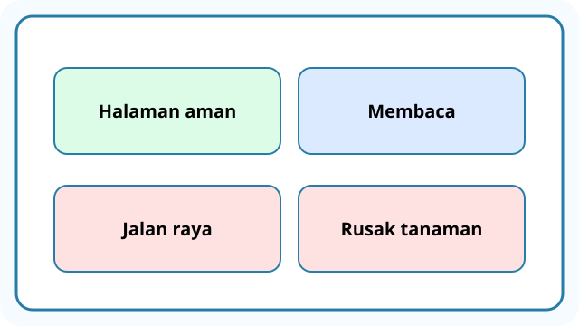
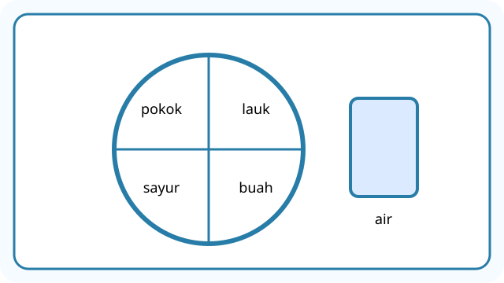
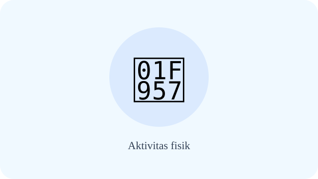
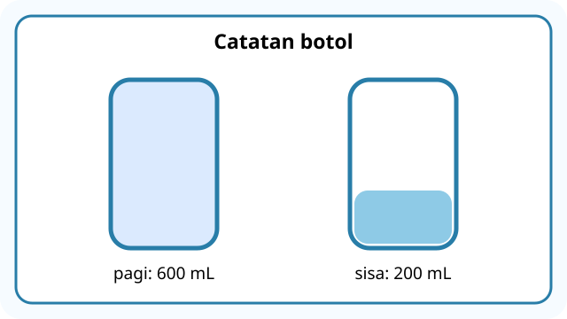
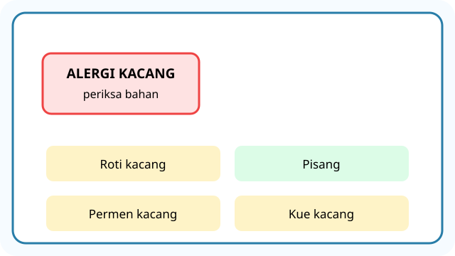

# Unit 8 — Aktivitas Fisik dan Memilih Makanan Bergizi

10 soal bergambar, **DRAF**. Ilustrasi SVG bersifat simbolik, belum ilustrasi gerak yang spesifik.

## Soal 36 — K03-PJK-B08-M01-036

**Pertanyaan:** Perhatikan kegiatan atau konsep "Air putih". Jawaban yang paling sesuai adalah ....

**Pilihan jawaban:**
- tidak diperlukan
- selalu diganti sirup
- penting untuk membantu kebutuhan cairan
- harus dihindari setelah bermain

**Kunci Jawaban:** penting untuk membantu kebutuhan cairan

**Pembahasan:** Air putih: penting untuk membantu kebutuhan cairan.

---

## Soal 37 — K03-PJK-B08-M01-037

**Pertanyaan:** Perhatikan kegiatan atau konsep "Sarapan bergizi". Jawaban yang paling sesuai adalah ....

**Pilihan jawaban:**
- harus dilewatkan
- membantu menyediakan energi untuk belajar dan bergerak
- membuat tidak perlu makan lagi
- hanya berupa permen

**Kunci Jawaban:** membantu menyediakan energi untuk belajar dan bergerak

**Pembahasan:** Sarapan bergizi: membantu menyediakan energi untuk belajar dan bergerak.

---

## Soal 38 — K03-PJK-B08-M01-038

**Pertanyaan:** Perhatikan kegiatan atau konsep "Cuci tangan sebelum makan". Jawaban yang paling sesuai adalah ....

**Pilihan jawaban:**
- membantu mengurangi perpindahan kuman
- membuat makanan lebih mahal
- mengganti olahraga
- tidak penting

**Kunci Jawaban:** membantu mengurangi perpindahan kuman

**Pembahasan:** Cuci tangan sebelum makan: membantu mengurangi perpindahan kuman.

---

## Soal 39 — K03-PJK-B08-M01-039

**Pertanyaan:** Perhatikan kegiatan atau konsep "Tidur cukup". Jawaban yang paling sesuai adalah ....

**Pilihan jawaban:**
- menggantikan makan
- berarti tidak perlu bergerak
- selalu membuang waktu
- mendukung pertumbuhan dan pemulihan

**Kunci Jawaban:** mendukung pertumbuhan dan pemulihan

**Pembahasan:** Tidur cukup: mendukung pertumbuhan dan pemulihan.

---

## Soal 40 — K03-PJK-B08-M01-040

**Pertanyaan:** Perhatikan kegiatan atau konsep "Pilihan jajanan". Jawaban yang paling sesuai adalah ....

**Pilihan jawaban:**
- pilih yang kedaluwarsa
- pilih tanpa memperhatikan kebersihan
- utamakan yang bersih, aman, dan bergizi
- pilih yang terbuka dekat sampah

**Kunci Jawaban:** utamakan yang bersih, aman, dan bergizi

**Pembahasan:** Pilihan jajanan: utamakan yang bersih, aman, dan bergizi.

---

## Soal 41 — K03-PJK-B08-M01-041

**Pertanyaan:** Perhatikan ilustrasi berikut. Apa penjelasan yang tepat tentang aktivitas fisik?

**Pilihan jawaban:**
- hanya duduk
- gerakan tubuh yang menggunakan energi
- hanya tidur
- hanya menonton

**Kunci Jawaban:** gerakan tubuh yang menggunakan energi

**Pembahasan:** Aktivitas fisik: gerakan tubuh yang menggunakan energi.

---

## Soal 42 — K03-PJK-B08-M01-042

**Pertanyaan:** Perhatikan ilustrasi berikut. Apa penjelasan yang tepat tentang makanan bergizi seimbang?

**Pilihan jawaban:**
- beragam sesuai kebutuhan tubuh
- hanya makanan manis
- hanya gorengan
- hanya satu jenis makanan

**Kunci Jawaban:** beragam sesuai kebutuhan tubuh

**Pembahasan:** Makanan bergizi seimbang: beragam sesuai kebutuhan tubuh.

---

## Soal 43 — K03-PJK-B08-M01-043

**Pertanyaan:** Perhatikan ilustrasi berikut. Apa penjelasan yang tepat tentang sumber protein?

**Pilihan jawaban:**
- permen
- minuman bersoda
- kerupuk saja
- telur, ikan, atau tempe

**Kunci Jawaban:** telur, ikan, atau tempe

**Pembahasan:** Sumber protein: telur, ikan, atau tempe.

---

## Soal 44 — K03-PJK-B08-M01-044

**Pertanyaan:** Perhatikan ilustrasi berikut. Apa penjelasan yang tepat tentang sayur dan buah?

**Pilihan jawaban:**
- selalu harus digoreng
- tidak berguna
- menyumbang vitamin, mineral, dan serat
- menggantikan semua makanan

**Kunci Jawaban:** menyumbang vitamin, mineral, dan serat

**Pembahasan:** Sayur dan buah: menyumbang vitamin, mineral, dan serat.

---

## Soal 45 — K03-PJK-B08-M01-045

**Pertanyaan:** Perhatikan ilustrasi berikut. Apa penjelasan yang tepat tentang karbohidrat?

**Pilihan jawaban:**
- menggantikan air minum
- menjadi salah satu sumber energi tubuh
- selalu berbahaya
- tidak boleh dimakan

**Kunci Jawaban:** menjadi salah satu sumber energi tubuh

**Pembahasan:** Karbohidrat: menjadi salah satu sumber energi tubuh.

---
