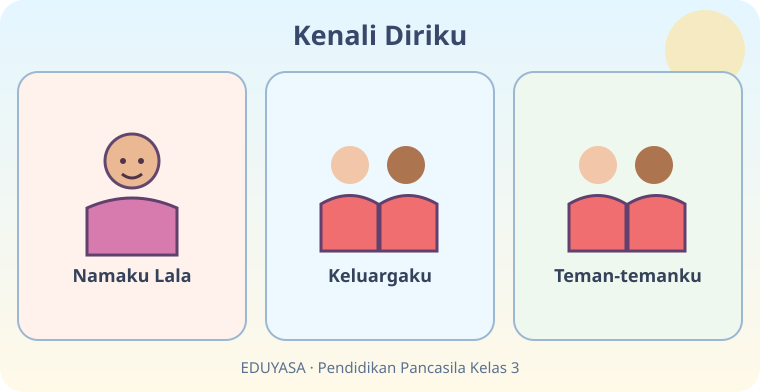
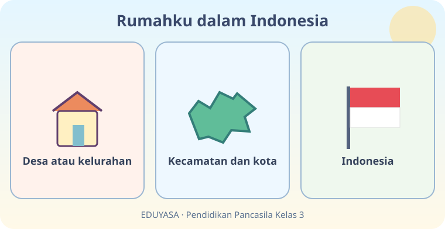

# Aku Anak Indonesia — Dua Modul EDUYASA

**Kelas:** 3 SD  
**Mata pelajaran:** Pendidikan Pancasila  
**Bab:** B01 / ID: K03-PKN-B01  
**Acuan:** Buku Siswa *Pendidikan Pancasila untuk SD/MI Kelas III*, edisi 1 (2023), Bab 1 subbab A–B.  
**Tujuan pembelajaran:**
- Mengenalkan identitas diri, keluarga, serta teman dengan sikap menghargai.
- Mengenali lingkungan alamat dan hubungan wilayah hingga NKRI.
- Menunjukkan kebanggaan sebagai anak Indonesia serta menjaga kerukunan.

**Keterangan:** Modul 01 dan 02 memiliki isi pokok setara tetapi alur belajar berbeda; tampilkan salah satu secara acak. Tautan gambar mengarah ke aset asli di folder ini. Pertahankan letaknya saat konversi.

---

## K03-PKN-B01-MOD-01

# Aku Anak Indonesia — Yuk, Kenalan!

Halo, Sahabat! Kamu pernah mengenalkan diri kepada teman baru? **Setiap anak punya identitas yang istimewa.** Identitas bisa berupa nama, tempat tinggal, kegemaran, dan cerita keluarga. Namun, hal pribadi seperti kata sandi tidak untuk dibagikan.

## Aku, keluargaku, dan teman-temanku

Namaku boleh berbeda dari nama temanmu. Keluargaku pun bisa berbeda susunannya dengan keluarga teman. Ada yang tinggal bersama kedua orang tua, ada yang tinggal bersama satu orang tua, kakek, nenek, atau wali. **Semua keluarga tetap perlu dihormati.**

Coba bayangkan: Lala suka melukis, sedangkan Bimo suka membaca. Apakah mereka harus punya hobi sama supaya berteman? Tentu tidak! Mereka justru dapat membuat buku cerita bersama: Lala menggambar, Bimo menulis. Itulah kerja sama.

**Ayo berpikir:** Sebutkan dua hal yang membuatmu unik tanpa membandingkan dirimu dengan orang lain.

## Alamat rumahku bagian dari Indonesia

Rumahmu berada dalam lingkungan tempat tinggal. Alamat sering memuat nama jalan atau dusun, **RT/RW**, desa atau kelurahan, kecamatan, kabupaten atau kota, dan provinsi. Wilayah tersebut merupakan bagian dari **Negara Kesatuan Republik Indonesia (NKRI)**. Susunan alamat dapat berbeda menurut daerah.

Bayangkan gambar lingkaran besar dan kecil. Desa berada dalam kecamatan; kecamatan berada dalam kabupaten atau kota; kabupaten atau kota berada dalam provinsi; provinsi berada di Indonesia. Dengan mengenali alamat, kita lebih memahami lingkungan. Untuk keselamatan, alamat lengkap tidak perlu diberikan kepada orang asing di internet.

## Aku bangga menjadi anak Indonesia

Indonesia memiliki banyak pulau, bahasa daerah, dan budaya. Bendera kebangsaan kita berwarna **merah di atas, putih di bawah**. Bahasa Indonesia membantu kita saling memahami meskipun berasal dari daerah berbeda. Bangga menjadi anak Indonesia bukan berarti mengejek negara atau daerah lain.

**Tantangan kecil:** Gambarlah rumah dan dua tempat di sekitarnya. Beri keterangan dengan bantuan keluarga. Setelah itu, ceritakan satu cara menjaga kerukunan dengan tetangga.

**Ingat!** Aku punya identitas, teman-temanku juga. Kita boleh berbeda, tetapi tetap saling menghormati sebagai sesama anak Indonesia.

---

## K03-PKN-B01-MOD-02

# Aku Anak Indonesia — Petualangan Si Penjelajah Mini

Ayo, kita bermain menjadi **penjelajah mini**! Kamu membawa tiga kartu petualangan: kartu DIRI, kartu RUMAH, dan kartu INDONESIA. Siap? Mari mulai!

## Kartu 1: Aku istimewa

Coba katakan dalam hati: “Namaku ..., aku senang ..., dan aku ingin belajar ...”. Itulah sebagian identitasmu. Nama dan kegemaran tidak menentukan siapa yang lebih hebat. Kita semua boleh berkembang dengan cara berbeda.

Pada suatu hari, Nara mengenalkan Kakek Tono kepada teman-temannya. Raka tinggal bersama ibu dan adiknya. Keduanya tetap punya keluarga yang patut disayangi. **Tidak ada alasan mengejek susunan keluarga orang lain.**

**Tebak sikap:** Jika temanmu kesulitan menyebut namamu, apakah kamu akan marah atau mengajarkannya dengan ramah? Mengajarkan dengan ramah lebih membantu!

## Kartu 2: Temukan tempat tinggalku

Mulailah dari rumah. Lihat jalan, RT atau RW, desa atau kelurahan, lalu kecamatan. Daerahmu berada di kabupaten atau kota, kemudian provinsi. Semuanya bagian dari **NKRI**. Coba minta orang tua atau wali menunjukkan alamat tempat tinggalmu. Jangan membagikan alamat rinci kepada orang yang tidak dikenal.

Bayangkan temanmu bertanya, “Kamu dari mana?” Kamu dapat menjawab nama kota atau kabupaten tanpa menyebut alamat lengkap. Ketika melihat denah, perhatikan letak kiri, kanan, depan, dan belakang; denah membantu kita mencari tempat.

## Kartu 3: Bersama dalam Indonesia

Bendera kita adalah **Merah Putih**. Teman dari Jawa, Sumatra, Kalimantan, Sulawesi, Bali, Papua, dan berbagai wilayah lain bisa berbicara bersama menggunakan Bahasa Indonesia. Bahasa daerah mereka tetap berharga.

**Misi penjelajah:** (1) Perkenalkan hobimu dengan satu kalimat. (2) Sebutkan nama kabupaten/kota tempat tinggalmu. (3) Ceritakan cara menyambut teman baru.

**Bintang petualangan:** Kamu berhasil jika dapat mengenali diri, menghargai keluarga dan teman, serta menyadari bahwa tempat tinggalmu termasuk Indonesia.
