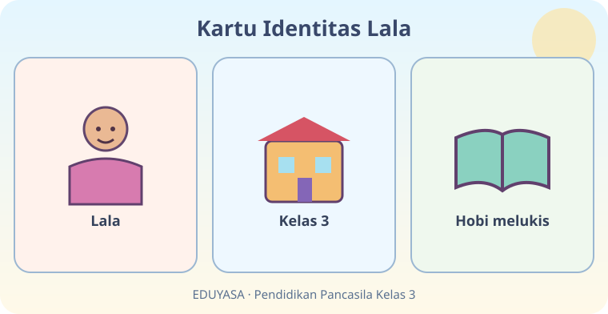
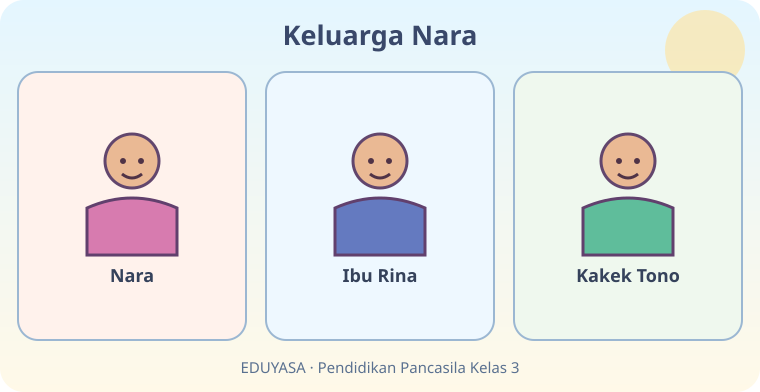
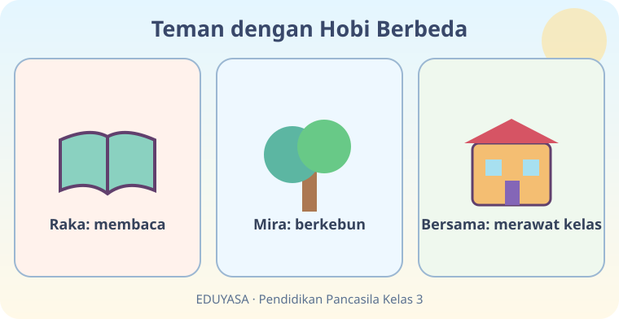
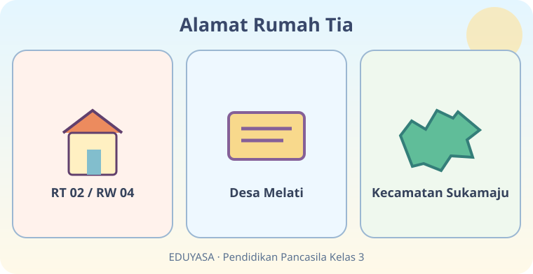
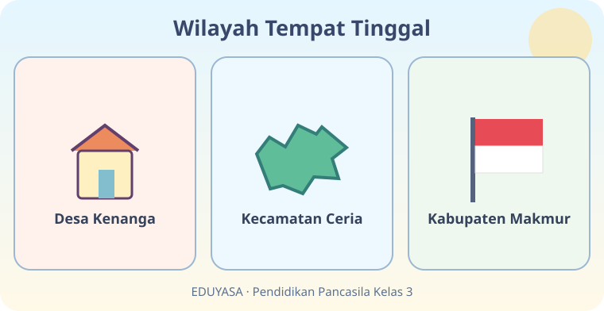
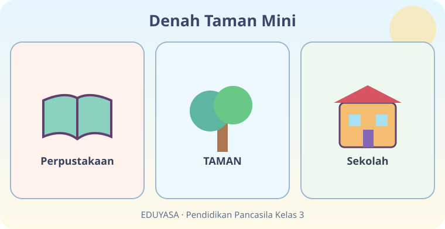
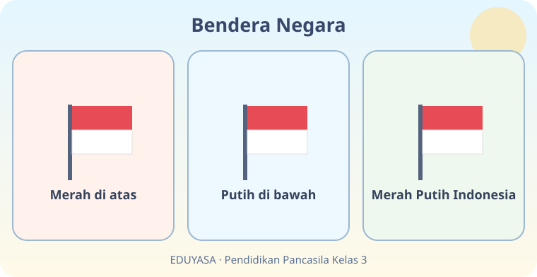
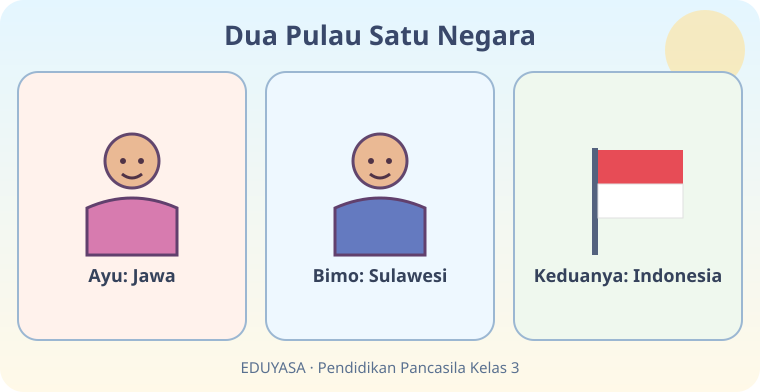
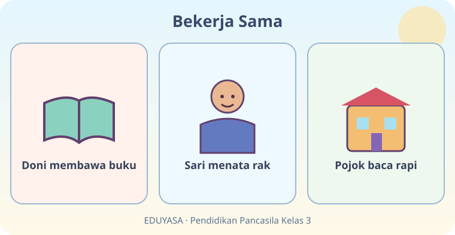
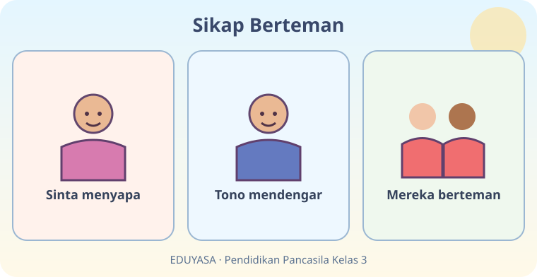

# Aku Anak Indonesia — 20 Soal Bergambar

Kelas 3 SD | Pendidikan Pancasila | B01 | Buku Siswa pemerintah, 2023

Bank gambar terpisah; setiap gambar menjadi stimulus dua soal. Gambar merupakan media yang wajib dipertahankan saat konversi.

## Soal 51 — K03-PKN-B01-M01-051

**Pertanyaan:** Menurut kartu bergambar, apa hobi Lala?

**Pilihan jawaban:**
- Melukis
- Menari
- Memasak
- Bersepeda

**Kunci jawaban:** Melukis

**Pembahasan:** Kartu ketiga menyebut hobi melukis.

---

## Soal 52 — K03-PKN-B01-M01-052

**Pertanyaan:** Lala belajar di kelas berapa?

**Pilihan jawaban:**
- Kelas 6
- Kelas 3
- Kelas 1
- Kelas 5

**Kunci jawaban:** Kelas 3

**Pembahasan:** Kartu identitas Lala menunjukkan kelas 3.

---

## Soal 53 — K03-PKN-B01-M01-053

**Pertanyaan:** Siapa nama kakek Nara pada gambar?

**Pilihan jawaban:**
- Lala
- Bimo
- Tono
- Rina

**Kunci jawaban:** Tono

**Pembahasan:** Gambar keluarga mencantumkan Kakek Tono.

---

## Soal 54 — K03-PKN-B01-M01-054

**Pertanyaan:** Siapa yang menjadi ibu Nara?

**Pilihan jawaban:**
- Tono
- Mira
- Sinta
- Rina

**Kunci jawaban:** Rina

**Pembahasan:** Ibu Nara pada gambar bernama Rina.

---

## Soal 55 — K03-PKN-B01-M01-055

**Pertanyaan:** Siapa yang suka berkebun?

**Pilihan jawaban:**
- Raka
- Lala
- Nara
- Mira

**Kunci jawaban:** Mira

**Pembahasan:** Panel tengah menjelaskan hobi Mira adalah berkebun.

---

## Soal 56 — K03-PKN-B01-M01-056

**Pertanyaan:** Apa kegiatan yang dilakukan bersama Raka dan Mira?

**Pilihan jawaban:**
- Merawat kelas
- Menonton film
- Memasak di kantin
- Membeli seragam

**Kunci jawaban:** Merawat kelas

**Pembahasan:** Panel ketiga menunjukkan mereka merawat kelas.

---

## Soal 57 — K03-PKN-B01-M01-057

**Pertanyaan:** Apa nomor RT pada kartu alamat Tia?

**Pilihan jawaban:**
- 12
- 02
- 04
- 10

**Kunci jawaban:** 02

**Pembahasan:** Kartu kiri bertuliskan RT 02.

---

## Soal 58 — K03-PKN-B01-M01-058

**Pertanyaan:** Kartu alamat Tia menyebut desa bernama ...

**Pilihan jawaban:**
- Makmur
- Kenanga
- Melati
- Sukamaju

**Kunci jawaban:** Melati

**Pembahasan:** Nama desa pada gambar adalah Desa Melati.

---

## Soal 59 — K03-PKN-B01-M01-059

**Pertanyaan:** Desa Kenanga berada di dalam kecamatan bernama ...

**Pilihan jawaban:**
- Kenanga Baru
- Indah
- Ceria
- Makmur

**Kunci jawaban:** Ceria

**Pembahasan:** Diagram wilayah menunjukkan Kecamatan Ceria.

---

## Soal 60 — K03-PKN-B01-M01-060

**Pertanyaan:** Wilayah paling luas di antara tiga panel adalah ...

**Pilihan jawaban:**
- Desa Kenanga
- Kecamatan Ceria
- Rumah warga
- Kabupaten Makmur

**Kunci jawaban:** Kabupaten Makmur

**Pembahasan:** Kabupaten meliputi kecamatan dan desa pada diagram.

---

## Soal 61 — K03-PKN-B01-M01-061

**Pertanyaan:** Tempat apa berada di tengah denah?

**Pilihan jawaban:**
- Taman
- Sekolah
- Perpustakaan
- Rumah

**Kunci jawaban:** Taman

**Pembahasan:** Denah menempatkan taman di tengah.

---

## Soal 62 — K03-PKN-B01-M01-062

**Pertanyaan:** Bangunan di sebelah kanan taman adalah ...

**Pilihan jawaban:**
- Pasar
- Sekolah
- Perpustakaan
- Rumah

**Kunci jawaban:** Sekolah

**Pembahasan:** Panel kanan denah menunjukkan sekolah.

---

## Soal 63 — K03-PKN-B01-M01-063

**Pertanyaan:** Warna bagian atas bendera yang tampak adalah ...

**Pilihan jawaban:**
- Hijau
- Merah
- Putih
- Biru

**Kunci jawaban:** Merah

**Pembahasan:** Bagian atas bendera Indonesia berwarna merah.

---

## Soal 64 — K03-PKN-B01-M01-064

**Pertanyaan:** Gabungan warna bendera tersebut dikenal sebagai ...

**Pilihan jawaban:**
- Putih Biru
- Hijau Merah
- Merah Putih
- Merah Kuning

**Kunci jawaban:** Merah Putih

**Pembahasan:** Bendera Indonesia disebut Sang Merah Putih.

---

## Soal 65 — K03-PKN-B01-M01-065

**Pertanyaan:** Bimo berasal dari pulau ...

**Pilihan jawaban:**
- Jawa
- Bali
- Sumatra
- Sulawesi

**Kunci jawaban:** Sulawesi

**Pembahasan:** Panel Bimo menyebut Sulawesi.

---

## Soal 66 — K03-PKN-B01-M01-066

**Pertanyaan:** Walau berasal dari dua pulau berbeda, Ayu dan Bimo tetap ...

**Pilihan jawaban:**
- anak Indonesia
- wajib sama hobinya
- tidak boleh berteman
- berasal dari satu desa

**Kunci jawaban:** anak Indonesia

**Pembahasan:** Panel ketiga menunjukkan keduanya Indonesia.

---

## Soal 67 — K03-PKN-B01-M01-067

**Pertanyaan:** Siapa yang menata rak buku?

**Pilihan jawaban:**
- Sari
- Doni
- Tia
- Ayu

**Kunci jawaban:** Sari

**Pembahasan:** Panel kedua menyebut Sari menata rak.

---

## Soal 68 — K03-PKN-B01-M01-068

**Pertanyaan:** Apa hasil kerja sama Doni dan Sari?

**Pilihan jawaban:**
- Taman rusak
- Pojok baca menjadi rapi
- Buku hilang
- Kelas ditutup

**Kunci jawaban:** Pojok baca menjadi rapi

**Pembahasan:** Panel terakhir menunjukkan pojok baca rapi.

---

## Soal 69 — K03-PKN-B01-M01-069

**Pertanyaan:** Apa yang dilakukan Sinta pada panel pertama?

**Pilihan jawaban:**
- Menangis
- Berlari menjauh
- Menyapa
- Mengejek

**Kunci jawaban:** Menyapa

**Pembahasan:** Panel pertama menampilkan Sinta menyapa.

---

## Soal 70 — K03-PKN-B01-M01-070

**Pertanyaan:** Sikap Tono yang membantu persahabatan adalah ...

**Pilihan jawaban:**
- Mengabaikan
- Mengejek
- Memalingkan wajah
- Mendengarkan

**Kunci jawaban:** Mendengarkan

**Pembahasan:** Panel kedua menampilkan Tono yang mendengar.
