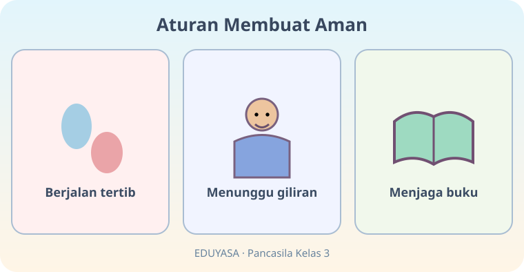
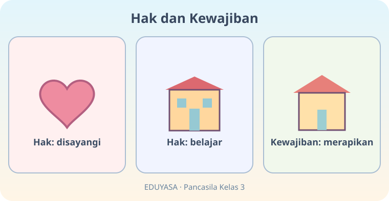

# Aku Patuh Aturan — Dua Modul

**Kelas:** 3 SD | **ID Bab:** K03-PKN-B02 | **Mata pelajaran:** Pendidikan Pancasila

**Sumber:** Buku Siswa Pendidikan Pancasila SD/MI Kelas III (2023), Bab 2 subbab A–D. Teks dan ilustrasi ini asli EDUYASA.

**Tujuan:**
- Memahami alasan dan contoh aturan sekolah beserta akibat pelanggaran.
- Menjelaskan cara membuat serta menjalankan kesepakatan kelas melalui diskusi.
- Membedakan hak dan kewajiban anak di rumah dan sekolah serta menerapkannya.

**Catatan konversi:** Tampilkan hanya salah satu versi MOD-01 atau MOD-02 secara acak. Pertahankan posisi, URL, dan deskripsi gambar; kedua modul mencakup tujuan yang sama.

---

## K03-PKN-B02-MOD-01

# Aku Patuh Aturan — Sekolahku Nyaman!

Hai, Sahabat! Bayangkan semua siswa berbicara sekaligus, berlarian di koridor, dan membuang sampah sesuka hati. Wah, pasti sulit belajar, ya? **Aturan membantu kita aman, tertib, dan saling menghormati.**

## Ayo kenali aturan sekolah

Contoh aturan: datang mengikuti jadwal, berjalan aman di koridor, antre, menjaga fasilitas, dan mendengarkan saat orang lain berbicara. Aturan bukan untuk menakuti anak; aturan membantu semua orang mendapatkan lingkungan belajar yang baik.

**Coba pikir:** Mengapa kita tidak boleh mendorong teman di tangga? Karena teman bisa jatuh dan terluka. Itulah alasan di balik aturan keselamatan.

## Kesepakatan: aturan yang kita bicarakan bersama

Teman-teman bisa bermusyawarah membuat kesepakatan kelas, misalnya bergiliran bicara atau mengembalikan alat gambar setelah dipakai. Langkahnya: **beri usul, dengarkan pendapat, sepakati bersama, lalu jalankan.** Jika suatu kesepakatan perlu ditinjau, ajak guru dan teman berdiskusi.

## Bedakan hak dan kewajiban

**Hak** adalah hal yang layak kita terima, seperti kasih sayang, perlindungan, istirahat, dan kesempatan belajar. **Kewajiban** adalah hal yang perlu kita lakukan dengan tanggung jawab, misalnya merapikan mainan, menjaga kebersihan, dan mengerjakan bagian piket yang disepakati. Hak dasar anak tetap berlaku meskipun ia belum sempurna menjalankan tugas.

Di rumah, kamu berhak disayangi sekaligus bisa membantu pekerjaan **yang aman dan sesuai usia**. Di sekolah, kamu berhak belajar tanpa gangguan; kamu juga perlu menghargai teman yang belajar.

## Uji dirimu!

Lala menemukan buku yang bukan miliknya. Apa sebaiknya ia lakukan? Serahkan kepada guru agar kembali ke pemilik! Sekarang buat satu contoh hak dan satu contoh kewajibanmu di sekolah.

**Pesan penting:** Patuh aturan bukan sekadar takut dihukum. Kita melakukannya karena peduli kepada diri sendiri dan orang lain.

---

## K03-PKN-B02-MOD-02

# Aku Patuh Aturan — Misi Penjaga Ketertiban

Selamat datang, **Detektif Kebaikan!** Hari ini kita punya tiga misi: menjaga kelas, membuat kesepakatan, dan membedakan hak serta kewajiban. Kamu siap?

## Misi 1: Periksa kelas!

Sebelum pelajaran, lihat kondisi kelas. Ada sampah? Buang ke tempatnya. Ada teman berbicara? Dengarkan sampai selesai. Ada antrean? Tunggu giliran. Perilaku kecil itu membuat sekolah nyaman untuk semuanya.

**Pertanyaan detektif:** Kalau kamu berlari di tangga lalu menabrak teman, apakah aturan berjalan pelan itu berguna? Ya, aturan melindungi kita. Kamu boleh bertanya kepada guru jika suatu aturan belum jelas.

## Misi 2: Rapat kelas yang adil

Bayangkan kelompokmu membuat peraturan meminjam pensil warna. Dito ingin satu anak memegang semua pensil, sedangkan Ayu ingin memakai bergantian. Dengarkan keduanya. Sepakati aturan yang adil, misalnya setiap anak meminjam secukupnya lalu mengembalikan. **Kesepakatan harus dilaksanakan, bukan hanya ditulis di poster.**

## Misi 3: Pilah dua kotak

Kotak **HAK** berisi sesuatu yang layak diterima: belajar, perlindungan, kasih sayang, dan waktu beristirahat. Kotak **KEWAJIBAN** berisi tindakan bertanggung jawab: menjaga buku, piket, menghormati giliran, dan merapikan barang.

Coba kamu pilah: “Mendapat penjelasan guru” termasuk hak. “Tidak mengganggu teman yang sedang belajar” termasuk kewajiban. Keduanya saling mendukung. Namun, hak atas keselamatan dan perlindungan **tidak boleh dicabut** sebagai hukuman.

## Tantangan untukmu

Tuliskan satu kesepakatan kelas yang membuat semua orang nyaman. Jelaskan alasannya. Lalu ceritakan satu tugas kecil di rumah yang kamu kerjakan dengan aman.

**Bintang detektif:** Kamu hebat jika mampu menaati aturan, mendengar teman, dan menjaga hak bersama!
