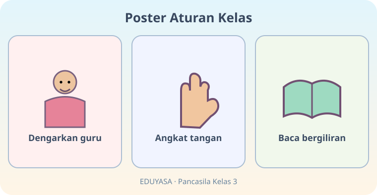
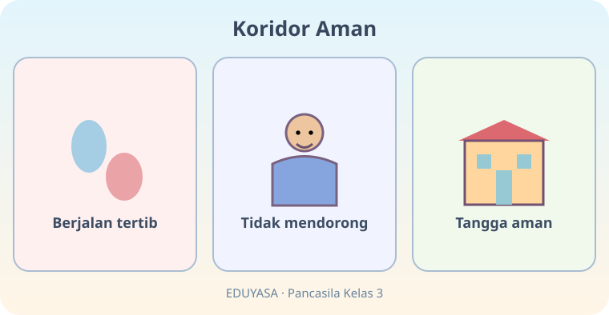
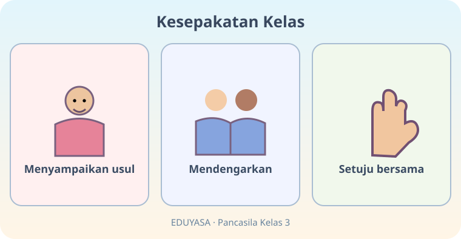
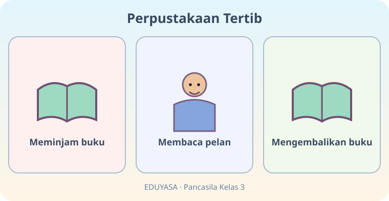
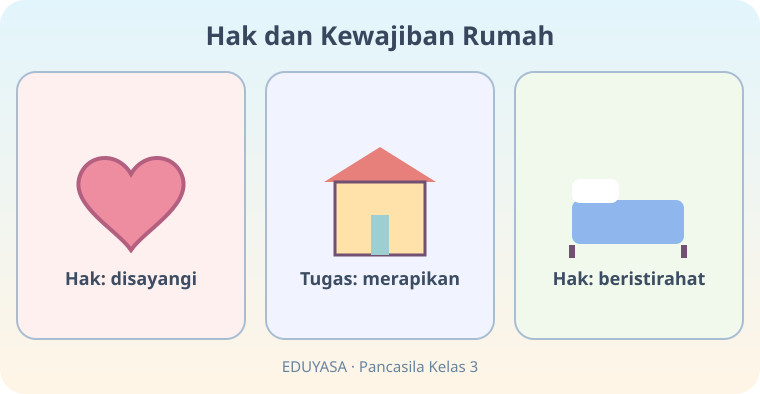
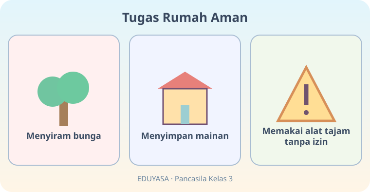
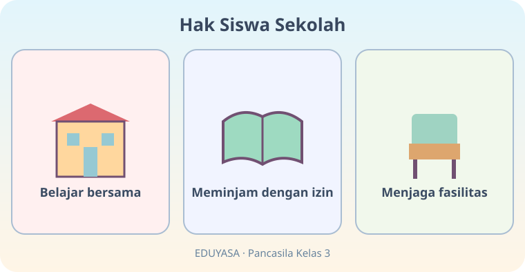
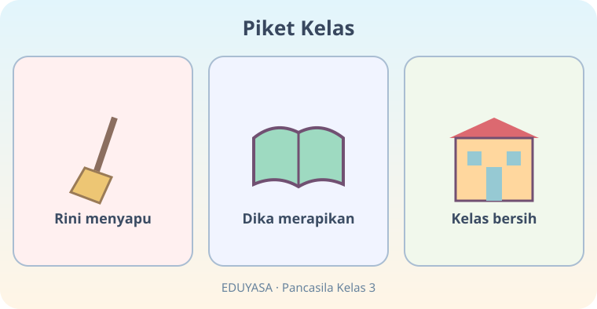
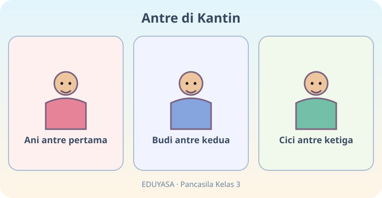
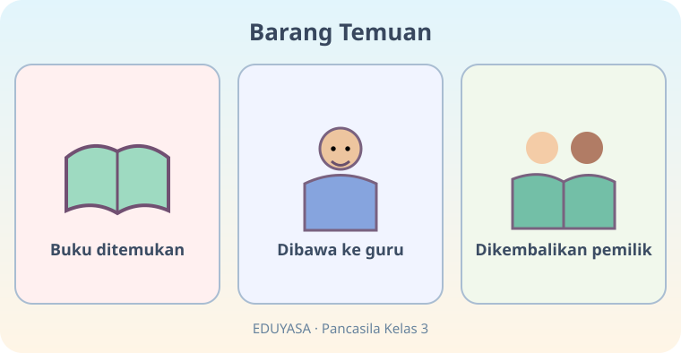

# Aku Patuh Aturan — 20 Soal Bergambar

Kelas 3 | K03-PKN-B02 | Pendidikan Pancasila | Kurikulum Merdeka

Bank soal bergambar terpisah; 10 gambar, masing-masing mendukung dua pertanyaan.

## Soal 51 — K03-PKN-B02-M01-051

**Pertanyaan:** Pada poster, apa yang perlu dilakukan sebelum berbicara?

**Pilihan jawaban:**
- Mengangkat tangan
- Menutup telinga
- Mengetuk meja keras
- Meninggalkan kelas

**Kunci jawaban:** Mengangkat tangan

**Pembahasan:** Poster memuat aturan angkat tangan.

---

## Soal 52 — K03-PKN-B02-M01-052

**Pertanyaan:** Apa aturan saat membaca di kelas pada gambar?

**Pilihan jawaban:**
- Meninggalkan buku
- Membaca bergiliran
- Bersuara bersama tanpa giliran
- Merebut buku

**Kunci jawaban:** Membaca bergiliran

**Pembahasan:** Poster menyebut baca bergiliran.

---

## Soal 53 — K03-PKN-B02-M01-053

**Pertanyaan:** Gambar koridor menganjurkan siswa untuk ...

**Pilihan jawaban:**
- melompat di tangga
- bermain di tengah tangga
- berjalan tertib
- berlari sambil mendorong

**Kunci jawaban:** berjalan tertib

**Pembahasan:** Panel pertama menunjukkan berjalan tertib.

---

## Soal 54 — K03-PKN-B02-M01-054

**Pertanyaan:** Perilaku yang dilarang pada koridor aman ialah ...

**Pilihan jawaban:**
- berjalan hati-hati
- menunggu giliran
- memegang pegangan tangga
- mendorong teman

**Kunci jawaban:** mendorong teman

**Pembahasan:** Panel kedua meminta tidak mendorong.

---

## Soal 55 — K03-PKN-B02-M01-055

**Pertanyaan:** Apa kegiatan pertama dalam membuat kesepakatan pada gambar?

**Pilihan jawaban:**
- Menyampaikan usul
- Mengejek teman
- Langsung pergi
- Merobek poster

**Kunci jawaban:** Menyampaikan usul

**Pembahasan:** Panel pertama menunjukkan penyampaian usul.

---

## Soal 56 — K03-PKN-B02-M01-056

**Pertanyaan:** Setelah mendengar berbagai usul, kelas ...

**Pilihan jawaban:**
- mencapai kesepakatan bersama
- melarang semua usul
- mengabaikan keputusan
- berkelahi

**Kunci jawaban:** mencapai kesepakatan bersama

**Pembahasan:** Panel ketiga menunjukkan persetujuan bersama.

---

## Soal 57 — K03-PKN-B02-M01-057

**Pertanyaan:** Apa yang dilakukan terakhir setelah membaca buku?

**Pilihan jawaban:**
- Membuang buku
- Mengembalikan buku
- Merobek halaman
- Menyembunyikannya

**Kunci jawaban:** Mengembalikan buku

**Pembahasan:** Panel terakhir adalah mengembalikan buku.

---

## Soal 58 — K03-PKN-B02-M01-058

**Pertanyaan:** Bagaimana cara membaca di perpustakaan pada gambar?

**Pilihan jawaban:**
- Sambil berlari
- Sambil menendang meja
- Dengan tenang
- Sambil berteriak

**Kunci jawaban:** Dengan tenang

**Pembahasan:** Panel tengah menampilkan membaca dengan pelan.

---

## Soal 59 — K03-PKN-B02-M01-059

**Pertanyaan:** Hak apa yang ditunjukkan panel pertama?

**Pilihan jawaban:**
- Merusak mainan
- Mengatur semua orang
- Memukul orang lain
- Mendapat kasih sayang

**Kunci jawaban:** Mendapat kasih sayang

**Pembahasan:** Panel pertama menyebut hak disayangi.

---

## Soal 60 — K03-PKN-B02-M01-060

**Pertanyaan:** Kegiatan yang merupakan kewajiban pada gambar ialah ...

**Pilihan jawaban:**
- merapikan barang
- melarang istirahat
- meminta hadiah
- mengambil mainan orang lain

**Kunci jawaban:** merapikan barang

**Pembahasan:** Panel tengah menunjukkan tugas merapikan.

---

## Soal 61 — K03-PKN-B02-M01-061

**Pertanyaan:** Tugas rumah yang sesuai kemampuan pada panel pertama adalah ...

**Pilihan jawaban:**
- menyiram bunga
- menggunakan pisau tanpa izin
- memanjat atap
- bermain listrik

**Kunci jawaban:** menyiram bunga

**Pembahasan:** Panel pertama menunjukkan menyiram bunga.

---

## Soal 62 — K03-PKN-B02-M01-062

**Pertanyaan:** Panel terakhir mengingatkan kita untuk tidak ...

**Pilihan jawaban:**
- menjaga kebersihan
- memakai alat tajam tanpa pendampingan
- merapikan mainan
- menyiram bunga

**Kunci jawaban:** memakai alat tajam tanpa pendampingan

**Pembahasan:** Panel ketiga memberi peringatan tentang alat tajam.

---

## Soal 63 — K03-PKN-B02-M01-063

**Pertanyaan:** Hak siswa yang digambarkan pada panel pertama ialah ...

**Pilihan jawaban:**
- merusak meja
- melarang pertanyaan
- belajar di sekolah
- mengusir teman

**Kunci jawaban:** belajar di sekolah

**Pembahasan:** Panel pertama memperlihatkan belajar bersama.

---

## Soal 64 — K03-PKN-B02-M01-064

**Pertanyaan:** Saat meminjam barang berdasarkan gambar, kita perlu ...

**Pilihan jawaban:**
- mengambil diam-diam
- menyembunyikannya
- merusaknya
- meminta izin

**Kunci jawaban:** meminta izin

**Pembahasan:** Panel kedua menyebut meminjam dengan izin.

---

## Soal 65 — K03-PKN-B02-M01-065

**Pertanyaan:** Siapa yang menyapu pada gambar piket?

**Pilihan jawaban:**
- Rini
- Dika
- Ani
- Cici

**Kunci jawaban:** Rini

**Pembahasan:** Panel pertama menyebut Rini menyapu.

---

## Soal 66 — K03-PKN-B02-M01-066

**Pertanyaan:** Apa hasil dari kerja sama piket?

**Pilihan jawaban:**
- Kelas menjadi bersih
- Kelas makin kotor
- Buku hilang
- Guru pergi

**Kunci jawaban:** Kelas menjadi bersih

**Pembahasan:** Panel terakhir menunjukkan kelas bersih.

---

## Soal 67 — K03-PKN-B02-M01-067

**Pertanyaan:** Siapa yang mendapat giliran kedua?

**Pilihan jawaban:**
- Dika
- Budi
- Ani
- Cici

**Kunci jawaban:** Budi

**Pembahasan:** Gambar menempatkan Budi pada posisi kedua.

---

## Soal 68 — K03-PKN-B02-M01-068

**Pertanyaan:** Siapa yang seharusnya dilayani pertama?

**Pilihan jawaban:**
- Cici
- Semua menyela
- Ani
- Budi

**Kunci jawaban:** Ani

**Pembahasan:** Ani berdiri paling awal dalam urutan antre.

---

## Soal 69 — K03-PKN-B02-M01-069

**Pertanyaan:** Kepada siapa buku temuan diserahkan?

**Pilihan jawaban:**
- Penjual
- Tetangga yang tak dikenal
- Disembunyikan sendiri
- Guru

**Kunci jawaban:** Guru

**Pembahasan:** Panel kedua menunjukkan buku dibawa ke guru.

---

## Soal 70 — K03-PKN-B02-M01-070

**Pertanyaan:** Apa akhir yang baik dari cerita buku temuan?

**Pilihan jawaban:**
- Buku kembali kepada pemiliknya
- Buku rusak
- Buku disembunyikan
- Buku dibuang

**Kunci jawaban:** Buku kembali kepada pemiliknya

**Pembahasan:** Panel terakhir menggambarkan buku kembali kepada pemilik.
