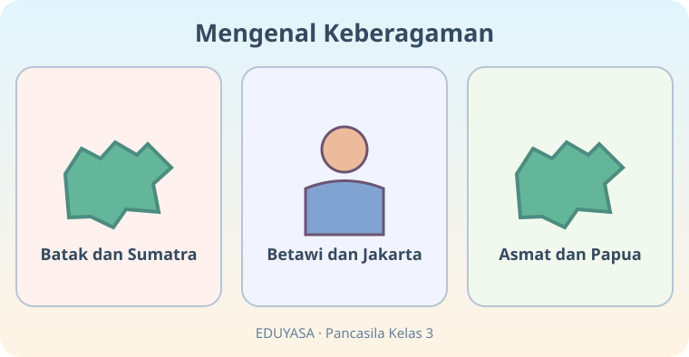
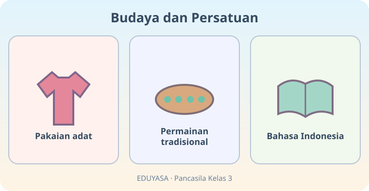

# Berbeda Itu Indah — Dua Modul

**Kelas:** 3 SD | **ID bab:** K03-PKN-B03

**Acuan:** Buku Siswa Pendidikan Pancasila untuk SD/MI Kelas III (2023), Bab 3 subbab A–C. Materi dan ilustrasi ini adaptasi asli EDUYASA.

**Tujuan pembelajaran:**
- Mengenali beberapa suku bangsa dan keberagaman budaya Indonesia tanpa stereotip.
- Menghargai karya budaya, tradisi, dan identitas teman melalui tindakan santun.
- Menjelaskan fungsi Bahasa Indonesia sebagai bahasa persatuan dan makna Bhinneka Tunggal Ika.

*Dua modul setara cakupan dan dipilih secara acak oleh aplikasi setelah dikonversi. Pertahankan gambar, URL, dan teks alternatifnya.*

---

## K03-PKN-B03-MOD-01

# Berbeda Itu Indah — Jelajah Nusantara!

Halo, Teman Hebat! Bayangkan kita naik kereta khayalan melintasi Nusantara. Di tiap pemberhentian, kita bertemu orang dengan bahasa, pakaian, makanan, dan cerita yang berbeda. **Perbedaan adalah kekayaan, bukan alasan untuk mengejek.**

## Kekayaan suku bangsaku

Indonesia dihuni banyak suku bangsa. Contohnya, Batak berkaitan dengan Sumatra Utara, Betawi dengan Jakarta, Baduy/Kanekes dengan Banten, Dayak dengan Kalimantan, serta Asmat dengan wilayah Papua. Ini hanya **contoh**, bukan daftar semua suku! Di satu daerah juga dapat hidup banyak suku berbeda.

Temanmu mungkin punya nama, kebiasaan keluarga, atau logat berbeda. Kamu boleh bertanya dengan santun: “Boleh ceritakan kebiasaan unik di daerahmu?” Jangan menirukan logat untuk mengejek.

## Budaya yang beraneka warna

**Budaya** dapat berupa pakaian adat, rumah tradisional, tarian, musik, makanan, kerajinan, bahasa daerah, dan permainan seperti congklak atau egrang. Kita belajar mengenalnya tanpa menganggap salah satu budaya paling hebat. Jika memamerkan benda budaya, mintalah izin sebelum menyentuhnya.

**Ayo berpikir:** Sinta membawa cerita tentang makanan daerahnya, tetapi kamu tidak suka makanan itu. Apakah kamu harus menghinanya? Tentu tidak. Selera berbeda boleh, saling menghormati tetap wajib.

## Bahasa Indonesia menyatukan kita

Bahasa Indonesia adalah **bahasa persatuan**. Ketika Nia dan Riko memiliki bahasa daerah berbeda, mereka bisa memakai Bahasa Indonesia untuk berbicara bersama. **Bahasa daerah tidak perlu ditinggalkan**; keduanya berharga.

Semboyan **Bhinneka Tunggal Ika** berarti *berbeda-beda tetapi tetap satu*. Kita dapat hidup rukun melalui kerja sama, sikap hormat, dan kesediaan mendengarkan.

**Misi jelajah:** Ceritakan satu budaya daerah yang ingin kamu pelajari dan alasanmu. Sebutkan juga satu cara bersahabat dengan teman dari daerah lain.

**Pesan utama:** Aku bangga pada budayaku, menghormati budaya teman, dan bersatu sebagai anak Indonesia.

---

## K03-PKN-B03-MOD-02

# Berbeda Itu Indah — Festival Sahabat Indonesia

Selamat datang di **Festival Sahabat Indonesia**! Kamu adalah pembawa acara. Di hadapanmu ada tiga panggung: panggung SUKU, panggung BUDAYA, dan panggung BAHASA. Mari kita jelajahi!

## Panggung 1: Berkenalan dengan suku bangsa

Suku bangsa adalah kelompok masyarakat dengan identitas dan tradisi budaya tertentu. Indonesia memiliki banyak sekali kelompok suku. Misalnya, ada suku Batak di Sumatra Utara, Betawi di Jakarta, Baduy/Kanekes di Banten, Dayak di Kalimantan, dan Asmat di Papua.

**Pertanyaan festival:** Ketika temanmu menyebut daerah asal yang baru kamu dengar, apa ucapan yang baik? “Wah, aku belum tahu. Boleh ceritakan lebih banyak?” Itulah rasa ingin tahu yang santun.

## Panggung 2: Galeri budaya

Lihatlah pameran kita! Ada contoh rumah tradisional, pakaian adat, permainan tradisional, kerajinan, tarian, serta makanan khas. Tiap daerah punya kisahnya sendiri. Belajarlah dari keluarga, guru, museum, buku, atau narasumber yang tahu tradisinya agar informasi tidak asal tebak.

Kamu boleh punya makanan kesukaan sendiri. Kamu juga boleh belum berani mencoba permainan egrang. **Tidak suka suatu hal bukan alasan untuk menghina budaya orang lain.** Pilih kegiatan yang aman dan sesuai kemampuan.

## Panggung 3: Bahasa yang menyambungkan

Nia berbicara bahasa daerah dengan neneknya. Riko berbicara bahasa daerah lain dengan keluarganya. Saat mereka belajar bersama, keduanya menggunakan **Bahasa Indonesia**. Mereka dapat saling memahami tanpa harus meninggalkan bahasa keluarga.

Di bagian atas panggung tertulis **Bhinneka Tunggal Ika**. Coba ucapkan artinya: “Berbeda-beda tetapi tetap satu.” Persatuan bukan berarti semua orang harus sama. Justru kita saling membantu walaupun berbeda.

## Permainan tiga kartu

Pilih satu contoh suku bangsa, satu contoh kegiatan budaya, dan satu cara berbicara santun. Ceritakan ketiganya dalam tiga kalimat pendek. Jika teman punya jawaban lain, dengarkan tanpa mengejek.

**Tepuk persatuan:** Berbeda? Boleh! Menghormati? Pasti! Bersatu? Indonesia!
