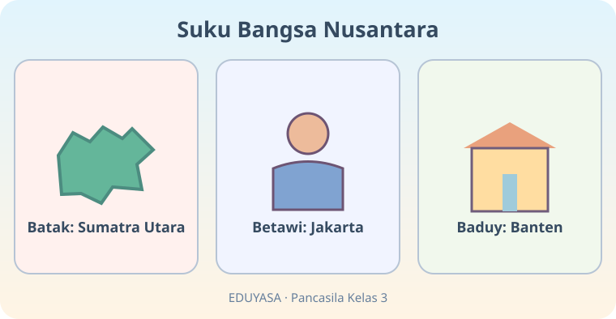
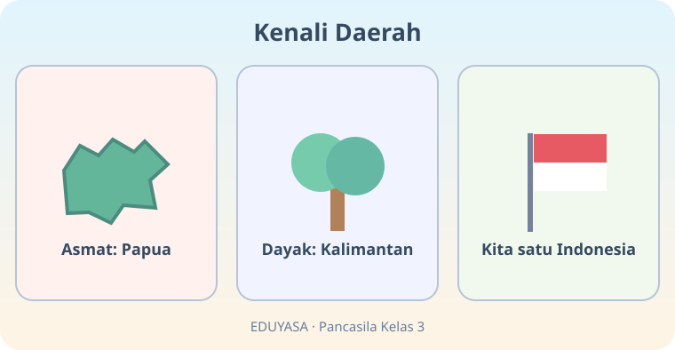
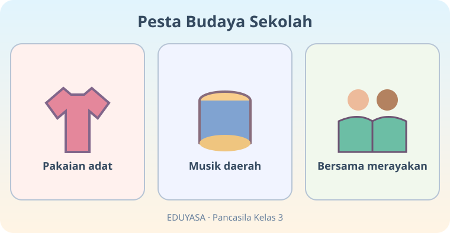
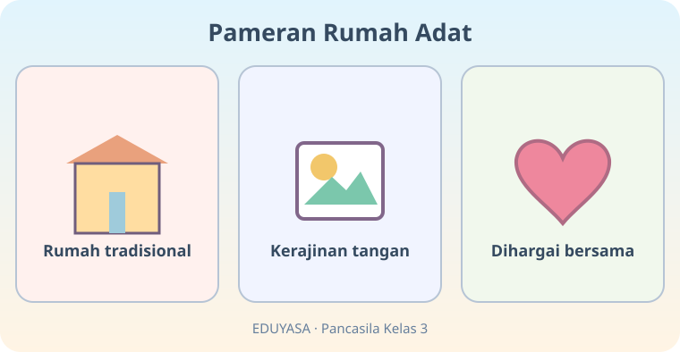
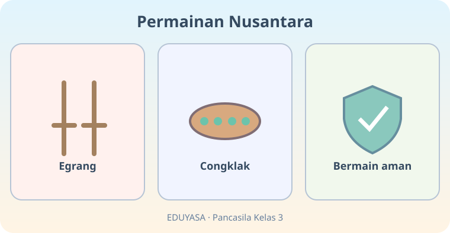
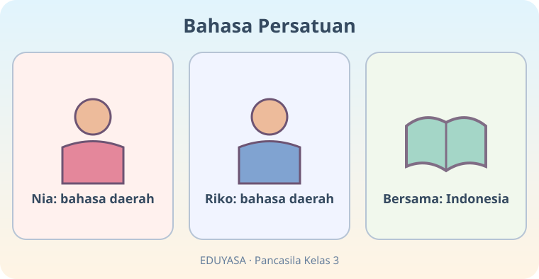
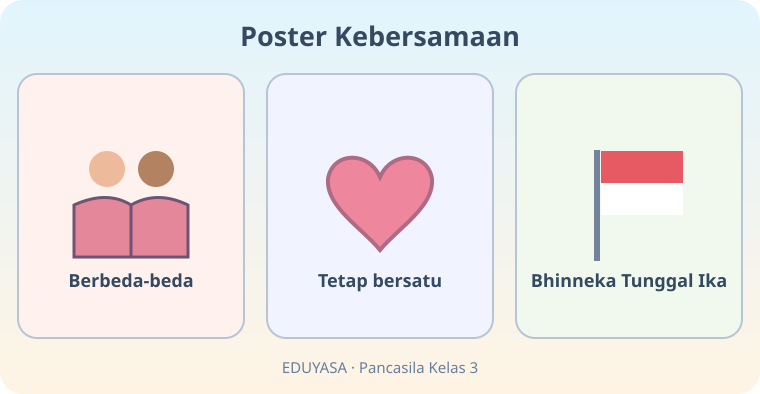
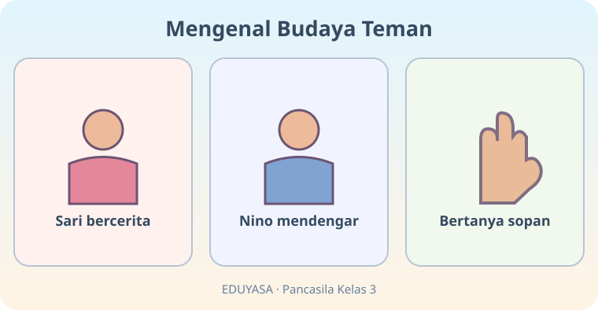
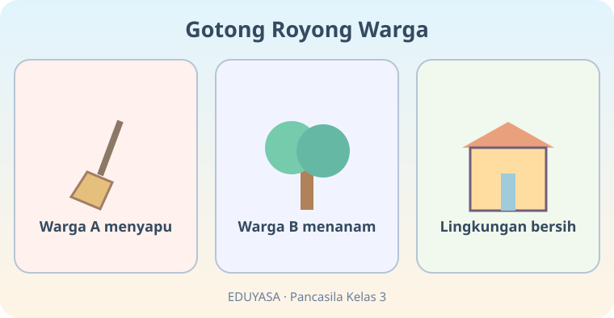
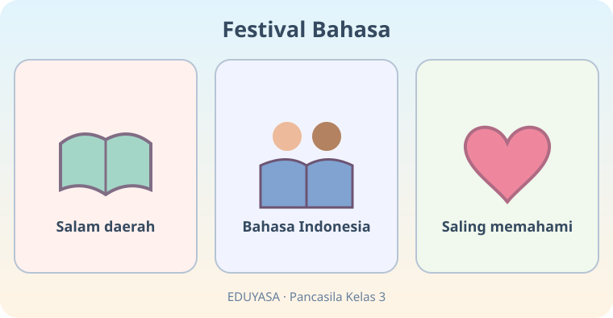

# Berbeda Itu Indah — 20 Soal Bergambar

**Bab:** K03-PKN-B03 | **Kelas:** 3 SD | **Mata pelajaran:** Pendidikan Pancasila

Bank ini terpisah untuk pengacakan 5 soal gambar per sesi.

## Soal 51 — K03-PKN-B03-M01-051

**Pertanyaan:** Dari gambar, suku Batak dicontohkan berasal dari ...

**Pilihan jawaban:**
- Sumatra Utara
- Banten
- Papua
- Bali

**Kunci jawaban:** Sumatra Utara

**Pembahasan:** Panel pertama menyebut Batak dan Sumatra Utara.

---

## Soal 52 — K03-PKN-B03-M01-052

**Pertanyaan:** Suku Betawi pada gambar dihubungkan dengan ...

**Pilihan jawaban:**
- Maluku
- Jakarta
- Kalimantan
- Aceh

**Kunci jawaban:** Jakarta

**Pembahasan:** Panel kedua menyebut Betawi dari Jakarta.

---

## Soal 53 — K03-PKN-B03-M01-053

**Pertanyaan:** Kelompok suku Asmat pada gambar dikaitkan dengan ...

**Pilihan jawaban:**
- Sumatra
- Jawa
- Papua
- Sulawesi

**Kunci jawaban:** Papua

**Pembahasan:** Panel pertama menuliskan Asmat Papua.

---

## Soal 54 — K03-PKN-B03-M01-054

**Pertanyaan:** Apa pesan panel ketiga setelah melihat dua suku berbeda?

**Pilihan jawaban:**
- Semua suku harus sama
- Perbedaan dilarang
- Hanya satu daerah penting
- Kita tetap satu Indonesia

**Kunci jawaban:** Kita tetap satu Indonesia

**Pembahasan:** Panel ketiga mengajak bersatu sebagai Indonesia.

---

## Soal 55 — K03-PKN-B03-M01-055

**Pertanyaan:** Kegiatan apa ditampilkan pada panel kedua?

**Pilihan jawaban:**
- Lari pagi
- Lomba matematika
- Berkebun
- Musik daerah

**Kunci jawaban:** Musik daerah

**Pembahasan:** Panel kedua menyebut musik daerah.

---

## Soal 56 — K03-PKN-B03-M01-056

**Pertanyaan:** Kesimpulan gambar pesta budaya ialah ...

**Pilihan jawaban:**
- budaya beragam dirayakan bersama
- hanya satu pakaian boleh dipakai
- musik daerah dilarang
- anak berbeda tidak boleh ikut

**Kunci jawaban:** budaya beragam dirayakan bersama

**Pembahasan:** Ketiga panel menunjukkan keberagaman yang dirayakan bersama.

---

## Soal 57 — K03-PKN-B03-M01-057

**Pertanyaan:** Benda budaya apa yang tampil pada panel pertama?

**Pilihan jawaban:**
- Telepon
- Rumah tradisional
- Kereta api
- Sepeda

**Kunci jawaban:** Rumah tradisional

**Pembahasan:** Panel pertama menunjukkan rumah tradisional.

---

## Soal 58 — K03-PKN-B03-M01-058

**Pertanyaan:** Sikap terhadap kerajinan yang dipamerkan adalah ...

**Pilihan jawaban:**
- mengejeknya
- mencurinya
- menghargainya
- merusaknya

**Kunci jawaban:** menghargainya

**Pembahasan:** Panel terakhir memperlihatkan karya dihargai.

---

## Soal 59 — K03-PKN-B03-M01-059

**Pertanyaan:** Permainan pertama yang ditampilkan ialah ...

**Pilihan jawaban:**
- Bola basket
- Catur
- Egrang
- Sepak bola

**Kunci jawaban:** Egrang

**Pembahasan:** Panel pertama menampilkan egrang.

---

## Soal 60 — K03-PKN-B03-M01-060

**Pertanyaan:** Apa aturan penting pada akhir rangkaian permainan?

**Pilihan jawaban:**
- Bermain di jalan raya
- Mendorong teman
- Mengambil alat tanpa izin
- Bermain aman

**Kunci jawaban:** Bermain aman

**Pembahasan:** Panel ketiga mengingatkan bermain aman.

---

## Soal 61 — K03-PKN-B03-M01-061

**Pertanyaan:** Bahasa apa dipakai Nia dan Riko saat berbicara bersama?

**Pilihan jawaban:**
- Bahasa Indonesia
- Hanya bahasa Nia
- Hanya bahasa Riko
- Bahasa rahasia

**Kunci jawaban:** Bahasa Indonesia

**Pembahasan:** Panel ketiga menampilkan Bahasa Indonesia.

---

## Soal 62 — K03-PKN-B03-M01-062

**Pertanyaan:** Mengapa Bahasa Indonesia dipilih pada panel ketiga?

**Pilihan jawaban:**
- Untuk mengejek logat
- Agar saling memahami
- Untuk menghapus bahasa daerah
- Agar satu anak selalu menang

**Kunci jawaban:** Agar saling memahami

**Pembahasan:** Bahasa Indonesia menghubungkan penutur bahasa daerah.

---

## Soal 63 — K03-PKN-B03-M01-063

**Pertanyaan:** Bunyi semboyan yang tampak pada poster ialah ...

**Pilihan jawaban:**
- Hemat Pangkal Kaya
- Bhinneka Tunggal Ika
- Rajin Pangkal Pandai
- Sekali Merdeka Tetap Belajar

**Kunci jawaban:** Bhinneka Tunggal Ika

**Pembahasan:** Panel ketiga tertulis Bhinneka Tunggal Ika.

---

## Soal 64 — K03-PKN-B03-M01-064

**Pertanyaan:** Apa arti pesan dua panel pertama poster?

**Pilihan jawaban:**
- Semua harus satu suku
- Perbedaan harus disembunyikan
- Berbeda-beda tetap bersatu
- Berbeda berarti bermusuhan

**Kunci jawaban:** Berbeda-beda tetap bersatu

**Pembahasan:** Panel menunjukkan berbeda lalu bersatu.

---

## Soal 65 — K03-PKN-B03-M01-065

**Pertanyaan:** Apa yang dilakukan Nino saat Sari bercerita?

**Pilihan jawaban:**
- Menertawakan
- Meninggalkan
- Memotong cerita
- Mendengarkan

**Kunci jawaban:** Mendengarkan

**Pembahasan:** Panel kedua menyatakan Nino mendengar.

---

## Soal 66 — K03-PKN-B03-M01-066

**Pertanyaan:** Cara Nino menggali informasi setelah mendengar ialah ...

**Pilihan jawaban:**
- bertanya sopan
- mengejek logat
- melarang Sari bercerita
- mengarang cerita

**Kunci jawaban:** bertanya sopan

**Pembahasan:** Panel ketiga menunjukkan pertanyaan sopan.

---

## Soal 67 — K03-PKN-B03-M01-067

**Pertanyaan:** Kegiatan pada panel kedua kerja bakti adalah ...

**Pilihan jawaban:**
- menanam
- membeli seragam
- memasak di kantin
- menonton televisi

**Kunci jawaban:** menanam

**Pembahasan:** Panel kedua menunjukkan warga menanam.

---

## Soal 68 — K03-PKN-B03-M01-068

**Pertanyaan:** Hasil kegiatan kerja bakti pada gambar ialah ...

**Pilihan jawaban:**
- tanaman dicabut
- lingkungan bersih
- lingkungan penuh sampah
- warga bertengkar

**Kunci jawaban:** lingkungan bersih

**Pembahasan:** Panel terakhir menyebut lingkungan bersih.

---

## Soal 69 — K03-PKN-B03-M01-069

**Pertanyaan:** Selain salam daerah, bahasa penghubung yang ditunjukkan ialah ...

**Pilihan jawaban:**
- bahasa asing wajib
- bahasa sandi
- Bahasa Indonesia
- hanya bahasa satu suku

**Kunci jawaban:** Bahasa Indonesia

**Pembahasan:** Panel tengah menunjukkan Bahasa Indonesia.

---

## Soal 70 — K03-PKN-B03-M01-070

**Pertanyaan:** Apa hasil memakai bahasa bersama dalam festival?

**Pilihan jawaban:**
- Saling mengejek
- Salah paham disengaja
- Tidak boleh berbicara
- Saling memahami

**Kunci jawaban:** Saling memahami

**Pembahasan:** Panel akhir menggambarkan saling memahami.
