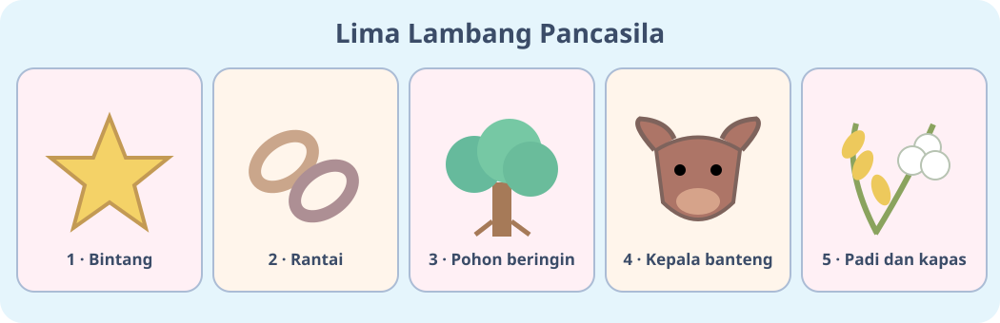
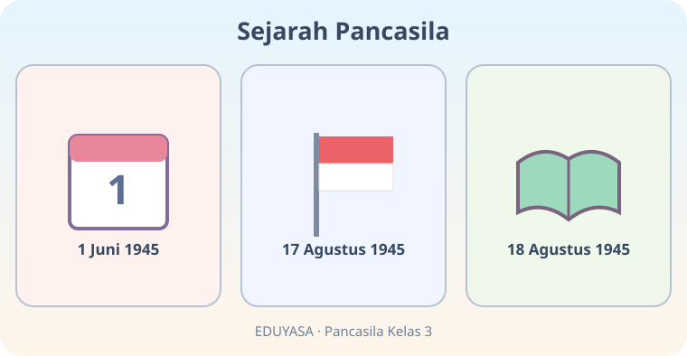

# Ayo Mengenal Pancasila — Dua Modul

**Kelas:** 3 SD | **ID bab:** K03-PKN-B04 | **Mapel:** Pendidikan Pancasila

**Rujukan:** Buku Siswa Pendidikan Pancasila untuk SD/MI Kelas III (2023), Bab 4 bagian A–B; tanggal sejarah dan istilah diringkas untuk tingkat Kelas 3. Materi dan ilustrasi asli EDUYASA.

**Tujuan pembelajaran:**
- Mengenali bunyi, nomor, dan lambang kelima sila Pancasila secara tepat.
- Memilih contoh perilaku yang mencerminkan nilai kelima sila di rumah dan sekolah.
- Mengenal peran Sukarno dan Mohammad Hatta serta teladan musyawarah, persatuan, dan tanggal sejarah penting.

**Instruksi Codex:** Kedua versi sama cakupan dan ditampilkan satu secara acak; jaga posisi gambar, URL, dan teks alternatif. Dokumen belum JSON.

---

## K03-PKN-B04-MOD-01

# Ayo Mengenal Pancasila — Lima Bintang Kebaikan

Halo, Sahabat! Tahukah kamu **Pancasila adalah dasar negara Indonesia**? Pancasila memiliki **lima sila** yang menjadi pedoman bersikap baik bersama. Yuk, kita mengenali bunyi, lambang, dan contohnya!

## Kenali lima sila

1. **Ketuhanan Yang Maha Esa** — lambang **bintang**. Contoh: beribadah menurut keyakinan sendiri dan menghormati orang lain yang beribadah.
2. **Kemanusiaan yang adil dan beradab** — lambang **rantai**. Contoh: menolong teman dan tidak merundung.
3. **Persatuan Indonesia** — lambang **pohon beringin**. Contoh: bekerja sama tanpa membeda-bedakan asal daerah.
4. **Kerakyatan yang dipimpin oleh hikmat kebijaksanaan dalam permusyawaratan/perwakilan** — lambang **kepala banteng**. Contoh: berdiskusi, mendengarkan usul, dan menerima keputusan bersama yang adil.
5. **Keadilan sosial bagi seluruh rakyat Indonesia** — lambang **padi dan kapas**. Contoh: membagi giliran menggunakan alat belajar secara adil.

**Tantangan cepat:** Bila kamu menolong teman yang jatuh, nilai sila berapa yang paling tampak? **Sila kedua!** Perbuatan baik sering juga mencerminkan lebih dari satu sila.

## Kenalan dengan para perumus

Pancasila tidak muncul begitu saja. Para tokoh bangsa **berdialog, berbeda pendapat, lalu berusaha bersatu**. Tokoh yang dipelajari di kelas 3 antara lain **Sukarno** (Presiden pertama RI) dan **Mohammad Hatta** (Wakil Presiden pertama RI). Keduanya termasuk **Panitia Sembilan** yang ikut proses perumusan dasar negara.

**1 Juni 1945** diperingati sebagai Hari Lahir Pancasila. **17 Agustus 1945** Indonesia memproklamasikan kemerdekaan. **18 Agustus 1945** PPKI mengesahkan UUD 1945 yang Pembukaannya memuat rumusan Pancasila sebagai dasar negara.

## Teladan untuk hari ini

Bayangkan kelasmu memilih permainan. Daripada saling berebut, lakukan musyawarah. Dengarkan pendapat, sepakati pilihan, dan bagi tugas dengan adil. Itulah cara sederhana meneladani persatuan para perumus.

**Misi kebaikan:** Pilih satu sila dan lakukan satu perbuatan baik hari ini. Ceritakan tindakanmu dan alasannya.

**Ingat:** Mengenal Pancasila bukan sekadar menghafal. Yang paling penting, **mempraktikkannya**.

---

## K03-PKN-B04-MOD-02

# Ayo Mengenal Pancasila — Lima Pos Petualangan

Hai, Petualang! Bayangkan kamu masuk ke taman dengan **lima pos**. Setiap pos punya lambang dan tantangan kebaikan. Siapkan senyum dan hati yang ramah!

## Pos 1 sampai 5

**Pos Bintang — Sila 1.** Ucapkan “Ketuhanan Yang Maha Esa”. Tantangan: beri kesempatan teman menjalankan ibadahnya tanpa gangguan.

**Pos Rantai — Sila 2.** Ucapkan “Kemanusiaan yang adil dan beradab”. Tantangan: tawarkan bantuan pada teman yang kesulitan, tanpa merendahkannya.

**Pos Beringin — Sila 3.** Ucapkan “Persatuan Indonesia”. Tantangan: ajak teman dari kelompok berbeda untuk bermain bersama.

**Pos Banteng — Sila 4.** Bunyi lengkap: “Kerakyatan yang dipimpin oleh hikmat kebijaksanaan dalam permusyawaratan/perwakilan”. Tantangan: dengarkan pendapat sebelum mengambil keputusan.

**Pos Padi dan Kapas — Sila 5.** Ucapkan “Keadilan sosial bagi seluruh rakyat Indonesia”. Tantangan: bergiliran memakai alat bermain dengan adil.

**Jeda berpikir:** Nilai Pancasila mana yang paling mudah kamu coba hari ini? Jawab dengan contoh tindakan nyata, bukan hanya nomor sila.

## Ruang sejarah kecil

Di dinding taman ada gambar dua tokoh: **Sukarno**, Presiden pertama Indonesia, dan **Mohammad Hatta**, Wakil Presiden pertama. Mereka termasuk tokoh **Panitia Sembilan** dalam proses perumusan dasar negara. Para tokoh bangsa memberi teladan berani menyampaikan pendapat, mau mendengar, serta mendahulukan persatuan.

Perhatikan tiga tanggal: **1 Juni 1945** merupakan Hari Lahir Pancasila; **17 Agustus 1945** hari proklamasi Indonesia; **18 Agustus 1945** pengesahan UUD 1945 oleh PPKI yang memuat rumusan Pancasila dalam Pembukaannya. Masing-masing memiliki peristiwa berbeda, ya!

## Uji petualangan

Cerita 1: Temanmu sedang beribadah. Kamu memilih bermain dengan tenang. Ini contoh nilai sila pertama.

Cerita 2: Kelompokmu memiliki satu kotak pensil warna. Kalian sepakat memakai bergiliran. Ini contoh nilai keadilan dan musyawarah.

Sekarang coba buat cerita ketigamu sendiri! Pilih satu nilai Pancasila, siapa yang terlibat, dan bagaimana kamu menerapkannya.

**Pesan petualang:** Pancasila hidup dalam tindakan kecil kita setiap hari.
