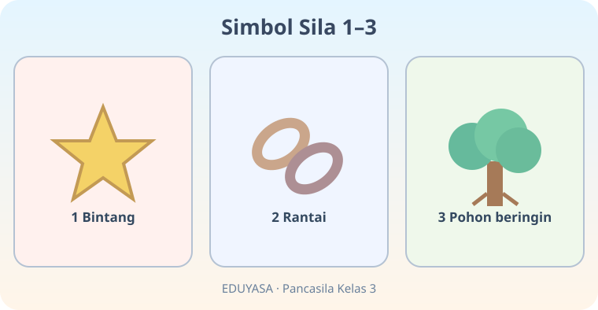
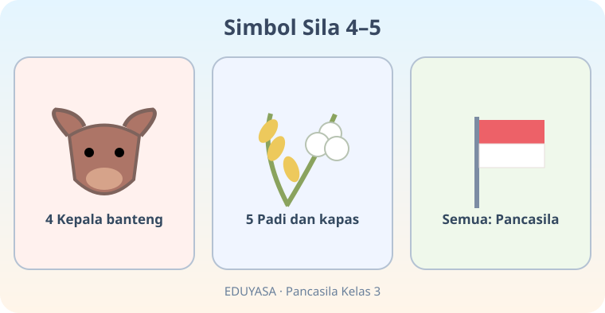
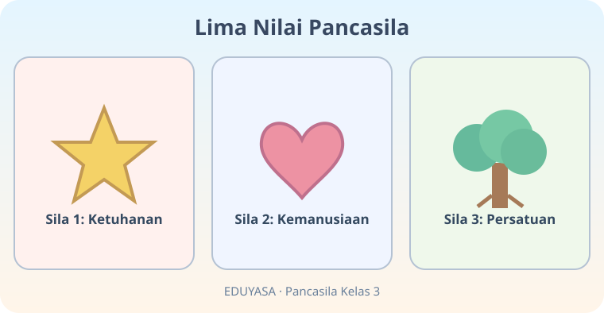
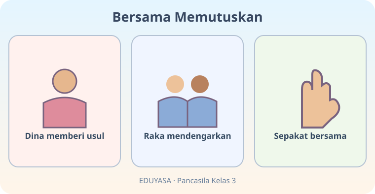
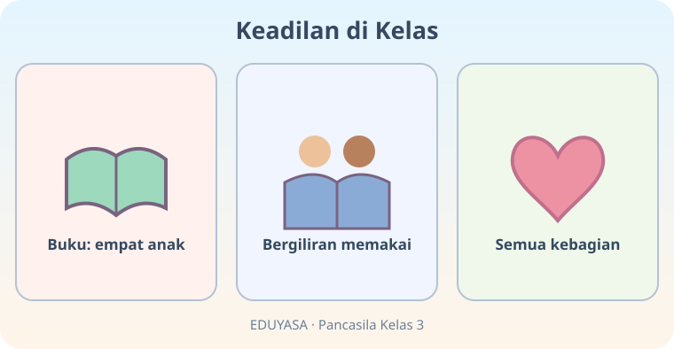
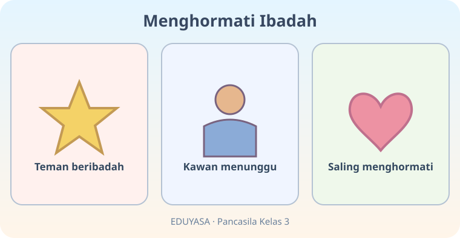
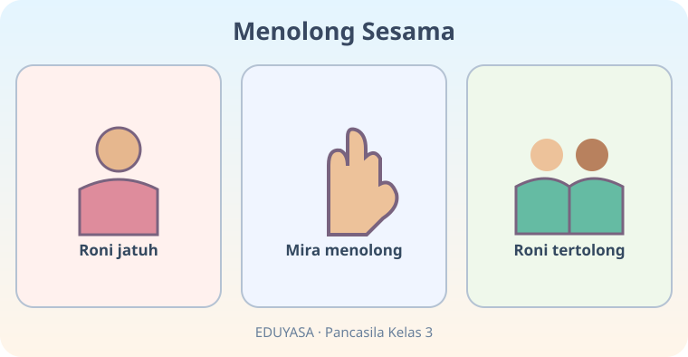
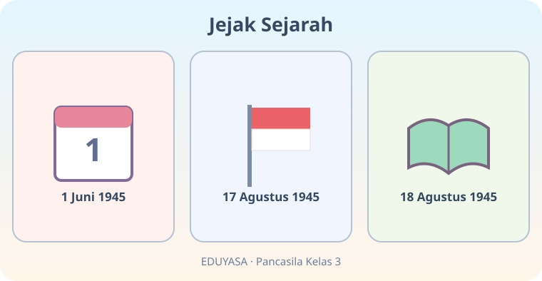
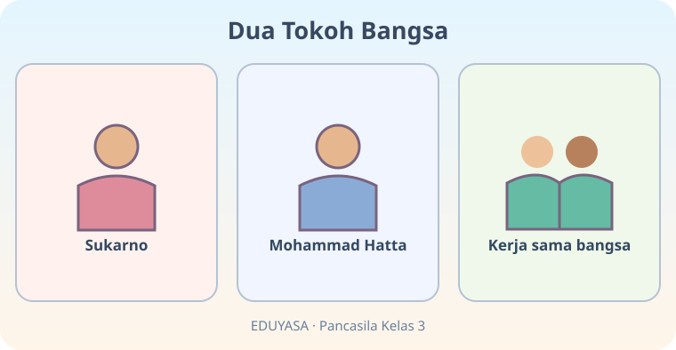
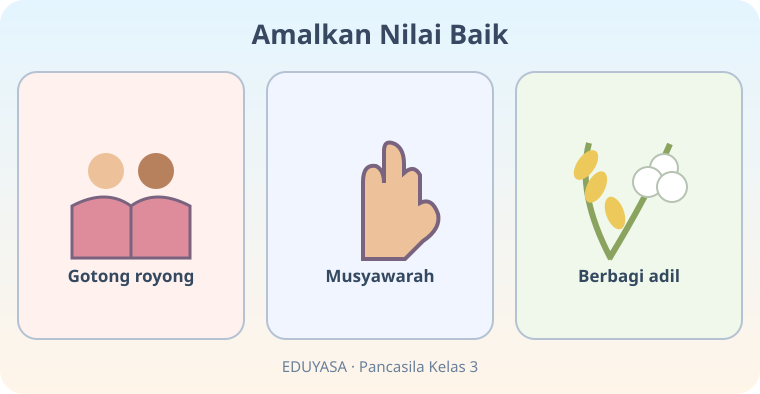

# Ayo Mengenal Pancasila — 20 Soal Bergambar

**Mata pelajaran:** Pendidikan Pancasila | **Kelas:** 3 | **ID:** K03-PKN-B04

Bank media dipisah agar pengacakan dapat mengambil 5 soal gambar dan 15 soal biasa.

## Soal 51 — K03-PKN-B04-M01-051

**Pertanyaan:** Pada gambar pertama, lambang sila pertama adalah ...

**Pilihan jawaban:**
- bintang
- rantai
- pohon beringin
- kapas

**Kunci jawaban:** bintang

**Pembahasan:** Panel pertama memperlihatkan bintang.

---

## Soal 52 — K03-PKN-B04-M01-052

**Pertanyaan:** Menurut urutan gambar, lambang sila kedua ialah ...

**Pilihan jawaban:**
- kepala banteng
- rantai
- bintang
- pohon beringin

**Kunci jawaban:** rantai

**Pembahasan:** Panel kedua memperlihatkan rantai.

---

## Soal 53 — K03-PKN-B04-M01-053

**Pertanyaan:** Kepala banteng melambangkan sila ke ...

**Pilihan jawaban:**
- dua
- lima
- empat
- satu

**Kunci jawaban:** empat

**Pembahasan:** Panel pertama menuliskan 4 Kepala banteng.

---

## Soal 54 — K03-PKN-B04-M01-054

**Pertanyaan:** Padi dan kapas merupakan lambang sila ...

**Pilihan jawaban:**
- pertama
- kedua
- ketiga
- kelima

**Kunci jawaban:** kelima

**Pembahasan:** Panel kedua menyebut 5 Padi dan kapas.

---

## Soal 55 — K03-PKN-B04-M01-055

**Pertanyaan:** Pada gambar, nilai sila pertama berkaitan dengan ...

**Pilihan jawaban:**
- Persatuan
- Keadilan sosial
- Permusyawaratan
- Ketuhanan

**Kunci jawaban:** Ketuhanan

**Pembahasan:** Panel pertama berbunyi Sila 1 Ketuhanan.

---

## Soal 56 — K03-PKN-B04-M01-056

**Pertanyaan:** Nilai kemanusiaan terletak pada sila ke ...

**Pilihan jawaban:**
- dua
- satu
- tiga
- lima

**Kunci jawaban:** dua

**Pembahasan:** Panel kedua bertuliskan Sila 2 Kemanusiaan.

---

## Soal 57 — K03-PKN-B04-M01-057

**Pertanyaan:** Siapa yang memberi usul dalam musyawarah pada gambar?

**Pilihan jawaban:**
- Roni
- Dina
- Raka
- Mira

**Kunci jawaban:** Dina

**Pembahasan:** Panel pertama menyebut Dina.

---

## Soal 58 — K03-PKN-B04-M01-058

**Pertanyaan:** Setelah mendengarkan usul, kelompok sebaiknya ...

**Pilihan jawaban:**
- melarang orang bicara
- merobek catatan
- mencapai kesepakatan bersama
- membubarkan kelompok

**Kunci jawaban:** mencapai kesepakatan bersama

**Pembahasan:** Panel ketiga menunjukkan kesepakatan.

---

## Soal 59 — K03-PKN-B04-M01-059

**Pertanyaan:** Bagaimana buku digunakan menurut gambar?

**Pilihan jawaban:**
- Disembunyikan
- Dibuang
- Bergiliran
- Direbut satu anak

**Kunci jawaban:** Bergiliran

**Pembahasan:** Panel kedua menyebut bergiliran.

---

## Soal 60 — K03-PKN-B04-M01-060

**Pertanyaan:** Apa nilai utama dari semua anak memperoleh giliran?

**Pilihan jawaban:**
- Kesombongan
- Kecurangan
- Paksaan
- Keadilan

**Kunci jawaban:** Keadilan

**Pembahasan:** Panel akhir menampilkan semua kebagian.

---

## Soal 61 — K03-PKN-B04-M01-061

**Pertanyaan:** Apa yang dilakukan teman saat orang lain beribadah?

**Pilihan jawaban:**
- Memberi kesempatan
- Mengganggu
- Mengejek
- Memaksa berhenti

**Kunci jawaban:** Memberi kesempatan

**Pembahasan:** Panel kedua memperlihatkan teman menunggu.

---

## Soal 62 — K03-PKN-B04-M01-062

**Pertanyaan:** Sikap yang menjadi pesan gambar adalah ...

**Pilihan jawaban:**
- saling mengancam
- saling menghormati
- saling mengejek
- saling menghalangi

**Kunci jawaban:** saling menghormati

**Pembahasan:** Panel akhir berbunyi saling menghormati.

---

## Soal 63 — K03-PKN-B04-M01-063

**Pertanyaan:** Siapa yang menolong Roni?

**Pilihan jawaban:**
- Hatta
- Mira
- Dina
- Sukarno

**Kunci jawaban:** Mira

**Pembahasan:** Panel kedua menyebut Mira menolong.

---

## Soal 64 — K03-PKN-B04-M01-064

**Pertanyaan:** Sila apa yang terutama dicontohkan oleh menolong teman jatuh?

**Pilihan jawaban:**
- Kelima
- Pertama
- Kedua
- Keempat

**Kunci jawaban:** Kedua

**Pembahasan:** Menolong sesama mencerminkan kemanusiaan yang adil dan beradab.

---

## Soal 65 — K03-PKN-B04-M01-065

**Pertanyaan:** Tanggal Hari Lahir Pancasila pada gambar adalah ...

**Pilihan jawaban:**
- 17 Agustus 1945
- 18 Agustus 1945
- 1 Januari 1945
- 1 Juni 1945

**Kunci jawaban:** 1 Juni 1945

**Pembahasan:** Panel pertama menunjukkan 1 Juni 1945.

---

## Soal 66 — K03-PKN-B04-M01-066

**Pertanyaan:** Tanggal proklamasi kemerdekaan pada gambar adalah ...

**Pilihan jawaban:**
- 17 Agustus 1945
- 1 Juni 1945
- 18 Agustus 1945
- 2 Mei 1945

**Kunci jawaban:** 17 Agustus 1945

**Pembahasan:** Panel kedua menunjukkan 17 Agustus 1945.

---

## Soal 67 — K03-PKN-B04-M01-067

**Pertanyaan:** Siapa tokoh yang menjadi Presiden pertama Republik Indonesia?

**Pilihan jawaban:**
- Sukarno
- Mohammad Hatta
- Dina
- Raka

**Kunci jawaban:** Sukarno

**Pembahasan:** Panel Sukarno menunjukkan Presiden pertama RI.

---

## Soal 68 — K03-PKN-B04-M01-068

**Pertanyaan:** Siapa tokoh yang menjadi Wakil Presiden pertama Republik Indonesia?

**Pilihan jawaban:**
- Mira
- Mohammad Hatta
- Sukarno
- Roni

**Kunci jawaban:** Mohammad Hatta

**Pembahasan:** Mohammad Hatta merupakan Wakil Presiden pertama RI.

---

## Soal 69 — K03-PKN-B04-M01-069

**Pertanyaan:** Kegiatan pada panel pertama merupakan contoh ...

**Pilihan jawaban:**
- perebutan alat
- pemaksaan pendapat
- gotong royong
- mengejek teman

**Kunci jawaban:** gotong royong

**Pembahasan:** Panel pertama menunjukkan gotong royong.

---

## Soal 70 — K03-PKN-B04-M01-070

**Pertanyaan:** Apa kegiatan pada panel terakhir yang memperlihatkan sila kelima?

**Pilihan jawaban:**
- Merebut makanan
- Memaksa kelompok
- Mengejek teman
- Berbagi adil

**Kunci jawaban:** Berbagi adil

**Pembahasan:** Berbagi adil sesuai nilai keadilan sosial.
