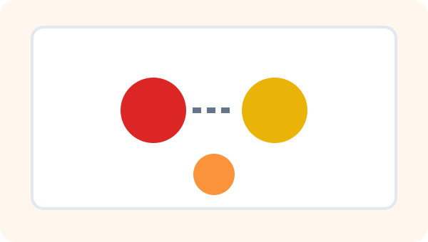
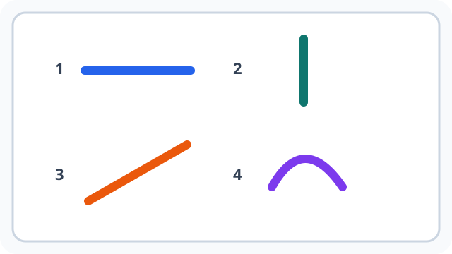
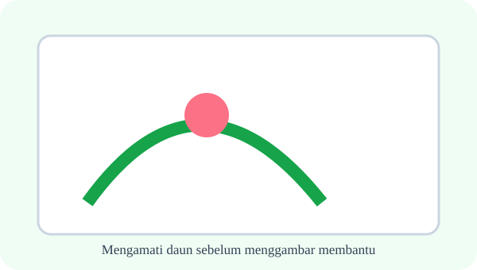
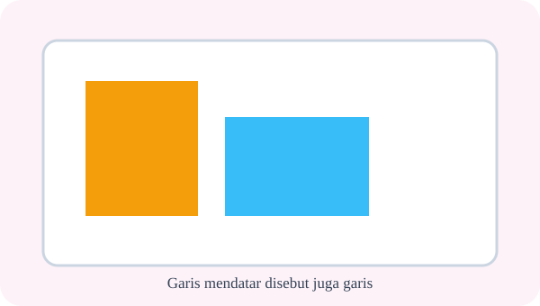
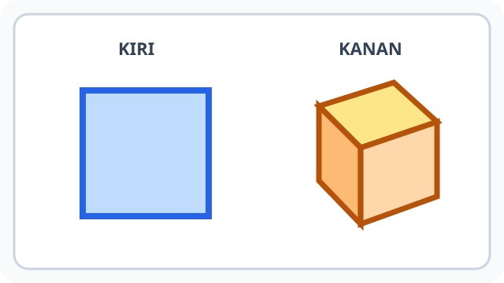
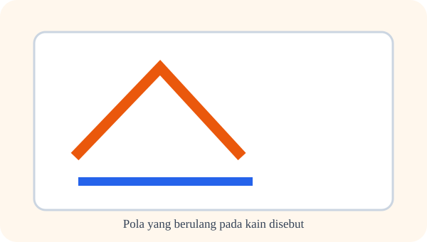
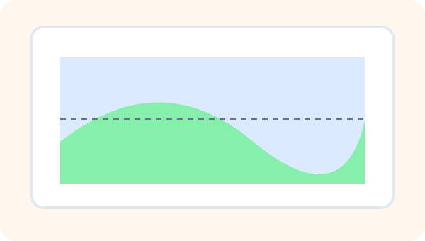
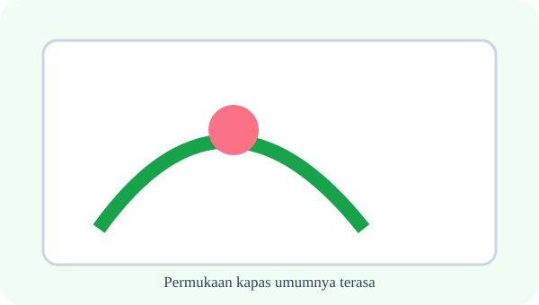
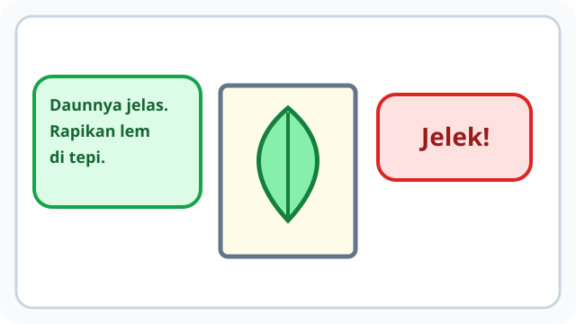

# Bab 1 — Menemukan Keindahan di Sekitar Kita

10 soal bergambar — ilustrasi berfungsi sebagai stimulus pengamatan, klasifikasi, pencampuran warna, prosedur kolase, keselamatan alat, dan apresiasi.

## Soal 36 — K03-SBD-B01-M01-036

**Pertanyaan:** Deretan titik manakah yang paling kuat memberi kesan sebuah garis?

**Pilihan jawaban:**
- deretan titik rapat pada bagian bawah
- dua titik berjauhan pada bagian atas
- satu titik di sudut kiri
- semua bidang kosong

**Kunci Jawaban:** deretan titik rapat pada bagian bawah

**Pembahasan:** Titik-titik yang rapat dan berurutan pada bagian bawah terbaca sebagai jejak memanjang atau garis.

---

## Soal 37 — K03-SBD-B01-M01-037

**Pertanyaan:** Garis nomor berapa yang merupakan garis diagonal?

**Pilihan jawaban:**
- garis nomor 3
- garis nomor 1
- garis nomor 2
- garis nomor 4

**Kunci Jawaban:** garis nomor 3

**Pembahasan:** Garis nomor 3 miring dari kiri bawah ke kanan atas sehingga termasuk garis diagonal.

---

## Soal 38 — K03-SBD-B01-M01-038

**Pertanyaan:** Gambar manakah yang menunjukkan garis tertutup sehingga membatasi sebuah bidang?

**Pilihan jawaban:**
- gambar di sebelah kanan
- gambar di sebelah kiri
- kedua gambar sama-sama terbuka
- tidak satu pun gambar

**Kunci Jawaban:** gambar di sebelah kanan

**Pembahasan:** Ujung garis pada gambar kanan saling bertemu sehingga bagian di dalamnya menjadi bidang.

---

## Soal 39 — K03-SBD-B01-M01-039

**Pertanyaan:** Kelompok di sebelah kanan berisi bidang organis karena bentuknya ....

**Pilihan jawaban:**
- bebas dan menyerupai bentuk alam
- selalu memiliki sisi sama panjang
- hanya tersusun dari garis lurus
- memiliki volume dan dapat diputar

**Kunci Jawaban:** bebas dan menyerupai bentuk alam

**Pembahasan:** Siluet daun dan awan memiliki tepi bebas yang menyerupai bentuk alam sehingga termasuk bidang organis.

---

## Soal 40 — K03-SBD-B01-M01-040

**Pertanyaan:** Objek manakah yang menunjukkan bentuk tiga dimensi karena memiliki volume?

**Pilihan jawaban:**
- kubus di sebelah kanan
- persegi di sebelah kiri
- garis di bawah persegi
- warna latar gambar

**Kunci Jawaban:** kubus di sebelah kanan

**Pembahasan:** Kubus memiliki panjang, lebar, dan tinggi, sedangkan persegi pada gambar merupakan bidang datar.

---

## Soal 41 — K03-SBD-B01-M01-041

**Pertanyaan:** Jika dua warna cat pada gambar dicampur, warna yang umumnya terbentuk adalah ....

**Pilihan jawaban:**
- oranye
- hijau
- ungu
- biru

**Kunci Jawaban:** oranye

**Pembahasan:** Dalam pencampuran cat dasar, merah dan kuning menghasilkan oranye.

---

## Soal 42 — K03-SBD-B01-M01-042

**Pertanyaan:** Warna apa yang tepat untuk mengisi kotak kosong pada baris kedua?

**Pilihan jawaban:**
- hijau
- oranye
- ungu
- merah

**Kunci Jawaban:** hijau

**Pembahasan:** Baris kedua menunjukkan pencampuran kuning dan biru yang menghasilkan hijau.

---

## Soal 43 — K03-SBD-B01-M01-043

**Pertanyaan:** Potongan bahan pada gambar belum dilem. Langkah berikut yang paling baik adalah ....

**Pilihan jawaban:**
- mencoba susunannya pada bidang gambar
- menuangkan semua lem sekaligus
- menggunting sambil berlari
- membuang seluruh bahan

**Kunci Jawaban:** mencoba susunannya pada bidang gambar

**Pembahasan:** Potongan sebaiknya dicoba susunannya dahulu agar komposisi dapat diperbaiki sebelum dilem.

---

## Soal 44 — K03-SBD-B01-M01-044

**Pertanyaan:** Cara menyerahkan gunting yang lebih aman ditunjukkan oleh ....

**Pilihan jawaban:**
- anak di sebelah kanan
- anak di sebelah kiri
- keduanya sama aman
- tidak perlu memegang gunting

**Kunci Jawaban:** anak di sebelah kanan

**Pembahasan:** Pada gambar kanan, bilah gunting tertutup dan gagang diarahkan kepada penerima.

---

## Soal 45 — K03-SBD-B01-M01-045

**Pertanyaan:** Komentar manakah yang merupakan umpan balik sopan dan berguna?

**Pilihan jawaban:**
- komentar anak di sebelah kiri
- komentar anak di sebelah kanan
- keduanya berisi saran rinci
- keduanya tidak berkaitan dengan karya

**Kunci Jawaban:** komentar anak di sebelah kiri

**Pembahasan:** Komentar kiri menyebut kelebihan dan saran tertentu, sedangkan komentar kanan hanya merendahkan.

---
