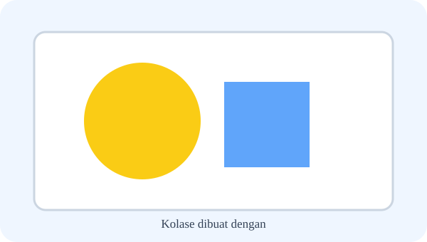
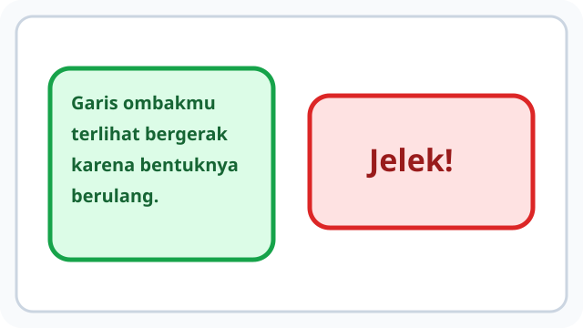
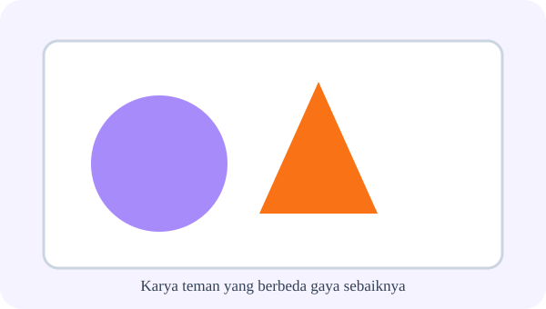
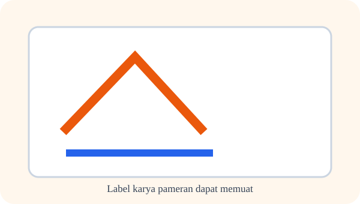
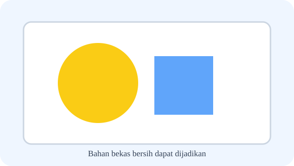
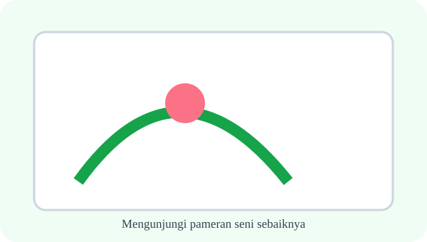
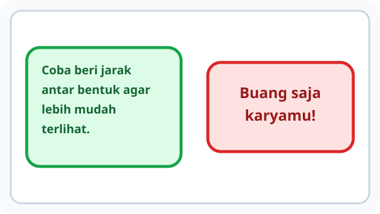
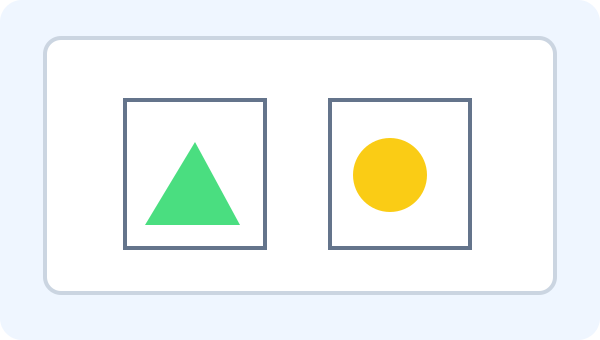

# Bab 2 — Belajar dari Karya Orang Lain

10 soal bergambar — pertanyaan sudah disesuaikan dengan situasi ilustrasi; media ditangani terpisah.

## Soal 36 — K03-SBD-B02-M01-036

**Pertanyaan:** Perhatikan potongan bahan berbeda yang direkatkan pada bidang kertas. Cara membuat karya itu disebut ....

**Pilihan jawaban:**
- memukul drum
- menari berpasangan
- menempel berbagai bahan pada bidang
- menyanyi bersama

**Kunci Jawaban:** menempel berbagai bahan pada bidang

**Pembahasan:** Kolase dibuat dengan menempel berbagai bahan pada bidang.

---

## Soal 37 — K03-SBD-B02-M01-037

**Pertanyaan:** Keping-keping kecil disusun berdekatan untuk mengisi gambar pada ilustrasi. Teknik yang dicontohkan memakai ....

**Pilihan jawaban:**
- satu nada panjang
- suara air
- gerakan lari
- potongan kecil bahan yang disusun

**Kunci Jawaban:** potongan kecil bahan yang disusun

**Pembahasan:** Mozaik dapat dibuat dari potongan kecil bahan yang disusun.

---

## Soal 38 — K03-SBD-B02-M01-038

**Pertanyaan:** Seorang anak menanggapi karya teman pada ilustrasi. Agar tanggapannya membantu, isi komentar harus berupa ....

**Pilihan jawaban:**
- saran yang jelas dan santun
- ejekan pribadi
- ancaman
- kebohongan

**Kunci Jawaban:** saran yang jelas dan santun

**Pembahasan:** Kritik membangun sebaiknya berisi saran yang jelas dan santun.

---

## Soal 39 — K03-SBD-B02-M01-039

**Pertanyaan:** Dua karya pada gambar menggunakan gaya berbeda. Bagaimana pengunjung seharusnya memperlakukan keduanya?

**Pilihan jawaban:**
- ditertawakan
- tetap dihargai
- disembunyikan
- dihancurkan

**Kunci Jawaban:** tetap dihargai

**Pembahasan:** Karya teman yang berbeda gaya sebaiknya tetap dihargai.

---

## Soal 40 — K03-SBD-B02-M01-040

**Pertanyaan:** Pada kartu pengenal karya yang ditunjukkan, informasi apa yang seharusnya tercantum?

**Pilihan jawaban:**
- kata ejekan
- rahasia keluarga
- judul dan nama pembuat
- nilai rapor teman

**Kunci Jawaban:** judul dan nama pembuat

**Pembahasan:** Label karya pameran dapat memuat judul dan nama pembuat.

---

## Soal 41 — K03-SBD-B02-M01-041

**Pertanyaan:** Di meja tampak kardus bekas bersih yang hendak dipakai membuat hiasan. Bahan itu dapat menjadi ....

**Pilihan jawaban:**
- sampah yang harus dibakar
- bahan makanan
- alat musik otomatis
- bahan berkarya kreatif

**Kunci Jawaban:** bahan berkarya kreatif

**Pembahasan:** Bahan bekas bersih dapat dijadikan bahan berkarya kreatif.

---

## Soal 42 — K03-SBD-B02-M01-042

**Pertanyaan:** Pengunjung melihat karya yang diberi tanda tidak boleh disentuh. Apa perilaku yang tepat?

**Pilihan jawaban:**
- mengikuti aturan dan tidak menyentuh karya tanpa izin
- menarik bingkai
- mencoret karya
- berlari di dekat pajangan

**Kunci Jawaban:** mengikuti aturan dan tidak menyentuh karya tanpa izin

**Pembahasan:** Mengunjungi pameran seni sebaiknya mengikuti aturan dan tidak menyentuh karya tanpa izin.

---

## Soal 43 — K03-SBD-B02-M01-043

**Pertanyaan:** Dalam karya berwarna pada ilustrasi, ada satu warna mengisi sebagian besar bidang. Warna dominan berarti warna yang ....

**Pilihan jawaban:**
- tidak terlihat
- paling menonjol
- tidak dipakai
- selalu putih

**Kunci Jawaban:** paling menonjol

**Pembahasan:** Warna yang dominan pada karya berarti warna yang paling menonjol.

---

## Soal 44 — K03-SBD-B02-M01-044

**Pertanyaan:** Perhatikan karya berisi pegunungan dan aliran air. Jenis objek utama gambar itu adalah ....

**Pilihan jawaban:**
- rumus matematika
- daftar belanja
- alam seperti gunung atau sungai
- hanya angka

**Kunci Jawaban:** alam seperti gunung atau sungai

**Pembahasan:** Lukisan pemandangan biasanya menampilkan alam seperti gunung atau sungai.

---

## Soal 45 — K03-SBD-B02-M01-045

**Pertanyaan:** Siswa menjelaskan bagian menarik dari lukisan temannya. Tindakan itu merupakan contoh ....

**Pilihan jawaban:**
- perundungan
- plagiarisme
- perusakan
- apresiasi positif

**Kunci Jawaban:** apresiasi positif

**Pembahasan:** Menyebut kelebihan karya teman merupakan contoh apresiasi positif.

---
