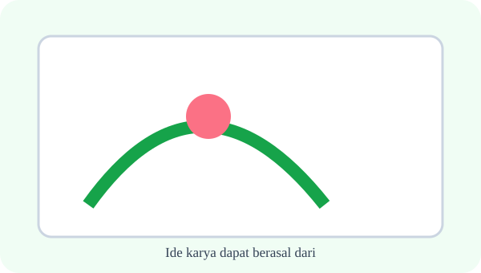
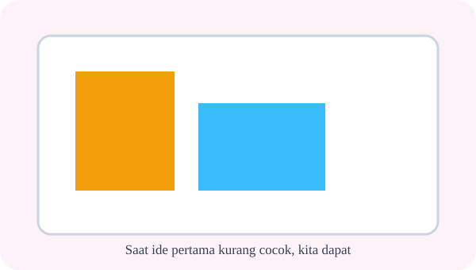
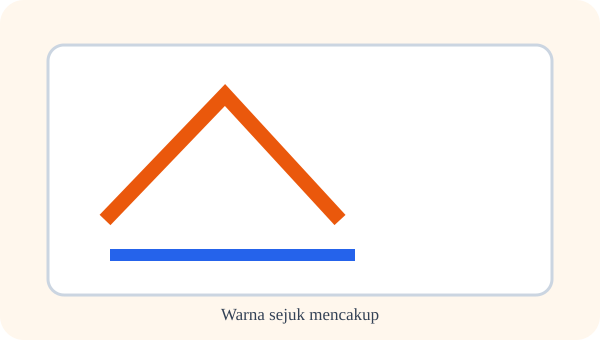
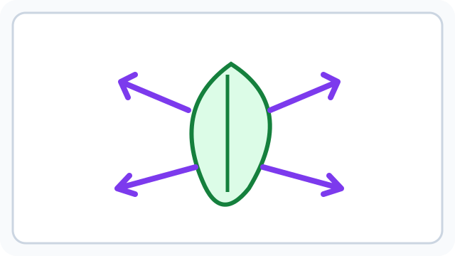
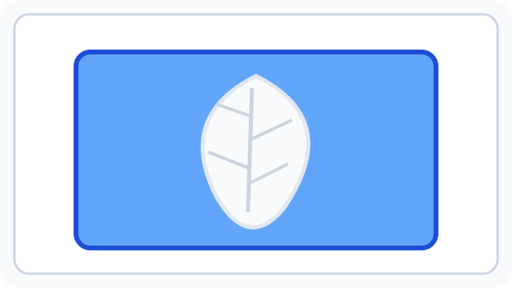
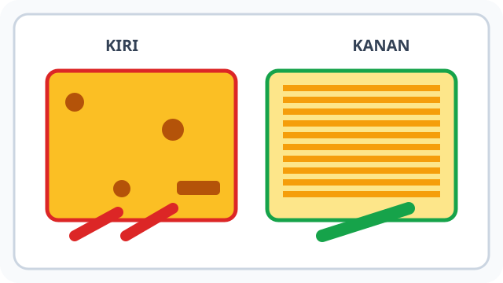
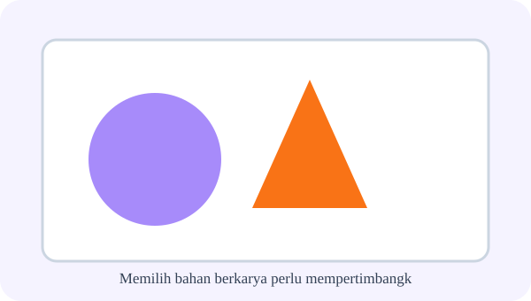
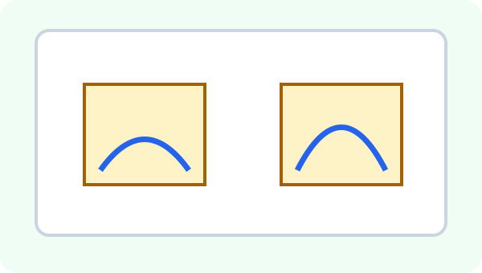
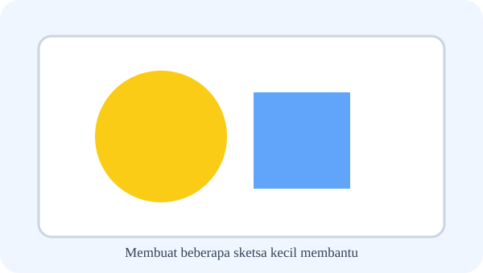

# Bab 3 — Ideku, Gagasanku

10 soal bergambar — ilustrasi masih skematis dan perlu pengembangan sesuai konteks pertanyaan.

## Soal 36 — K03-SBD-B03-M01-036

**Pertanyaan:** Perhatikan situasi kegiatan seni rupa berikut. Ide karya dapat berasal dari ....

**Pilihan jawaban:**
- hanya gambar orang lain
- pengalaman sehari-hari
- hanya televisi
- hanya buku mahal

**Kunci Jawaban:** pengalaman sehari-hari

**Pembahasan:** Ide karya dapat berasal dari pengalaman sehari-hari.

---

## Soal 37 — K03-SBD-B03-M01-037

**Pertanyaan:** Perhatikan situasi kegiatan seni rupa berikut. Saat ide pertama kurang cocok, kita dapat ....

**Pilihan jawaban:**
- menyalahkan teman
- merusak alat
- mencoba alternatif dan memperbaiki rancangan
- langsung menyerah

**Kunci Jawaban:** mencoba alternatif dan memperbaiki rancangan

**Pembahasan:** Saat ide pertama kurang cocok, kita dapat mencoba alternatif dan memperbaiki rancangan.

---

## Soal 38 — K03-SBD-B03-M01-038

**Pertanyaan:** Perhatikan situasi kegiatan seni rupa berikut. Warna hangat mencakup ....

**Pilihan jawaban:**
- biru dan hijau saja
- hitam dan putih saja
- abu-abu saja
- merah, oranye, dan kuning

**Kunci Jawaban:** merah, oranye, dan kuning

**Pembahasan:** Warna hangat mencakup merah, oranye, dan kuning.

---

## Soal 39 — K03-SBD-B03-M01-039

**Pertanyaan:** Perhatikan situasi kegiatan seni rupa berikut. Warna sejuk mencakup ....

**Pilihan jawaban:**
- biru dan hijau
- merah dan oranye
- kuning dan merah
- cokelat dan oranye

**Kunci Jawaban:** biru dan hijau

**Pembahasan:** Warna sejuk mencakup biru dan hijau.

---

## Soal 40 — K03-SBD-B03-M01-040

**Pertanyaan:** Perhatikan situasi kegiatan seni rupa berikut. Komposisi berarti ....

**Pilihan jawaban:**
- harga kertas
- penataan unsur dalam bidang gambar
- jenis lem
- ukuran kuas

**Kunci Jawaban:** penataan unsur dalam bidang gambar

**Pembahasan:** Komposisi berarti penataan unsur dalam bidang gambar.

---

## Soal 41 — K03-SBD-B03-M01-041

**Pertanyaan:** Perhatikan situasi kegiatan seni rupa berikut. Titik fokus dalam gambar adalah bagian yang ....

**Pilihan jawaban:**
- tidak terlihat
- harus dihapus
- menarik perhatian utama
- selalu tersembunyi

**Kunci Jawaban:** menarik perhatian utama

**Pembahasan:** Titik fokus dalam gambar adalah bagian yang menarik perhatian utama.

---

## Soal 42 — K03-SBD-B03-M01-042

**Pertanyaan:** Perhatikan situasi kegiatan seni rupa berikut. Rancangan poster hemat air dapat menampilkan ....

**Pilihan jawaban:**
- air terbuang tanpa pesan
- hanya coretan acak
- gambar tanpa hubungan
- keran tertutup dan pesan singkat

**Kunci Jawaban:** keran tertutup dan pesan singkat

**Pembahasan:** Rancangan poster hemat air dapat menampilkan keran tertutup dan pesan singkat.

---

## Soal 43 — K03-SBD-B03-M01-043

**Pertanyaan:** Perhatikan situasi kegiatan seni rupa berikut. Memilih bahan berkarya perlu mempertimbangkan ....

**Pilihan jawaban:**
- keamanan dan ketersediaan bahan
- harga paling mahal saja
- warna kemasan saja
- merek terkenal saja

**Kunci Jawaban:** keamanan dan ketersediaan bahan

**Pembahasan:** Memilih bahan berkarya perlu mempertimbangkan keamanan dan ketersediaan bahan.

---

## Soal 44 — K03-SBD-B03-M01-044

**Pertanyaan:** Perhatikan situasi kegiatan seni rupa berikut. Gagasan orisinal berarti ....

**Pilihan jawaban:**
- meniru tanpa memahami
- mengembangkan ide sendiri dengan jujur
- menyalin karya teman lalu mengaku milik sendiri
- menghapus nama pembuat

**Kunci Jawaban:** mengembangkan ide sendiri dengan jujur

**Pembahasan:** Gagasan orisinal berarti mengembangkan ide sendiri dengan jujur.

---

## Soal 45 — K03-SBD-B03-M01-045

**Pertanyaan:** Perhatikan situasi kegiatan seni rupa berikut. Membuat beberapa sketsa kecil membantu ....

**Pilihan jawaban:**
- menghilangkan ide
- menghindari belajar
- membandingkan pilihan komposisi
- membuat kertas selalu basah

**Kunci Jawaban:** membandingkan pilihan komposisi

**Pembahasan:** Membuat beberapa sketsa kecil membantu membandingkan pilihan komposisi.

---
