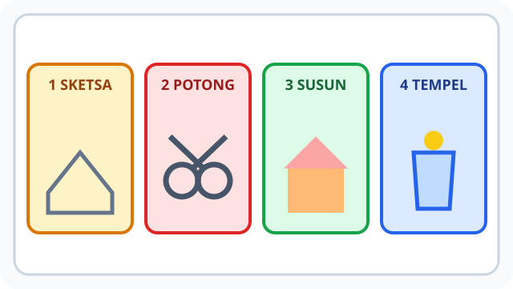
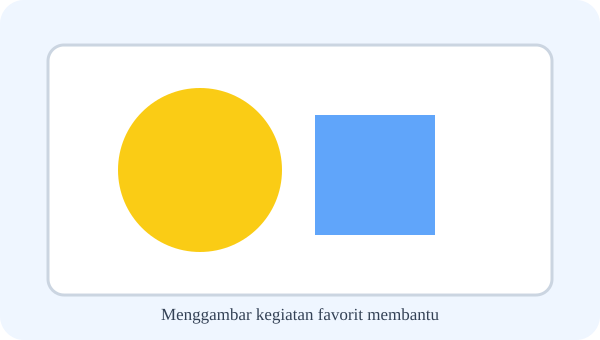
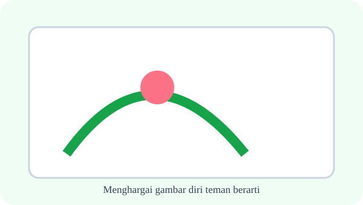
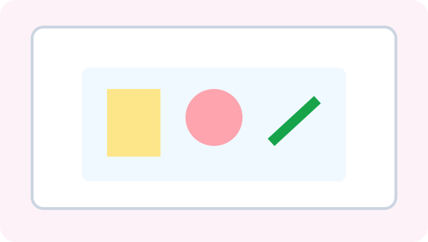
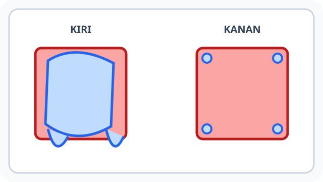
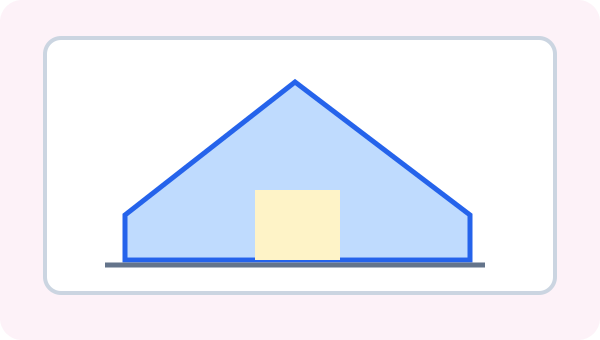
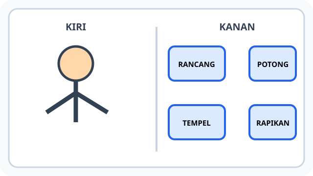
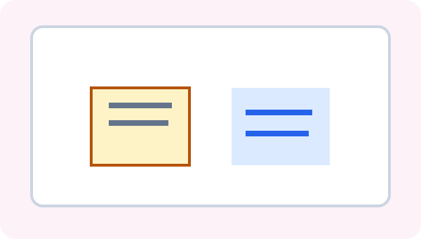

# Bab 4 — Karya yang Mewakili Diriku

10 soal bergambar — pertanyaan sudah disesuaikan dengan situasi ilustrasi; media ditangani terpisah.

## Soal 36 — K03-SBD-B04-M01-036

**Pertanyaan:** Tokoh pada gambar tersenyum dan matanya tampak ceria. Perasaan yang biasa ditampilkan adalah ....

**Pilihan jawaban:**
- perasaan senang
- perasaan marah
- perasaan takut
- perasaan bosan

**Kunci Jawaban:** perasaan senang

**Pembahasan:** Ekspresi wajah tersenyum sering menunjukkan perasaan senang.

---

## Soal 37 — K03-SBD-B04-M01-037

**Pertanyaan:** Wajah dalam gambar menunjukkan alis menurun dan air mata. Perasaan yang mungkin ditunjukkan adalah ....

**Pilihan jawaban:**
- terkejut
- sedih
- gembira
- bangga

**Kunci Jawaban:** sedih

**Pembahasan:** Ekspresi wajah dengan alis menurun dan air mata dapat menunjukkan sedih.

---

## Soal 38 — K03-SBD-B04-M01-038

**Pertanyaan:** Dua potret diri pada ilustrasi berbeda gaya. Karya pribadi tidak perlu dibuat ....

**Pilihan jawaban:**
- dibuat dengan usaha
- menampilkan pilihan pribadi
- sama persis dengan karya teman
- memiliki tema

**Kunci Jawaban:** sama persis dengan karya teman

**Pembahasan:** Karya yang mewakili diri tidak harus sama persis dengan karya teman.

---

## Soal 39 — K03-SBD-B04-M01-039

**Pertanyaan:** Gambar menunjukkan anak sedang melakukan hobi kesukaan. Hal apa yang hendak dikomunikasikan pembuat karya?

**Pilihan jawaban:**
- menghilangkan hobi
- mengubah nama
- mengganti teman
- menceritakan minat diri

**Kunci Jawaban:** menceritakan minat diri

**Pembahasan:** Menggambar kegiatan favorit membantu menceritakan minat diri.

---

## Soal 40 — K03-SBD-B04-M01-040

**Pertanyaan:** Perhatikan tanggapan pengunjung terhadap gambar diri temannya. Sikap menghargai yang tepat adalah ....

**Pilihan jawaban:**
- tidak mengejek ciri fisiknya
- menertawakan bentuk tubuh
- mencoret wajah
- menghina warna kulit

**Kunci Jawaban:** tidak mengejek ciri fisiknya

**Pembahasan:** Menghargai gambar diri teman berarti tidak mengejek ciri fisiknya.

---

## Soal 41 — K03-SBD-B04-M01-041

**Pertanyaan:** Kolase identitas pada gambar berisi benda favorit dan kegiatan harian. Isinya dapat berupa ....

**Pilihan jawaban:**
- informasi rahasia
- gambar aktivitas dan benda kesukaan
- hanya sampah kotor
- benda berbahaya

**Kunci Jawaban:** gambar aktivitas dan benda kesukaan

**Pembahasan:** Kolase identitas diri dapat memuat gambar aktivitas dan benda kesukaan.

---

## Soal 42 — K03-SBD-B04-M01-042

**Pertanyaan:** Siswa berdiri di dekat gambar dirinya untuk menjelaskan makna simbol. Cara menyampaikan yang baik adalah ....

**Pilihan jawaban:**
- berbohong tentang proses
- memaksa semua orang setuju
- menyampaikan makna gambar dengan percaya diri dan santun
- merendahkan karya teman

**Kunci Jawaban:** menyampaikan makna gambar dengan percaya diri dan santun

**Pembahasan:** Saat menjelaskan karya sendiri, kita sebaiknya menyampaikan makna gambar dengan percaya diri dan santun.

---

## Soal 43 — K03-SBD-B04-M01-043

**Pertanyaan:** Gambar rumah dijadikan simbol kedekatan pribadi. Rumah dalam karya bisa melambangkan ....

**Pilihan jawaban:**
- bunyi alat musik
- rasa makanan
- ukuran sepatu
- tempat tinggal atau keluarga

**Kunci Jawaban:** tempat tinggal atau keluarga

**Pembahasan:** Bentuk rumah dalam karya pribadi dapat melambangkan tempat tinggal atau keluarga.

---

## Soal 44 — K03-SBD-B04-M01-044

**Pertanyaan:** Gambar memperlihatkan kegiatan bersama beberapa orang di rumah. Tema keluarga dapat menampilkan ....

**Pilihan jawaban:**
- anggota keluarga atau kegiatan bersama
- hanya angka ujian
- daftar harga
- peta cuaca

**Kunci Jawaban:** anggota keluarga atau kegiatan bersama

**Pembahasan:** Memilih tema keluargaku berarti karya dapat menampilkan anggota keluarga atau kegiatan bersama.

---

## Soal 45 — K03-SBD-B04-M01-045

**Pertanyaan:** Seusai berkarya, meja pada gambar dipenuhi alat dan sisa kertas. Langkah baik berikutnya adalah ....

**Pilihan jawaban:**
- merusak karya teman
- merapikan alat dan tempat kerja
- membuang cat ke lantai
- meninggalkan gunting terbuka

**Kunci Jawaban:** merapikan alat dan tempat kerja

**Pembahasan:** Setelah berkarya, sikap baik adalah merapikan alat dan tempat kerja.

---
