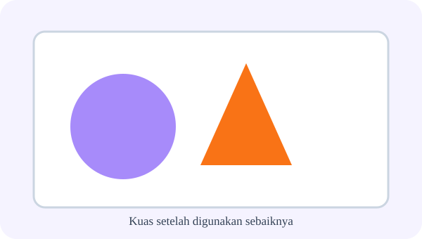
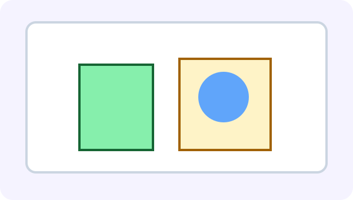
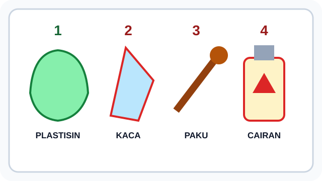
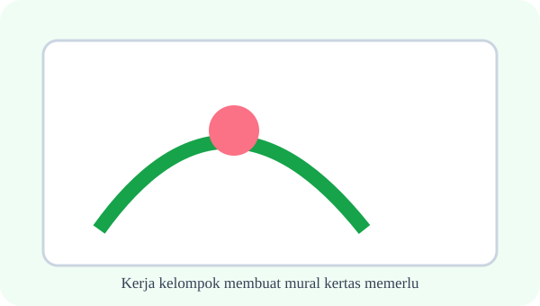
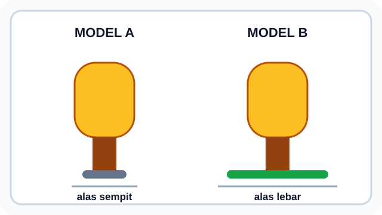
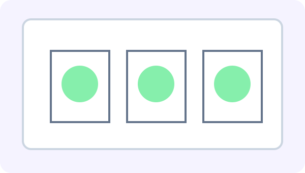
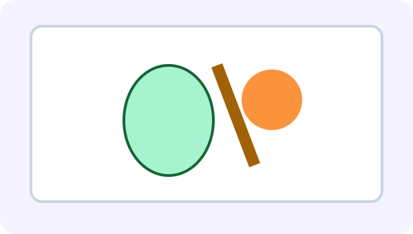
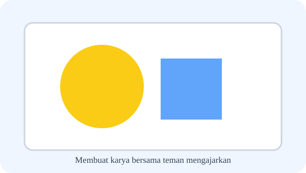
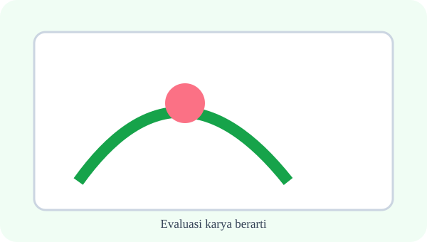
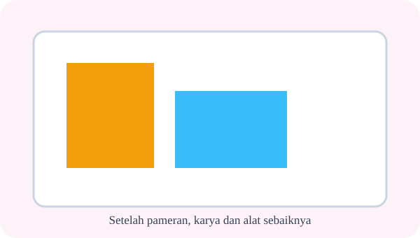

# Bab 5 — Eksplorasi Membuat Bentuk 3 Dimensi: Hewan di Sekitarku

10 soal bergambar — setiap ilustrasi menjadi data yang diperlukan untuk menjawab.

## Soal 36 — K03-SBD-B05-M01-036

**Pertanyaan:** Perhatikan dua karya pada gambar. Pernyataan yang tepat adalah ....

**Pilihan jawaban:**
- Karya B memiliki volume dan dapat diamati dari berbagai arah
- Karya A memiliki tinggi nyata lebih besar daripada karya B
- Karya B hanya dapat dilihat dari satu sisi
- Kedua karya tidak memiliki bentuk

**Kunci Jawaban:** Karya B memiliki volume dan dapat diamati dari berbagai arah

**Pembahasan:** Karya B digambarkan sebagai bentuk ikan bervolume, sedangkan karya A berupa gambar ikan pada bidang datar.

---

## Soal 37 — K03-SBD-B05-M01-037

**Pertanyaan:** Ciri hewan pada kartu pengamatan yang paling perlu diwujudkan agar bentuk ikan mudah dikenali adalah ....

**Pilihan jawaban:**
- badan lonjong, sirip, dan ekor
- empat kaki dan dua tanduk
- delapan lengan dan paruh
- cangkang dan sayap

**Kunci Jawaban:** badan lonjong, sirip, dan ekor

**Pembahasan:** Kartu menunjukkan ikan dengan badan lonjong, sirip, dan ekor sebagai ciri visual utamanya.

---

## Soal 38 — K03-SBD-B05-M01-038

**Pertanyaan:** Untuk membuat badan hewan yang dapat diremas dan dibentuk langsung, bahan bernomor berapa yang paling sesuai?

**Pilihan jawaban:**
- 1, plastisin
- 2, kaca pecah
- 3, paku berkarat
- 4, cairan pembersih

**Kunci Jawaban:** 1, plastisin

**Pembahasan:** Plastisin pada nomor 1 dapat dibentuk dengan tangan; tiga bahan lain pada gambar berbahaya untuk proyek ini.

---

## Soal 39 — K03-SBD-B05-M01-039

**Pertanyaan:** Menurut diagram, langkah yang dilakukan setelah merancang bentuk adalah ....

**Pilihan jawaban:**
- memilih bahan yang aman
- langsung memajang karya
- membuang semua alat
- memberi nilai teman

**Kunci Jawaban:** memilih bahan yang aman

**Pembahasan:** Panah urutan menunjukkan mengamati, merancang, memilih bahan, membentuk, lalu meninjau.

---

## Soal 40 — K03-SBD-B05-M01-040

**Pertanyaan:** Dua model memiliki badan sama berat. Model yang lebih stabil adalah ....

**Pilihan jawaban:**
- model B karena alasnya lebih lebar
- model A karena alasnya lebih sempit
- model A karena badannya lebih tinggi
- keduanya pasti sama tanpa perlu diuji

**Kunci Jawaban:** model B karena alasnya lebih lebar

**Pembahasan:** Pada gambar, model B memiliki alas lebih lebar sehingga badan mendapat bidang tumpu lebih besar.

---

## Soal 41 — K03-SBD-B05-M01-041

**Pertanyaan:** Berdasarkan gambar uji sambungan, cara yang menghasilkan dua bagian plastisin menyatu adalah ....

**Pilihan jawaban:**
- cara B, sambungan ditekan dan diratakan
- cara A, kedua bagian dibiarkan berjarak
- cara A, bagian tidak saling menyentuh
- kedua cara sama-sama tanpa sambungan

**Kunci Jawaban:** cara B, sambungan ditekan dan diratakan

**Pembahasan:** Cara B memperlihatkan dua bagian bertemu lalu batas sambungannya diratakan.

---

## Soal 42 — K03-SBD-B05-M01-042

**Pertanyaan:** Agar bentuk capung seimbang seperti rancangan, sayap perlu dipasang ....

**Pilihan jawaban:**
- dua di kiri dan dua di kanan badan
- empat di sisi kiri saja
- semuanya pada ujung ekor
- tanpa menyentuh badan

**Kunci Jawaban:** dua di kiri dan dua di kanan badan

**Pembahasan:** Rancangan menunjukkan empat sayap tersebar serasi pada kedua sisi badan capung.

---

## Soal 43 — K03-SBD-B05-M01-043

**Pertanyaan:** Pada akuarium mini, benda yang berada paling depan adalah ....

**Pilihan jawaban:**
- rumput A
- ikan B
- batu C
- latar D

**Kunci Jawaban:** rumput A

**Pembahasan:** Diagram kedalaman menempatkan rumput A pada lapisan depan, diikuti ikan B, batu C, dan latar D.

---

## Soal 44 — K03-SBD-B05-M01-044

**Pertanyaan:** Perubahan dari contoh awal ke hasil modifikasi adalah ....

**Pilihan jawaban:**
- sirip diberi pola dan ekor dibuat lebih lebar
- badan ikan dihilangkan
- semua sirip dilepas
- karya diubah menjadi gambar datar

**Kunci Jawaban:** sirip diberi pola dan ekor dibuat lebih lebar

**Pembahasan:** Hasil modifikasi tetap berupa ikan, tetapi pola sirip ditambah dan bentuk ekornya dikembangkan.

---

## Soal 45 — K03-SBD-B05-M01-045

**Pertanyaan:** Catatan uji menunjukkan karya miring ke kanan. Perbaikan yang paling sesuai ialah ....

**Pilihan jawaban:**
- memperkuat atau memperlebar alas di sisi kanan
- menambah beban tinggi di sisi kanan
- memotong seluruh alas
- menambah hiasan pada ujung atas

**Kunci Jawaban:** memperkuat atau memperlebar alas di sisi kanan

**Pembahasan:** Arah miring dan alas sempit pada gambar menunjukkan sisi kanan membutuhkan tumpuan yang lebih baik.

---
